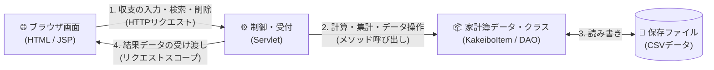

<div style="background: linear-gradient(135deg, #1e3c72 0%, #2a5298 100%); color: white; padding: 28px; border-radius: 14px; margin-bottom: 24px; box-shadow: 0 4px 12px rgba(0,0,0,0.15);">
  <div style="font-size: 0.9em; letter-spacing: 2px; color: #90caf9; font-weight: bold;">JAVA WEB APPLICATION COURSE (Ubuntu 26.04 LTS 完全対応版)</div>
  <h1 style="margin: 8px 0 12px 0; font-size: 1.9em; color: #ffffff; border: none;">📒 ゼロから作る家計簿Webアプリ！Java実践カリキュラム（全14回）</h1>
  <p style="margin: 0; font-size: 1.05em; color: #e3f2fd;">
    副読本：高橋麻奈 著『やさしいJava』完全連動 ／ 最終成果物：Servlet &amp; JSP → JDBC / JSON API / JUnit / Spring Boot 対応「MyKakeibo」<br>
    🐧 <strong>Ubuntu Linux 専用コマンド（<code>apt</code> / <code>systemctl</code> / 権限問題が出ないローカルTomcat構成）完備！</strong>
  </p>
</div>

## 🎮 ゲーム形式で学ぶ新アプリ「Java Quest: MyKakeibo RPG」（`game/`）

従来の講義資料（`lesson01.md`〜`lesson14.md`）をそのまま残しつつ、全14回の内容を**RPGバトル・コード修復・コード構築パズル形式で楽しく学べるWebアプリ**を用意しています！

- **アプリ本体**: [`game/index.html`](./game/index.html)
  - ⚔️ **冒険マップ（全14章×10問＝140問）**：各章のモンスターをクイズバトルで討伐！
  - 🛒 **アイテムショップ＆バトルスキル**：稼いだコインで「回復ポーション」「50/50スキャン」「2倍ダメージお守り」を購入・使用可能！
  - 💻 **コード修復クエスト（全28問）**：Java / JSP / JDBC / JUnit / Spring Boot コードの空欄修復！
  - 🧩 **コード構築パズル（全14問）**：正しいJava処理順序を並べ替えて組み立てる実践パズル！
  - ⚡ **弱点特訓アリーナ ＆ ⏱️ ランダム10問試験 ＆ 🏆 バッジ図鑑**
- **起動方法（方法1：サーバー起動スクリプト / PC・スマホ両対応）**:
  ```bash
  ./run_game.sh
  # PC:     http://localhost:8081/game/
  # スマホ: 起動時に表示される http://<PCのIPアドレス>:8081/game/ を同じWi-Fiから開く
  ```
  スマホから接続できない場合はPCのWi-Fi側IPアドレスとファイアウォールを確認してください。複数のネットワークがある場合、表示されたIPがWi-Fi側と異なることがあります。このサーバーは認証なしで同じネットワークにファイルを公開するため、信頼できるネットワークでのみ使用し、使用後は Ctrl+C で停止してください。学習記録は各端末・ブラウザ内に保存され、PCとスマホ間では共有されません。
- **起動方法（方法2：ファイルを直接開く）**:
  `game/index.html` をブラウザで直接開いても動作します（外部ライブラリ不要の静的Webアプリ）。

---

## 🎯 1. カリキュラムの目的と特徴

本教材は、**Javaを一度も触ったことがない方**が、名著**『やさしいJava』（高橋麻奈 著）**を副読本として活用しながら、**ご自身の Ubuntu 環境**で**Servlet / JSPを使った「家計簿Webアプリケーション」を完成させ、さらに実務必須の SQL/JDBC・JSON API・JUnit・Maven/Spring Boot まで到達する**ための実践型テキストです。

<div style="display: flex; gap: 16px; flex-wrap: wrap; margin: 20px 0;">
  <div style="flex: 1; min-width: 240px; background: #e3f2fd; border-left: 6px solid #1976d2; padding: 16px; border-radius: 8px; color: #0d47a1;">
    <h3 style="margin-top: 0; color: #1565c0;">🌱 基礎編（第1回〜第5回）</h3>
    <p style="margin-bottom: 0; color: #1e293b;">
      Ubuntuのターミナル上で動く「ミニ家計簿」を少しずつ進化させながら、変数・制御文・<strong style="color: #d32f2f;">クラスとメソッドの概念</strong>・オブジェクト指向・例外処理・コレクション（<code>ArrayList</code>）を基礎からしっかり習得します。
    </p>
  </div>
  <div style="flex: 1; min-width: 240px; background: #e8f5e9; border-left: 6px solid #388e3c; padding: 16px; border-radius: 8px; color: #1b5e20;">
    <h3 style="margin-top: 0; color: #2e7d32;">🚀 Webアプリ編（第6回〜第10回）</h3>
    <p style="margin-bottom: 0; color: #1e293b;">
      前半で作った家計簿のクラス設計をそのままWebの世界（<strong>Servlet / JSP・Tomcat 10</strong>）へ持ち込み、Ubuntu上で権限エラーに悩まされずに1コマンドでコンパイル＆起動できる構成でWebアプリを完成させます。
    </p>
  </div>
  <div style="flex: 1; min-width: 240px; background: #f3e5f5; border-left: 6px solid #7b1fa2; padding: 16px; border-radius: 8px; color: #4a148c;">
    <h3 style="margin-top: 0; color: #6a1b9a;">🏆 実務発展編（第11回〜第14回）</h3>
    <p style="margin-bottom: 0; color: #1e293b;">
      CSVから<strong>SQLite + JDBC</strong>へ進化し、<strong>HashMap / Stream API / JSON API</strong>、<strong>JUnit 5 単体テスト</strong>、さらに<strong>Maven &amp; Spring Boot</strong>への架け橋までを完全カバーします。
    </p>
  </div>
</div>

---

## 💻 2. 完成するWebアプリケーション「MyKakeibo（マイ家計簿）」

最終回（第10回）までに、以下の4つの機能を備えたWebアプリケーションを完成させます。



1. <span style="color: #1976d2; font-weight: bold;">収支データの登録機能</span>：日付・区分（収入／支出）・費目（食費、交通費、お小遣いなど）・品名・金額をブラウザのフォームから登録
2. <span style="color: #2e7d32; font-weight: bold;">明細一覧・集計表示機能</span>：登録された家計簿データを表形式で一覧表示し、「収入合計」「支出合計」「現在の残高」を自動計算して表示
3. <span style="color: #e65100; font-weight: bold;">絞り込み・検索機能</span>：費目別やキーワードで支出履歴をフィルタリング
4. <span style="color: #6a1b9a; font-weight: bold;">データの削除と保存（永続化）機能</span>：間違えて入力した明細の削除、およびサーバーを再起動してもデータが消えないファイル保存処理

---

## 📚 3. 全14回 カリキュラム一覧（各回をクリックして開けます）

| 回 | ファイルリンク・タイトル | 主な学習テーマ | 対応フェーズ | 家計簿アプリの進捗 |
| :---: | :--- | :--- | :---: | :--- |
| **第1回** | **[lesson01.md](./lesson01.md)**<br>Javaの世界へようこそ！開発環境構築と変数・計算の基本 | JDK導入、コンパイルと実行、`class`と`main`メソッドの役割、変数と型、四則演算、キーボード入力 | 基礎編 (Lesson 1〜4) | 収入と支出を入力して残高を計算する「お小遣い計算機」を作る |
| **第2回** | **[lesson02.md](./lesson02.md)**<br>条件分岐と繰り返し・配列で複数データを扱おう | `if`文、`switch`文、`for`/`while`文、配列（Array）の基礎と集計ループ | 基礎編 (Lesson 5〜7) | 複数日分の支出を入力し、合計・平均・赤字判定を行うプログラムを作る |
| **第3回** | **[lesson03.md](./lesson03.md)**<br><span style="color: #d32f2f; font-weight: bold;">【最重要】クラスとメソッドの基本概念をマスターする</span> | オブジェクト指向の入口、クラス（設計図）とインスタンス（実体）、フィールド、メソッドの定義・引数・戻り値、カプセル化 | 基礎編 (Lesson 8〜9) | 家計簿の1件分のデータを表す `KakeiboItem` クラスと計算メソッドを設計する |
| **第4回** | **[lesson04.md](./lesson04.md)**<br>クラスライブラリと継承・インターフェース | `String`や日付クラス(`LocalDate`)の活用、コンストラクタ、継承(`extends`)、オーバーライド、インターフェース | 基礎編 (Lesson 10〜12) | 「収入データ」と「支出データ」をクラス階層で整理し、日付管理を組み込む |
| **第5回** | **[lesson05.md](./lesson05.md)**<br>例外処理とコレクション（ArrayList）・前半総まとめ | 例外処理(`try-catch`)、コレクション(`ArrayList`)、ファイル入出力の基礎、コンソール版アプリの完成 | 基礎編 (Lesson 13〜14) | データを何件でも追加・一覧表示・集計できる「コンソール版・家計簿アプリ」を完成させる |
| **第6回** | **[lesson06.md](./lesson06.md)**<br>Webアプリケーションの仕組みとServletはじめの一歩 | Webの仕組み(HTTPリクエスト/レスポンス)、Tomcatサーバー構築、初めてのServlet作成、HTMLの出力 | Web基礎編 | ブラウザからアクセスすると家計簿のトップ画面が表示されるWebサーバーを動かす |
| **第7回** | **[lesson07.md](./lesson07.md)**<br>JSPとフォーム送信！ブラウザから家計簿データを送る | JSPの基本、HTMLフォーム(`GET`/`POST`)、リクエストパラメータの受け取り、文字化け対策 | Web基礎編 | ブラウザの入力フォームから「日付・品名・金額」を送信し、画面に確認表示する |
| **第8回** | **[lesson08.md](./lesson08.md)**<br>MVCモデルとスコープ！一覧表示と合計金額の自動計算 | MVCアーキテクチャ、モデルクラス（第3回のクラスを活用）、スコープ、JSPでの一覧ループ表示 | Web基礎編 | 複数の家計簿データをブラウザの表（テーブル）に一覧表示し、合計・残高を自動計算する |
| **第9回** | **[lesson09.md](./lesson09.md)**<br>データの永続化！アプリを再起動しても消えない家計簿へ | データ保存の仕組み（CSVファイル保存）、DAOパターン、指定IDの削除機能の実装 | Web基礎編 | データの自動保存・読み込み・指定した明細の削除機能を実装する |
| **第10回** | **[lesson10.md](./lesson10.md)**<br>家計簿Webアプリの完成！検索機能・デザイン調整・総仕上げ | 費目別フィルタリング、入力チェック（バリデーション）、CSSによる画面デザイン整備、総合演習 | Web基礎完成 | 見た目も使いやすさも整った「MyKakeibo Webアプリ」を完成させる！ |
| **第11回** | **[lesson11.md](./lesson11.md)**<br>データベース連携！SQLとJDBCで本格的な永続化 | SQL基礎（CRUD）、SQLite + JDBC（`Connection`/`PreparedStatement`/`ResultSet`）、SQLインジェクション対策 | 実務発展編 | 保存先をCSVからSQLiteデータベースへ進化させ、編集(UPDATE)にも対応する |
| **第12回** | **[lesson12.md](./lesson12.md)**<br>HashMap・Stream APIとJSON REST API入門 | `HashMap`/`HashSet`、ラムダ式、Stream API、JSONレスポンスと `fetch()` 非同期連携 | 実務発展編 | 費目別集計API・画面リロードなしのJSON更新・明細編集機能を実装する |
| **第13回** | **[lesson13.md](./lesson13.md)**<br>JUnit単体テストとバグに強い例外・デバッグ技術 | JUnit 5（`@Test`/`assertEquals`/`assertThrows`）、境界値テスト、スタックトレース読解 | 実務発展編 | モデルとDAOを自動検証するテストスイートを構築し、デグレードを防ぐ |
| **第14回** | **[lesson14.md](./lesson14.md)**<br>ビルドツール（Maven）と Spring Boot 入門・総まとめ | Maven（`pom.xml` / `mvn test`）、Spring Boot（`@RestController` / DI）、3層設計総括 | 実務発展・総仕上げ | 現代的なSpring Bootプロジェクトへ発展させる設計力を完成させる！ |

---

## ⏱️ 4. 推奨する1回あたり（3〜4時間）の時間配分

<div style="background: #fff8e1; border: 2px solid #ffb300; border-radius: 10px; padding: 18px; color: #3e2723;">
  <ul style="margin: 0; padding-left: 20px; line-height: 1.9;">
    <li><strong style="color: #e65100;">0:00 〜 0:40（40分）【インプット】</strong>：本教材の解説を読み、『やさしいJava』の該当章の図解に目を通す</li>
    <li><strong style="color: #1565c0;">0:40 〜 1:50（70分）【ハンズオン実習】</strong>：サンプルコードを実際に手で打ち込み、動かして動作を確認する</li>
    <li><strong style="color: #2e7d32;">1:50 〜 3:10（80分）【実践演習（3題）】</strong>：家計簿アプリの機能を作る演習問題に自力で挑戦し、解答例と照らし合わせる</li>
    <li><strong style="color: #6a1b9a;">3:10 〜 3:45（35分）【確認テスト（10問）】</strong>：各回末の10問テストを解き、8問以上正解を目指して復習する</li>
  </ul>
</div>
