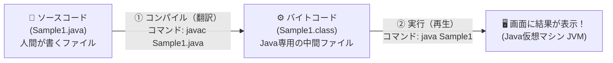

<div style="background: linear-gradient(135deg, #1976d2 0%, #42a5f5 100%); color: white; padding: 24px; border-radius: 12px; margin-bottom: 20px;">
  <div style="font-size: 0.9em; color: #e3f2fd; font-weight: bold;">Java実践カリキュラム ― 第1回 / 全10回</div>
  <h1 style="margin: 6px 0 10px 0; color: #ffffff; border: none;">🌱 第1回：Javaの世界へようこそ！開発環境構築と変数・計算の基本</h1>
  <span style="background: rgba(255,255,255,0.2); padding: 4px 10px; border-radius: 20px; font-size: 0.85em; margin-right: 8px;">⏱ 目安時間：3〜4時間</span>
  <span style="background: rgba(255,255,255,0.2); padding: 4px 10px; border-radius: 20px; font-size: 0.85em;">📖 『やさしいJava』対応：Lesson 1 〜 Lesson 4</span>
</div>

---

## 🎯 0. 今日のゴールと時間配分

記念すべき第1回では、Javaプログラムを自分のパソコンで動かすための準備（環境構築）からスタートし、画面に文字を出したり、キーボードから金額を入力して計算したりする**「家計簿アプリの心臓部（計算機能）」**を作ります。

| 時間目安 | パート | 内容 |
| :--- | :--- | :--- |
| **0:00〜0:40** | <span style="color: #1565c0; font-weight: bold;">Part 1：環境構築と最初のプログラム</span> | Javaが動く仕組み、JDKのインストール、コンパイルと実行 |
| **0:40〜1:20** | <span style="color: #2e7d32; font-weight: bold;">Part 2：クラスとメソッドの「形」を知る</span> | なぜJavaは `class` や `main` と書くのか？その意味と画面出力 |
| **1:20〜2:15** | <span style="color: #e65100; font-weight: bold;">Part 3：変数・型・キーボード入力と計算</span> | 金額を入れる「箱（変数）」、四則演算、キーボードからのデータ入力 |
| **2:15〜3:15** | <span style="color: #6a1b9a; font-weight: bold;">Part 4：実践演習（ミニ家計簿 Ver.1）</span> | 3つの演習課題で「お小遣い収支計算プログラム」を自分の手で作る |
| **3:15〜3:45** | <span style="color: #c62828; font-weight: bold;">Part 5：第1回 確認テスト（10問）</span> | 今日の知識が定着しているか10問のテストでチェック！ |

---

## 💻 Part 1：Javaが動く仕組みと環境構築（Lesson 1 対応）

### 1-1. Javaプログラムが動くまでの2ステップ
私たちが普段使っている日本語や英語に近い言葉で書かれたプログラムのことを**「ソースコード」**と呼びます（拡張子は `.java`）。
しかし、コンピュータは人間が書いたソースコードをそのままでは理解できません。そこで、Javaでは以下の2つのステップを踏んでプログラムを動かします。



1. <span style="color: #1565c0; font-weight: bold;">コンパイル（翻訳）</span>：人間が書いた `.java` ファイルを、コンピュータ（Java仮想マシン）が読める専用の言葉（バイトコード：`.class` ファイル）に翻訳する作業。これを行う道具が **`javac`**（Javaコンパイラ）です。
2. <span style="color: #2e7d32; font-weight: bold;">実行（再生）</span>：翻訳された `.class` ファイルを実際に動かす作業。これを行う道具が **`java`**（Java実行環境）です。

<div style="background: #e3f2fd; border-left: 5px solid #1976d2; padding: 14px; border-radius: 6px; margin: 16px 0; color: #0d47a1;">
  <strong>📖 『やさしいJava』のここも読もう！</strong><br>
  Lesson 1「1.1 Javaとはどんな言語か」「1.2 Javaプログラムの作成と実行」を開いて、ソースコードからバイトコード（クラスファイル）が作られるイラストを確認してみましょう。
</div>

### 1-2. 🐧 Ubuntuでの開発環境（JDK）インストール手順
Javaのコンパイルと実行を行うための道具セットを **JDK（Java Development Kit）** と呼びます。
お使いの **Ubuntu（26.04 LTS）** では、標準のパッケージ管理コマンド `apt` を使ってたった2行で最新のOpenJDKを導入できます！

#### ステップ①：Ubuntuのターミナルを開く
- キーボードの **`Ctrl + Alt + T`** を押すか、エディタ内のターミナル（下部パネル）を開きます。
- まず現在の作業フォルダ（`/home/miyakawaharuki/java学習`）にいることを `pwd` コマンドで確認しましょう。

```bash
pwd
# → /home/miyakawaharuki/java学習 と表示されればOK！
```

#### ステップ②：JDKが入っているか確認し、インストールする
まずは以下のコマンドを入力してEnterキーを押してみてください。

```bash
javac -version
```

もし **`Command 'javac' not found`（または `javac: コマンドが見つかりません`）** と表示された場合は、以下のコマンドでUbuntu公式のJDK（`default-jdk`）をインストールしましょう！（※ `sudo` のあとパスワードを聞かれたら、Ubuntuのログインパスワードを入力してEnterを押します。入力中は画面に文字や `***` は表示されませんが、そのまま打ってEnterで大丈夫です！）

```bash
sudo apt update
sudo apt install -y default-jdk
```

インストールが終わったら、もう一度以下の2つのコマンドを実行してバージョン番号（`openjdk 21.x.x` や `25.x.x` など）が表示されるか確認しましょう。
```bash
java -version
javac -version
```

<div style="background: #e8f5e9; border-left: 5px solid #2e7d32; padding: 14px; border-radius: 6px; margin: 16px 0; color: #1b5e20;">
  <strong>🐧 UbuntuでJavaを動かすときの便利ポイント！</strong><br>
  Windowsだと文字コードが「Shift-JIS」になって日本語が文字化けすることがよくありますが、<strong>Ubuntuは標準の文字コードが最初から世界標準の「UTF-8」</strong>です！そのため、特別な設定をしなくても日本語の品名（「食費」「お小遣い」など）がそのまま綺麗にコンパイル・実行できます。
</div>

---

## 🏛️ Part 2：クラスとメソッドの「形」を知る（Lesson 2 対応）

Javaを学び始めると、最初に次のようなコードを書くことになります。まずは丸暗記ではなく、**「なぜこんな書き方をするのか？」**という意味から理解しましょう。

### 2-1. 最初のプログラムを書いて動かしてみよう

作業フォルダ（`/home/miyakawaharuki/java学習`）の中に、**`Sample1.java`** という名前のファイルを作り、以下のコードをそのまま入力（手打ち）してみましょう。

```java
public class Sample1 {
    public static void main(String[] args) {
        System.out.println("ようこそ！マイ家計簿アプリへ！");
        System.out.println("今日からUbuntuでJavaの学習をスタートします。");
    }
}
```

<div style="background: #ffebee; border-left: 5px solid #d32f2f; padding: 14px; border-radius: 6px; margin: 16px 0; color: #b71c1c;">
  <strong>⚠️ 【Ubuntuでの絶対ルール】ファイル名とクラス名は「大文字・小文字」まで完全に一致させる！</strong><br>
  Ubuntu（Linux）はファイル名の大文字と小文字を厳密に区別します（<code>Sample1.java</code> と <code>sample1.java</code> はまったく別物として扱われます）。<br>
  <code>public class Sample1</code> と書いた場合、ファイル名は必ず先頭の <code>S</code> を大文字にした <strong><code>Sample1.java</code></strong> にしてください！
</div>

#### コンパイルと実行をしてみよう
ファイルを保存したら、Ubuntuのターミナルで以下の2つのコマンドを順番に実行します。

```bash
# 1. コンパイル（翻訳）：Sample1.java から Sample1.class を作る
javac Sample1.java

# （lsコマンドで Sample1.class が作られたか確認してみよう！）
ls -l Sample1.*

# 2. 実行：Sample1 を動かす（※注意：実行するときは .class や .java を付けません！）
java Sample1
```

**【実行結果】**
```text
ようこそ！マイ家計簿アプリへ！
今日からUbuntuでJavaの学習をスタートします。
```

---

### 2-2. 「クラス（class）」と「メソッド（method）」って何？（超重要！）

第3回で本格的に学びますが、第1回の今からイメージを持っておくと今後の学習が10倍楽になります。

<div style="background: #f3e5f5; border: 2px solid #8e24aa; padding: 18px; border-radius: 10px; margin: 16px 0; color: #4a148c;">
  <h4 style="margin-top: 0; color: #6a1b9a;">🏢 建物（クラス）と、お部屋の作業（メソッド）のイメージ</h4>
  <ul style="margin-bottom: 0; color: #1e293b;">
    <li><strong style="color: #8e24aa;">① クラス（<code>class</code>）＝「設計図・建物」</strong><br>
      Javaの世界では、<strong>すべてのプログラムを「クラス」という単位で包んで作ります</strong>。<br>
      <code>public class Sample1 { ... }</code> は、「ここからここまでが <code>Sample1</code> という名前の建物（クラス）ですよ」という宣言です。</li>
    <li style="margin-top: 8px;"><strong style="color: #1565c0;">② メソッド（<code>method</code>）＝「具体的な作業・お仕事」</strong><br>
      クラスの中に作られる<strong>「処理（機能）のまとまり」</strong>のことです。名前と丸カッコ <code>()</code> が付いているものはすべてメソッドです。<br>
      その中でも <code style="color: #d32f2f; font-weight: bold;">public static void main(String[] args)</code> は特別で、<strong>「Javaプログラムを動かしたとき、一番最初にスタートする玄関（開始地点）のメソッド」</strong>という決まりになっています。</li>
    <li style="margin-top: 8px;"><strong style="color: #2e7d32;">③ 文（Statement）とセミコロン <code>;</code> ＝「1つ1つの手順」</strong><br>
      メソッドの <code>{ }</code> の中に書く1行1行の命令を「文」と呼びます。日本語の句点「。」と同じように、<strong>命令の終わりには必ずセミコロン <code>;</code> を付けます</strong>。</li>
  </ul>
</div>

---

### 2-3. 画面への出力とコメント・文字のルール

1. **`System.out.println(...)` と `System.out.print(...)` の違い**
   - `System.out.println(...)`：カッコの中の文字や数字を表示したあと、<span style="color: #d32f2f; font-weight: bold;">最後に改行する</span>（`ln` は line の略）。
   - `System.out.print(...)`：カッコの中の文字や数字を表示したあと、<span style="color: #1565c0; font-weight: bold;">改行しない</span>。
2. **コメント（メモ書き）の書き方**
   - `//` を書くと、その行の終わりまで人間用のメモ（コメント）になり、プログラム実行時には無視されます。
   - `/* ... */` で囲むと、複数行まとめてコメントにできます。
3. **文字列と数値の違い**
   - `"こんにちは"` や `"1000"` のようにダブルクォーテーション `"` で囲んだものは**「文字列（ただの文字）」**です。
   - `1000` や `500` のように囲まずに書いた数字は、足し算や引き算ができる**「数値」**です。

---

## 📦 Part 3：変数・型・キーボード入力と計算（Lesson 3・Lesson 4 対応）

家計簿アプリを作るには、「今月のお小遣いはいくらか」「今日のランチ代はいくらか」といった**データを一時的に記憶しておく場所**と、それらを**足し算・引き算する仕組み**が必要です。

### 3-1. 変数（Variable）とデータ型（Data Type）

プログラムの中で数値や文字を入れておく「名前付きの箱」を**変数（へんすう）**と呼びます。
Javaでは箱を作るときに、**「この箱にはどんな種類のデータ（型）を入れるか」**を最初に指定します。

#### 家計簿アプリでよく使う基本の4つの型

| データ型 | 入れるデータの種類 | 家計簿アプリでの使用例 | コード記述例 |
| :--- | :--- | :--- | :--- |
| <span style="color: #1565c0; font-weight: bold;">`int`</span> | **整数**（小数点のない数字） | 金額（1500円）、個数（3個）、月（10月） | `int price = 1500;` |
| <span style="color: #2e7d32; font-weight: bold;">`double`</span> | **小数**（小数点のある数字） | 消費税率（0.1）、支出の割合（35.5%） | `double taxRate = 0.1;` |
| <span style="color: #e65100; font-weight: bold;">`String`</span> | **文字列**（複数の文字） | 品名（"ランチ弁当"）、費目（"食費"） | `String itemName = "食費";` |
| <span style="color: #6a1b9a; font-weight: bold;">`boolean`</span> | **真偽値**（正しいか間違いか） | 赤字かどうか（`true` または `false`） | `boolean isRed = false;` |

<div style="background: #fff8e1; border-left: 5px solid #ffb300; padding: 14px; border-radius: 6px; margin: 16px 0; color: #3e2723;">
  <strong>💡 注意ポイント1：<code>String</code> だけ先頭が大文字の <code>S</code>！</strong><br>
  <code>int</code> や <code>double</code> はすべて小文字ですが、文字列を表す <code>String</code> だけ先頭が大文字です。<br><br>
  <strong>💡 注意ポイント2：プログラミングの <code>=</code> は「右から左へ箱に入れる（代入）」！</strong><br>
  <code>int income = 5000;</code> は「<code>income</code> という箱の中に、右側の <code>5000</code> を入れる」という意味です。
</div>

---

### 3-2. 四則演算と文字列の連結（Lesson 4 対応）

| 記号 | 意味 | 記述例 | 結果 |
| :---: | :--- | :--- | :--- |
| **`+`** | 足し算 | `1000 + 500` | `1500` |
| **`-`** | 引き算 | `1000 - 350` | `650` |
| **`*`** | 掛け算（`×` ではなくアスタリスク） | `120 * 3` | `360` |
| **`/`** | 割り算（`÷` ではなくスラッシュ） | `1000 / 3` | `333`（※<span style="color: #d32f2f; font-weight: bold;">整数同士の割り算は小数点以下切り捨て</span>） |
| **`%`** | 割り算の**余り** | `1000 % 3` | `1`（1000 ÷ 3 ＝ 333 余り 1） |

#### 便利に使える複合代入演算子（家計簿の集計で大活躍！）
```java
int total = 1000;        // 現在の合計が1000円
total += 500;            // total = total + 500 と同じ！ 500を加算して 1500 になる
total -= 300;            // total = total - 300 と同じ！ 300を減算して 1200 になる
```

#### ⚠️ 文字列と計算が混ざるときの落とし穴
`+` 記号の片方に文字列（`"..."`）があると、`+` は足し算ではなく**「文字をつなげる（連結）」**動きをします。
```java
System.out.println("合計は" + 500 + 300 + "円");   // ❌「合計は500300円」になってしまう！
System.out.println("合計は" + (500 + 300) + "円"); // ⭕「合計は800円」になる！（カッコが先に計算される）
```

---

### 3-3. サンプル実習1：計算機能つきプログラム（`Sample2.java`）

新しいファイル **`Sample2.java`** を作成して、変数の計算を試してみましょう。

```java
public class Sample2 {
    public static void main(String[] args) {
        // 1. 変数を用意して金額を入れる
        int allowance = 10000; // 今月のお小遣い（収入）
        int bookPrice = 2640;  // 技術書代（支出1）
        int lunchPrice = 980;  // ランチ代（支出2）

        // 2. 支出の合計と、残高を計算する
        int totalExpense = bookPrice + lunchPrice;
        int balance = allowance - totalExpense;

        // 3. 結果を画面にわかりやすく出力する
        System.out.println("=== ミニ家計簿 計算結果 ===");
        System.out.println("今月のお小遣い：" + allowance + "円");
        System.out.println("支出1（技術書）：" + bookPrice + "円");
        System.out.println("支出2（ランチ）：" + lunchPrice + "円");
        System.out.println("---------------------------");
        System.out.println("支出の合計　　：" + totalExpense + "円");
        System.out.println("現在の残高　　：" + balance + "円");
    }
}
```

---

### 3-4. サンプル実習2：キーボードからデータを入力する（`Sample3.java`）

本物のアプリらしく、**使う人がキーボードから品名や金額を入力できる**ようにしましょう。Java標準の **`Scanner`（スキャナー）** を使います。

```java
import java.util.Scanner; // ← ① Java標準の「Scanner（入力読み取り機）」を使う宣言

public class Sample3 {
    public static void main(String[] args) {
        // ② キーボード入力を受け取る準備
        Scanner scanner = new Scanner(System.in);

        System.out.println("=== 支出の入力 ===");

        // ③ 文字列（品名）を入力してもらう
        System.out.print("品名を入力してください（例：文房具）：");
        String itemName = scanner.next(); // キーボードから文字列を受け取る

        // ④ 整数（金額）を入力してもらう
        System.out.print(itemName + "の金額（円）を入力してください：");
        int price = scanner.nextInt();    // キーボードから整数を受け取る

        // ⑤ 消費税（10%）込みの金額を計算してみる（キャスト：型変換の練習）
        int taxIncluded = (int)(price * 1.1);

        System.out.println("----------------------------------");
        System.out.println("【登録完了】" + itemName + "：税抜 " + price + "円（税込 " + taxIncluded + "円）");

        scanner.close(); // ⑥ 使い終わった読み取り機を片付ける
    }
}
```

<div style="background: #e8f5e9; border-left: 5px solid #2e7d32; padding: 14px; border-radius: 6px; margin: 16px 0; color: #1b5e20;">
  <strong>💡 ワンポイント解説：型変換（キャスト）とは？（Lesson 4 対応）</strong><br>
  <code>price * 1.1</code> は小数（<code>double</code>型）が混ざっているため、計算結果も小数になります。それを整数の箱（<code>int taxIncluded</code>）に入れるには、前に <strong><code>(int)</code></strong> を付けて「小数点以下を切り捨てて整数に変換して！」と指示します。これを<strong>キャスト（型変換）</strong>と呼びます。
</div>

---

## 🛠️ Part 4：実践演習（自分の手で書いてみよう！）

ここからはあなたの番です！今日学んだ知識を使って、3つのプログラムを作成しましょう。

### 🟢 【演習1】家計簿の初期設定画面を表示しよう（難易度：★☆☆）
**作成ファイル名：`Ex1_1.java`**

1. 以下の3つの変数を作成し、自分の好きな値を代入してください。
   - ユーザー名 `String userName`（例：`"ハルキ"`）
   - 対象月 `int month`（例：`10`）
   - 今月の目標貯金額 `int targetSaving`（例：`20000`）
2. 変数を使って、以下の実行結果イメージの通りに画面に出力してください。

```text
************************************
  ハルキさんの 10月度 家計簿アプリ
  今月の目標貯金額：20000円
************************************
```

<details>
<summary>👉 演習1の解答例を見る（自分で書いてみてから開きましょう）</summary>

```java
public class Ex1_1 {
    public static void main(String[] args) {
        String userName = "ハルキ";
        int month = 10;
        int targetSaving = 20000;

        System.out.println("************************************");
        System.out.println("  " + userName + "さんの " + month + "月度 家計簿アプリ");
        System.out.println("  今月の目標貯金額：" + targetSaving + "円");
        System.out.println("************************************");
    }
}
```
</details>

---

### 🟡 【演習2】割り勘＆あまり計算機を作ろう（難易度：★★☆）
**作成ファイル名：`Ex1_2.java`**

友達と食事に行ったときの支出を家計簿につけるため、「1人あたりの支払額」と「割り切れなかった端数（余り）」を計算するプログラムを作成してください。
1. `Scanner` を使って、**「食事の合計金額（円）」**と**「参加人数（人）」**をそれぞれ整数（`int`）で入力させる。
2. 割り算 `/` で「1人あたりの支払額」、余り `%` で「割り切れなかった端数」を計算して表示する。

```text
食事の合計金額（円）を入力してください：5000
参加人数（人）を入力してください：3
--- 計算結果 ---
1人あたりの支払額：1666円
割り切れない端数 ：2円
```

<details>
<summary>👉 演習2の解答例を見る</summary>

```java
import java.util.Scanner;

public class Ex1_2 {
    public static void main(String[] args) {
        Scanner scanner = new Scanner(System.in);

        System.out.print("食事の合計金額（円）を入力してください：");
        int totalAmount = scanner.nextInt();

        System.out.print("参加人数（人）を入力してください：");
        int people = scanner.nextInt();

        int perPerson = totalAmount / people; // 商（1人あたり）
        int remainder = totalAmount % people; // 余り（端数）

        System.out.println("--- 計算結果 ---");
        System.out.println("1人あたりの支払額：" + perPerson + "円");
        System.out.println("割り切れない端数 ：" + remainder + "円");

        scanner.close();
    }
}
```
</details>

---

### 🔴 【演習3】ミニ家計簿 Ver.1（収支と残高・支出率の計算）（難易度：★★★）
**作成ファイル名：`KakeiboAppV1.java`**

第1回の集大成として、今月の収入と2件の支出をキーボードから入力すると、合計支出・残高・そして「収入に対する支出の割合（％）」を計算してレポート表示するプログラムを作成してください。

1. キーボードから「今月の収入(`int income`)」「1件目の品名(`String item1`)と金額(`int price1`)」「2件目の品名(`String item2`)と金額(`int price2`)」を入力させる。
2. **支出合計(`totalExpense`)**、**残高(`balance`)**、**収入に対する支出の割合(`double expenseRate`)** を計算して表示する。
   - ※ヒント：割合は `(double) totalExpense * 100 / income` のように `(double)` でキャストしてから割り算しましょう！

```text
=== マイ家計簿 Ver.1 ===
今月の収入（円）を入力してください：50000
1件目の支出の品名を入力してください：食費
食費の金額（円）を入力してください：12000
2件目の支出の品名を入力してください：交際費
交際費の金額（円）を入力してください：5500

========== 今月の収支レポート ==========
【収入】        50000円
【支出明細】
 ・食費：12000円
 ・交際費：5500円
----------------------------------------
【支出合計】    17500円
【現在の残高】  32500円
【支出の割合】  収入の 35.0 % を使用しました
========================================
```

<details>
<summary>👉 演習3の解答例を見る</summary>

```java
import java.util.Scanner;

public class KakeiboAppV1 {
    public static void main(String[] args) {
        Scanner scanner = new Scanner(System.in);

        System.out.println("=== マイ家計簿 Ver.1 ===");
        System.out.print("今月の収入（円）を入力してください：");
        int income = scanner.nextInt();

        System.out.print("1件目の支出の品名を入力してください：");
        String item1 = scanner.next();
        System.out.print(item1 + "の金額（円）を入力してください：");
        int price1 = scanner.nextInt();

        System.out.print("2件目の支出の品名を入力してください：");
        String item2 = scanner.next();
        System.out.print(item2 + "の金額（円）を入力してください：");
        int price2 = scanner.nextInt();

        int totalExpense = price1 + price2;
        int balance = income - totalExpense;
        double expenseRate = (double) totalExpense * 100 / income;

        System.out.println();
        System.out.println("========== 今月の収支レポート ==========");
        System.out.println("【収入】        " + income + "円");
        System.out.println("【支出明細】");
        System.out.println(" ・" + item1 + "：" + price1 + "円");
        System.out.println(" ・" + item2 + "：" + price2 + "円");
        System.out.println("----------------------------------------");
        System.out.println("【支出合計】    " + totalExpense + "円");
        System.out.println("【現在の残高】  " + balance + "円");
        System.out.println("【支出の割合】  収入の " + expenseRate + " % を使用しました");
        System.out.println("========================================");

        scanner.close();
    }
}
```
</details>

---

## 📝 Part 5：第1回 確認テスト（全10問）

目標は **8問以上正解** です！紙やメモ帳に答えを書いてから、最後の解答を開いて答え合わせをしましょう。

**第1問（ファイル名とクラス名のルール）**
`public class KakeiboStart { ... }` で始まるプログラムを保存するとき、正しいファイル名はどれですか？
- **A.** `kakeibostart.java` ／ **B.** `KakeiboStart.class` ／ **C.** `KakeiboStart.java` ／ **D.** 何でもよい

**第2問（コンパイルと実行のコマンド）**
`TestApp.java` をコンパイルし、その後実行するためのコマンドの組み合わせとして正しいものはどれですか？
- **A.** コンパイル：`java TestApp.java` ／ 実行：`javac TestApp`
- **B.** コンパイル：`javac TestApp.java` ／ 実行：`java TestApp`
- **C.** コンパイル：`javac TestApp.java` ／ 実行：`java TestApp.class`
- **D.** コンパイル：`compile TestApp.java` ／ 実行：`run TestApp`

**第3問（メソッドの役割）**
Javaプログラムを実行したとき、一番最初に呼び出されて処理がスタートする特別なメソッドの名前はどれですか？
- **A.** `start` ／ **B.** `class` ／ **C.** `system` ／ **D.** `main`

**第4問（画面出力の違い）**
以下のプログラムを実行したとき、画面にどのように表示されますか？
```java
System.out.print("収入：");
System.out.println(5000);
System.out.println("円");
```
- **A.** 3行に分かれて表示される ／ **B.** 1行目に`収入：5000`、2行目に`円`と表示される ／ **C.** 1行で`収入：5000円`と表示される ／ **D.** 1行目に`収入：`、2行目に`5000円`と表示される

**第5問（データ型の選択）**
①金額（`1280`などの整数）、②消費税率（`0.1`などの小数）、③費目名（`"食費"`などの文字列）を保存するデータ型の正しい組み合わせはどれですか？
- **A.** ① `int` ／ ② `double` ／ ③ `String`
- **B.** ① `double` ／ ② `int` ／ ③ `string`（小文字）
- **C.** ① `String` ／ ② `double` ／ ③ `int`
- **D.** ① `int` ／ ② `boolean` ／ ③ `String`

**第6問（変数の代入と更新）**
以下のコードを実行したあと、画面に表示される数値はいくつですか？
```java
int balance = 3000;
balance = 2000;
balance += 500;
System.out.println(balance);
```
- **A.** `3000` ／ **B.** `5500` ／ **C.** `2500` ／ **D.** `2000`

**第7問（整数同士の割り算と余り）**
`int a = 10; int b = 4;` のとき、`System.out.println((a / b) + "と" + (a % b));` の出力結果はどれですか？
- **A.** `2.5と0` ／ **B.** `2と2` ／ **C.** `2.5と2` ／ **D.** `3と2`

**第8問（文字列連結と計算の優先順位）**
`System.out.println("支払額：" + 100 + 200 + "円");` の出力結果はどれですか？
- **A.** `支払額：300円` ／ **B.** `支払額：100200円` ／ **C.** `支払額：100+200円` ／ **D.** エラーになる

**第9問（型変換・キャスト）**
`int price = 100;` に `1.08` を掛けて小数点以下を切り捨てた整数を `int total` に入れる正しい書き方はどれですか？
- **A.** `int total = price * 1.08;` ／ **B.** `int total = (double)(price * 1.08);` ／ **C.** `int total = (int)(price * 1.08);` ／ **D.** `int total = int(price * 1.08);`

**第10問（文の区切りと構文ルール）**
Javaのソースコードを書く際のルールとして、**間違っているもの**はどれですか？
- **A.** クラスやメソッドの範囲は波カッコ `{` と `}` で囲む。
- **B.** 文（命令）の終わりには、必ずコロン `:` を付ける。
- **C.** `//` を書くと、その行の後ろの部分はコメントとして無視される。
- **D.** 英字の大文字と小文字は厳密に区別される。

<details>
<summary>✅ 確認テスト（全10問）の解答と解説を見る</summary>

| 問題 | 正解 | 解説 |
| :---: | :---: | :--- |
| **第1問** | <span style="color: #d32f2f; font-weight: bold;">C</span> | クラス名と大文字・小文字まで一致させ、拡張子を `.java` にします（`KakeiboStart.java`）。 |
| **第2問** | <span style="color: #d32f2f; font-weight: bold;">B</span> | コンパイルは `javac ファイル名.java`、実行は拡張子なしの `java クラス名` です。 |
| **第3問** | <span style="color: #d32f2f; font-weight: bold;">D</span> | Javaプログラムは `main` メソッドから処理が始まります。 |
| **第4問** | <span style="color: #d32f2f; font-weight: bold;">B</span> | `print` は改行せず、`println` は表示後に改行します。 |
| **第5問** | <span style="color: #d32f2f; font-weight: bold;">A</span> | 整数は `int`、小数は `double`、文字列は先頭大文字の `String` です。 |
| **第6問** | <span style="color: #d32f2f; font-weight: bold;">C</span> | `balance = 2000;` で上書きされたあと、`+= 500` で500が足されて `2500` になります。 |
| **第7問** | <span style="color: #d32f2f; font-weight: bold;">B</span> | 整数同士の割り算 `10 / 4` は切り捨てで `2`、余り `10 % 4` は `2` です。 |
| **第8問** | <span style="color: #d32f2f; font-weight: bold;">B</span> | 左から順番に文字列連結されるため `"支払額：100200円"` になります。足し算するには `(100 + 200)` とカッコで囲みます。 |
| **第9問** | <span style="color: #d32f2f; font-weight: bold;">C</span> | 小数を整数に変換するには `(int)` キャスト演算子を使います。 |
| **第10問** | <span style="color: #d32f2f; font-weight: bold;">B</span> | 文の終わりに付けるのはコロン `:` ではなく、**セミコロン `;`** です。 |

</details>

---
<div style="text-align: right; margin-top: 20px;">
  <a href="./README.md" style="margin-right: 16px;">🏠 カリキュラム目次に戻る</a>
  <a href="./lesson02.md" style="font-weight: bold; color: #1976d2;">👉 第2回：条件分岐と繰り返し・配列へ進む</a>
</div>
