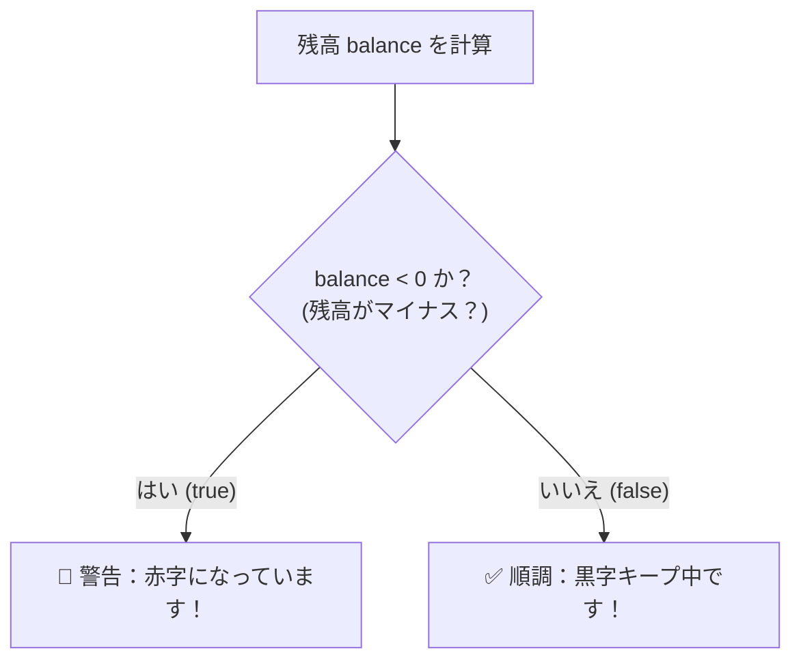
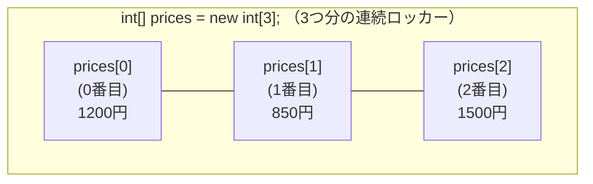

<div style="background: linear-gradient(135deg, #2e7d32 0%, #66bb6a 100%); color: white; padding: 24px; border-radius: 12px; margin-bottom: 20px;">
  <div style="font-size: 0.9em; color: #e8f5e9; font-weight: bold;">Java実践カリキュラム ― 第2回 / 全10回</div>
  <h1 style="margin: 6px 0 10px 0; color: #ffffff; border: none;">🌿 第2回：条件分岐と繰り返し・配列で複数データを扱おう</h1>
  <span style="background: rgba(255,255,255,0.2); padding: 4px 10px; border-radius: 20px; font-size: 0.85em; margin-right: 8px;">⏱ 目安時間：3〜4時間</span>
  <span style="background: rgba(255,255,255,0.2); padding: 4px 10px; border-radius: 20px; font-size: 0.85em;">📖 『やさしいJava』対応：Lesson 5 〜 Lesson 7</span>
</div>

---

## 🎯 0. 今日のゴールと時間配分

第1回では「1回だけ計算するプログラム」を作りました。第2回では、コンピュータが最も得意とする**「状況に応じた判断（条件分岐）」**と**「何十件ものデータの自動集計（繰り返し・配列）」**を習得します。これで家計簿アプリが「黒字・赤字の自動判定」や「1週間分の支出まとめ集計」ができるようになります！

| 時間目安 | パート | 内容 |
| :--- | :--- | :--- |
| **0:00〜0:45** | <span style="color: #1565c0; font-weight: bold;">Part 1：条件分岐（if文・switch文）</span> | 残高がマイナスなら「赤字警告」を出す、費目番号で自動振り分け |
| **0:45〜1:30** | <span style="color: #2e7d32; font-weight: bold;">Part 2：繰り返し処理（for文・while文）</span> | 決まった回数や、ユーザーが「終了」と言うまで入力を繰り返す |
| **1:30〜2:15** | <span style="color: #e65100; font-weight: bold;">Part 3：配列（Array）で複数データを管理</span> | 複数の品名と金額をロッカー（配列）に並べて一括集計する |
| **2:15〜3:15** | <span style="color: #6a1b9a; font-weight: bold;">Part 4：実践演習（ミニ家計簿 Ver.2）</span> | 3つの演習課題で「週間家計簿＆予算判定アプリ」を完成させる |
| **3:15〜3:45** | <span style="color: #c62828; font-weight: bold;">Part 5：第2回 確認テスト（10問）</span> | 今日の知識が定着しているか10問のテストでチェック！ |

---

## 🔀 Part 1：条件によって動きを変える「条件分岐」（Lesson 5 対応）

家計簿をつけていて、「残高が0円未満になったら**『⚠️赤字です！』**と警告したい」「1万円以上の買い物なら**『高額出費』**とマークしたい」という場面がありますよね。このように条件によって処理を分ける仕組みを**条件分岐（じょうけんぶんき）**と呼びます。



### 1-1. 比較演算子（大小や一致を比べる記号）

条件を書くときは、以下の記号を使って2つの値を比べます。結果は必ず `true`（正しい）か `false`（間違い）になります。

| 演算子 | 意味 | 記述例 | 意味の説明 |
| :---: | :--- | :--- | :--- |
| <span style="color: #d32f2f; font-weight: bold;">`==`</span> | **等しい**（※ `=` が2つ！） | `price == 0` | `price` が `0` と等しいとき `true` |
| <span style="color: #1565c0; font-weight: bold;">`!=`</span> | **等しくない** | `price != 0` | `price` が `0` ではないとき `true` |
| **`>`** / **`<`** | より大きい ／ より小さい（未満） | `balance < 0` | `balance` が `0` 未満（マイナス）のとき `true` |
| **`>=`** / **`<=`** | **以上** ／ **以下** | `price >= 10000` | `price` が `10000` 以上のとき `true` |

<div style="background: #ffebee; border-left: 5px solid #d32f2f; padding: 14px; border-radius: 6px; margin: 16px 0; color: #b71c1c;">
  <strong>⚠️ 超重要：文字列（<code>String</code>）が同じかどうか比べるときは <code>.equals()</code> を使う！</strong><br>
  数値（<code>int</code>）は <code>a == 100</code> で比べられますが、文字列（<code>String</code>）を比べるときは <code>==</code> ではなく、必ず <strong><code>category.equals("食費")</code></strong> と書きます。これはJavaの非常に大切なルールです！
</div>

### 1-2. `if` 〜 `else if` 〜 `else` 文の書き方

**サンプルコード（`Sample2_1.java`）**を作って動かしてみましょう。

```java
import java.util.Scanner;

public class Sample2_1 {
    public static void main(String[] args) {
        Scanner scanner = new Scanner(System.in);

        System.out.print("今月の予算（円）を入力してください：");
        int budget = scanner.nextInt();

        System.out.print("今月の支出合計（円）を入力してください：");
        int expense = scanner.nextInt();

        int balance = budget - expense; // 残り予算
        System.out.println("残り予算：" + balance + "円");

        // 条件分岐で家計の健康状態をチェック！
        if (balance < 0) {
            System.out.println("🚨【警告】予算をオーバー（赤字）しています！");
        } else if (balance <= 3000) {
            System.out.println("⚠️【注意】残り予算が3,000円以下です。節約しましょう！");
        } else {
            System.out.println("✅【順調】予算内でしっかりやりくりできています！");
        }

        scanner.close();
    }
}
```

### 1-3. 複数の条件を組み合わせる「論理演算子」と `switch` 文
- <span style="color: #1565c0; font-weight: bold;">`&&`（なおかつ / AND）</span>：`price >= 1000 && price < 5000`（1000円以上 **かつ** 5000円未満）
- <span style="color: #e65100; font-weight: bold;">`||`（または / OR）</span>：`day == 10 || day == 25`（10日 **または** 25日）
- **`switch` 文**：番号（1:食費、2:交通費、3:娯楽費…）のように、1つの変数の値によって何通りにも分岐するときに便利です（『やさしいJava』Lesson 5「5.4 switch文」参照）。

---

## 🔄 Part 2：同じ処理を繰り返す「ループ処理」（Lesson 6 対応）

家計簿で「5日分の支出を入力する」とき、同じコードを5回コピー＆ペーストするのは大変です。Javaには繰り返し（ループ）を行う **`for` 文**と **`while` 文**があります。

<div style="display: flex; gap: 16px; flex-wrap: wrap; margin: 16px 0;">
  <div style="flex: 1; min-width: 250px; background: #e3f2fd; border: 2px solid #1976d2; padding: 14px; border-radius: 8px; color: #0d47a1;">
    <h4 style="margin-top: 0; color: #1565c0;">🔁 ① <code>for</code> 文（回数が決まっているとき）</h4>
    「5回繰り返す」「7日分繰り返す」のように、<strong>あらかじめ繰り返す回数がわかっているとき</strong>に使います。
  </div>
  <div style="flex: 1; min-width: 250px; background: #fff3e0; border: 2px solid #f57c00; padding: 14px; border-radius: 8px; color: #e65100;">
    <h4 style="margin-top: 0; color: #ef6c00;">🔄 ② <code>while</code> 文（条件を満たす間ずっと）</h4>
    「ユーザーが『0（終了）』を入力するまで、何件でも入力を続ける」のように、<strong>回数が決まっていないとき</strong>に使います。
  </div>
</div>

### 2-1. `for` 文の基本構造とサンプル（`Sample2_2.java`）

```java
// i を 1 からスタートし、i が 3 以下の間、1ずつ増やしながら（i++）繰り返す
for (int i = 1; i <= 3; i++) {
    System.out.println(i + "件目の処理です");
}
```
> 💡 **`i++` とは？**：変数 `i` の値を **`1` 増やす**（`i = i + 1` と同じ）という意味です。

それでは、3件分の支出をループで入力して合計を求める **`Sample2_2.java`** を動かしてみましょう！

```java
import java.util.Scanner;

public class Sample2_2 {
    public static void main(String[] args) {
        Scanner scanner = new Scanner(System.in);
        int total = 0; // 合計金額を入れる箱（最初は必ず 0 にしておく！）

        System.out.println("=== 3日間の支出合計を計算します ===");

        for (int day = 1; day <= 3; day++) {
            System.out.print(day + "日目の支出金額（円）を入力してください：");
            int amount = scanner.nextInt();
            total += amount; // 合計(total)に入力金額(amount)を足し込む！
        }

        System.out.println("----------------------------------");
        System.out.println("3日間の支出合計：" + total + "円");
        scanner.close();
    }
}
```

### 2-2. `while` 文と `break` で「0が入力されるまで繰り返す」
何件あるかわからないレシートを連続入力するときは、`while (true)`（無限ループ）と `if (...) break;`（ループ脱出）の組み合わせが実務でもよく使われます。

```java
while (true) {
    System.out.print("金額を入力（0を入力すると終了）：");
    int price = scanner.nextInt();
    if (price == 0) {
        break; // 0が入力されたら繰り返しを終了して外へ出る！
    }
    total += price;
}
```

---

## 🗄️ Part 3：配列（Array）で複数データをまとめて管理（Lesson 7 対応）

`Sample2_2.java` では、合計金額は計算できましたが、1日目・2日目・3日目に「それぞれいくら使ったか」は変数 `amount` が上書きされて消えてしまいました。
あとから**「入力したすべての明細を一覧表示したい！」**というときに使うのが**配列（はいれつ）**です。

### 3-1. 配列は「番号付きの連続ロッカー」



<div style="background: #fff8e1; border-left: 5px solid #ffb300; padding: 14px; border-radius: 6px; margin: 16px 0; color: #3e2723;">
  <strong>💡 配列の超重要ルール：ロッカーの番号（添字・インデックス）は「0番」から始まる！</strong><br>
  3個分の配列 <code>new int[3]</code> を作ると、使える番号は <strong><code>[0]</code>, <code>[1]</code>, <code>[2]</code></strong> の3つになります。<code>[3]</code> を使おうとするとエラー（<code>ArrayIndexOutOfBoundsException</code>）になるので注意しましょう！<br>
  また、配列の個数（長さ）は <strong><code>配列名.length</code></strong> で自動的に取得できます。
</div>

### 3-2. 配列を使った家計簿明細一覧サンプル（`Sample2_3.java`）

品名の配列 `items` と、金額の配列 `prices` を使って、3件分の家計簿データを記録・一覧表示してみましょう！

```java
public class Sample2_3 {
    public static void main(String[] args) {
        // 最初からデータを入れて配列を作る書き方（初期化）
        String[] items = {"スーパー食材", "電車代", "カフェ代"};
        int[] prices   = {2400, 480, 650};

        int total = 0;

        System.out.println("=== 家計簿 明細一覧 ===");
        // i は 0 からスタートし、items.length（要素数3）未満の間（0, 1, 2）繰り返す
        for (int i = 0; i < items.length; i++) {
            System.out.println((i + 1) + "件目：" + items[i] + " (" + prices[i] + "円)");
            total += prices[i];
        }

        System.out.println("-----------------------");
        System.out.println("合計金額：" + total + "円");
        System.out.println("平均金額：" + (total / items.length) + "円");
    }
}
```

---

## 🛠️ Part 4：実践演習（自分の手で書いてみよう！）

### 🟢 【演習1】費目番号から費目名を判定するプログラム（難易度：★☆☆）
**作成ファイル名：`Ex2_1.java`**

1. キーボードから費目番号（`1`〜`4` の整数）と、支出金額（円）を入力させてください。
   - `1`：食費 ／ `2`：交通費 ／ `3`：交際費 ／ それ以外：その他
2. `switch` 文（または `if - else if` 文）を使って費目名を判定し、さらに金額が **`5000` 円以上なら `「※高額出費です！」`** と追加でメッセージを表示してください。

```text
費目番号を選択してください（1:食費, 2:交通費, 3:交際費, 4:その他）：3
支出金額（円）を入力してください：6500
--- 登録結果 ---
【交際費】6500円 を記録しました。
※高額出費です！使いすぎに注意しましょう。
```

<details>
<summary>👉 演習1の解答例を見る</summary>

```java
import java.util.Scanner;

public class Ex2_1 {
    public static void main(String[] args) {
        Scanner scanner = new Scanner(System.in);

        System.out.print("費目番号を選択してください（1:食費, 2:交通費, 3:交際費, 4:その他）：");
        int categoryNum = scanner.nextInt();

        System.out.print("支出金額（円）を入力してください：");
        int price = scanner.nextInt();

        String categoryName;
        switch (categoryNum) {
            case 1:
                categoryName = "食費";
                break;
            case 2:
                categoryName = "交通費";
                break;
            case 3:
                categoryName = "交際費";
                break;
            default:
                categoryName = "その他";
                break;
        }

        System.out.println("--- 登録結果 ---");
        System.out.println("【" + categoryName + "】" + price + "円 を記録しました。");

        if (price >= 5000) {
            System.out.println("※高額出費です！使いすぎに注意しましょう。");
        }

        scanner.close();
    }
}
```
</details>

---

### 🟡 【演習2】0円が入力されるまで加算し続けるレジ計算機（難易度：★★☆）
**作成ファイル名：`Ex2_2.java`**

`while` 文を使って、ユーザーが `0` を入力するまで何度でも支出金額を入力でき、最後に「入力した件数」と「合計金額」を表示するプログラムを作成してください。

```text
=== 連続支出入力（0を入力すると終了して集計します） ===
金額を入力してください：1200
金額を入力してください：450
金額を入力してください：3000
金額を入力してください：0
--- 集計結果 ---
入力件数：3件
合計金額：4650円
```

<details>
<summary>👉 演習2の解答例を見る</summary>

```java
import java.util.Scanner;

public class Ex2_2 {
    public static void main(String[] args) {
        Scanner scanner = new Scanner(System.in);
        int count = 0; // 件数を数える変数
        int total = 0; // 合計金額を入れる変数

        System.out.println("=== 連続支出入力（0を入力すると終了して集計します） ===");

        while (true) {
            System.out.print("金額を入力してください：");
            int price = scanner.nextInt();

            if (price == 0) {
                break; // 0ならループを抜ける
            }

            count++;        // 件数を1増やす
            total += price; // 合計に加算する
        }

        System.out.println("--- 集計結果 ---");
        System.out.println("入力件数：" + count + "件");
        System.out.println("合計金額：" + total + "円");

        scanner.close();
    }
}
```
</details>

---

### 🔴 【演習3】ミニ家計簿 Ver.2（配列を使った複数件の登録・一覧・最高額チェック）（難易度：★★★）
**作成ファイル名：`KakeiboAppV2.java`**

配列と `for` 文、`if` 文を組み合わせて、以下の機能を持つ「ミニ家計簿 Ver.2」を作成してください！
1. 最初に「何件の支出を登録しますか？」と聞いて件数 `n` を入力させ、要素数 `n` の品名配列 `String[] items = new String[n];` と金額配列 `int[] prices = new int[n];` を作成する。
2. `for` ループで `n` 件分の「品名」と「金額」を入力して配列に保存する。
3. 入力が終わったら、登録された全明細を一覧表示しつつ、**「合計金額」「平均金額」「一番高かった支出（最高額とその品名）」**を求めて表示する。

```text
=== マイ家計簿 Ver.2 ===
何件の支出を登録しますか？：3
1件目の品名：ランチ
1件目の金額（円）：950
2件目の品名：スニーカー
2件目の金額（円）：6800
3件目の品名：コーヒー
3件目の金額（円）：450

========== 登録明細一覧 ==========
[1] ランチ : 950円
[2] スニーカー : 6800円
[3] コーヒー : 450円
----------------------------------
支出合計：8200円
1件平均 ：2733円
最高出費：スニーカー（6800円）
==================================
```

<details>
<summary>👉 演習3の解答例を見る</summary>

```java
import java.util.Scanner;

public class KakeiboAppV2 {
    public static void main(String[] args) {
        Scanner scanner = new Scanner(System.in);

        System.out.println("=== マイ家計簿 Ver.2 ===");
        System.out.print("何件の支出を登録しますか？：");
        int n = scanner.nextInt();

        // n件分の配列（ロッカー）を用意する
        String[] items = new String[n];
        int[] prices = new int[n];

        // 1. データの入力ループ
        for (int i = 0; i < n; i++) {
            System.out.print((i + 1) + "件目の品名：");
            items[i] = scanner.next();
            System.out.print((i + 1) + "件目の金額（円）：");
            prices[i] = scanner.nextInt();
        }

        // 2. 一覧表示と集計ループ
        int total = 0;
        int maxPrice = prices[0];     // 仮の最高額として0番目を入れておく
        String maxItem = items[0];    // 仮の最高額品名として0番目を入れておく

        System.out.println("\n========== 登録明細一覧 ==========");
        for (int i = 0; i < n; i++) {
            System.out.println("[" + (i + 1) + "] " + items[i] + " : " + prices[i] + "円");
            total += prices[i];

            // 今見ている金額(prices[i])が、これまでの最高額(maxPrice)より大きければ更新！
            if (prices[i] > maxPrice) {
                maxPrice = prices[i];
                maxItem = items[i];
            }
        }

        System.out.println("----------------------------------");
        System.out.println("支出合計：" + total + "円");
        System.out.println("1件平均 ：" + (total / n) + "円");
        System.out.println("最高出費：" + maxItem + "（" + maxPrice + "円）");
        System.out.println("==================================");

        scanner.close();
    }
}
```
</details>

---

## 📝 Part 5：第2回 確認テスト（全10問）

目標は **8問以上正解** です！

**第1問（等しいかどうかの比較）**
変数 `int balance` の中身が `0` と等しいかどうかを判定する `if` 文の条件式として、正しいものはどれですか？
- **A.** `if (balance = 0)` ／ **B.** `if (balance == 0)` ／ **C.** `if (balance != 0)` ／ **D.** `if (balance === 0)`

**第2問（文字列の比較）**
`String item = "食費";` の中身が `"食費"` と一致するか判定する書き方として、最も適切なものはどれですか？
- **A.** `if (item.equals("食費"))` ／ **B.** `if (item = "食費")` ／ **C.** `if (item >= "食費")` ／ **D.** `if (equals(item, "食費"))`

**第3問（論理演算子）**
「金額 `price` が 1000以上 **かつ（なおかつ）** 5000未満」を表す条件式はどれですか？
- **A.** `1000 <= price < 5000`
- **B.** `price >= 1000 || price < 5000`
- **C.** `price >= 1000 && price < 5000`
- **D.** `price >= 1000 &| price < 5000`

**第4問（if - else if の動き）**
`int x = 80;` のとき、以下のコードを実行すると画面に何が表示されますか？
```java
if (x >= 100) {
    System.out.println("A");
} else if (x >= 50) {
    System.out.println("B");
} else if (x >= 70) {
    System.out.println("C");
} else {
    System.out.println("D");
}
```
- **A.** `B` だけ表示される ／ **B.** `B` と `C` が表示される ／ **C.** `C` だけ表示される ／ **D.** `D` が表示される

**第5問（for文の繰り返し回数）**
`for (int i = 0; i < 5; i++) { System.out.print("*"); }` を実行すると、`*` は何個表示されますか？
- **A.** 4個 ／ **B.** 5個 ／ **C.** 6個 ／ **D.** 無限に表示される

**第6問（ループの中断）**
`while` 文や `for` 文の途中で、繰り返し処理を強制的に終了してループの外へ抜けるために使うキーワードはどれですか？
- **A.** `stop;` ／ **B.** `exit;` ／ **C.** `return;` ／ **D.** `break;`

**第7問（配列の生成と添字）**
`int[] scores = new int[4];` と宣言したとき、使える要素の番号（添字）の組み合わせとして正しいものはどれですか？
- **A.** `scores[1]` 〜 `scores[4]`
- **B.** `scores[0]` 〜 `scores[4]`
- **C.** `scores[0]` 〜 `scores[3]`
- **D.** `scores[1]` 〜 `scores[3]`

**第8問（配列の初期化と要素の取得）**
`String[] days = {"月", "火", "水", "木"};` のとき、`System.out.println(days[2]);` を実行すると何が表示されますか？
- **A.** `月` ／ **B.** `火` ／ **C.** `水` ／ **D.** `木`

**第9問（配列の要素数の取得）**
配列 `int[] prices` に何個のデータが入っているか（配列の長さ）を取得する書き方はどれですか？
- **A.** `prices.size` ／ **B.** `prices.count()` ／ **C.** `prices.length` ／ **D.** `length(prices)`

**第10問（配列とfor文による合計計算）**
配列 `int[] nums = {10, 20, 30};` の合計を求める以下のコードの空欄 `[  ?  ]` に入る正しい式はどれですか？
```java
int sum = 0;
for (int i = 0; i < nums.length; i++) {
    sum += [  ?  ];
}
```
- **A.** `i` ／ **B.** `nums` ／ **C.** `nums[i]` ／ **D.** `nums.length`

<details>
<summary>✅ 確認テスト（全10問）の解答と解説を見る</summary>

| 問題 | 正解 | 解説 |
| :---: | :---: | :--- |
| **第1問** | <span style="color: #d32f2f; font-weight: bold;">B</span> | `=` 1つは代入になってしまいます。等しいかどうかの比較には `==` を使います。 |
| **第2問** | <span style="color: #d32f2f; font-weight: bold;">A</span> | 文字列（`String`）の中身が同じか比較するときは `文字列変数.equals("比較文字")` を使います。 |
| **第3問** | <span style="color: #d32f2f; font-weight: bold;">C</span> | 「A かつ B」は `&&` でつなぎます（数学のように `1000 <= price < 5000` とは書けません）。 |
| **第4問** | <span style="color: #d32f2f; font-weight: bold;">A</span> | `if - else if` 文は上から順番に判定し、**最初に `true` になった1箇所だけ**を実行して全体の分岐を抜けます。`x >= 50` が `true` になるため `B` だけが表示されます。 |
| **第5問** | <span style="color: #d32f2f; font-weight: bold;">B</span> | `i` が `0, 1, 2, 3, 4` の計5回繰り返されるため、`*` は5個表示されます。 |
| **第6問** | <span style="color: #d32f2f; font-weight: bold;">D</span> | ループを途中で脱出するときは `break;` を使います。 |
| **第7問** | <span style="color: #d32f2f; font-weight: bold;">C</span> | 添字は `0` から始まるため、要素数4の配列は `[0], [1], [2], [3]` が使えます。 |
| **第8問** | <span style="color: #d32f2f; font-weight: bold;">C</span> | `days[0]`が`"月"`、`days[1]`が`"火"`、`days[2]`が`"水"`です。 |
| **第9問** | <span style="color: #d32f2f; font-weight: bold;">C</span> | 配列の要素数は `配列名.length` で取得できます。 |
| **第10問** | <span style="color: #d32f2f; font-weight: bold;">C</span> | `i` 番目のロッカーの中身を取り出すには `nums[i]` と書きます。 |

</details>

---
<div style="display: flex; justify-content: space-between; margin-top: 20px;">
  <a href="./lesson01.md">👈 第1回へ戻る</a>
  <a href="./README.md">🏠 カリキュラム目次</a>
  <a href="./lesson03.md" style="font-weight: bold; color: #2e7d32;">👉 第3回：【最重要】クラスとメソッドの基本概念へ進む</a>
</div>
