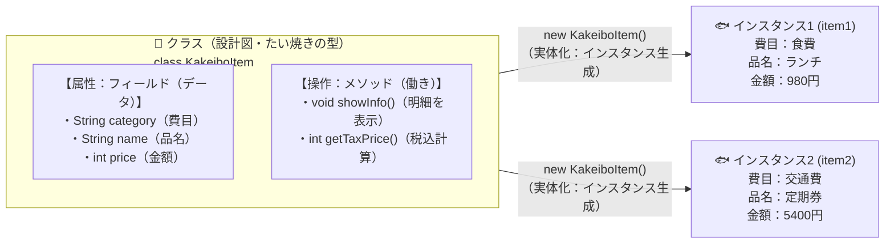
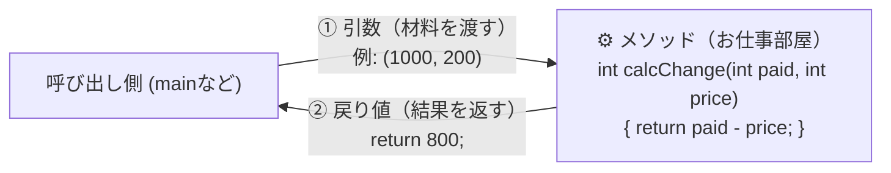

<div style="background: linear-gradient(135deg, #c62828 0%, #ef5350 100%); color: white; padding: 24px; border-radius: 12px; margin-bottom: 20px;">
  <div style="font-size: 0.9em; color: #ffebee; font-weight: bold;">Java実践カリキュラム ― 第3回 / 全10回 【最重要回】</div>
  <h1 style="margin: 6px 0 10px 0; color: #ffffff; border: none;">🔥 第3回：【最重要】クラスとメソッドの基本概念をマスターする</h1>
  <span style="background: rgba(255,255,255,0.2); padding: 4px 10px; border-radius: 20px; font-size: 0.85em; margin-right: 8px;">⏱ 目安時間：3.5〜4時間</span>
  <span style="background: rgba(255,255,255,0.2); padding: 4px 10px; border-radius: 20px; font-size: 0.85em;">📖 『やさしいJava』対応：Lesson 8 〜 Lesson 9</span>
</div>

---

## 🎯 0. 今日のゴールと時間配分

第3回は、Java学習全体の中で**最も重要な山場**です！
第2回では「品名の配列 `items[]`」と「金額の配列 `prices[]`」をバラバラに作りましたが、もしそこに「日付」「費目」「メモ」が増えたら、配列が5個も6個もバラバラに増えて管理できなくなってしまいます。
そこで登場するのが、**「関連するデータ（フィールド）と、それを使う処理（メソッド）を1つの設計図にまとめる＝クラス」**という考え方です。今日作る `KakeiboItem` クラスは、後半のWebアプリでもそのまま主役として活躍します！

| 時間目安 | パート | 内容 |
| :--- | :--- | :--- |
| **0:00〜0:50** | <span style="color: #c62828; font-weight: bold;">Part 1：クラス（設計図）とインスタンス（実体）</span> | たい焼きの型（クラス）とたい焼き（インスタンス）、フィールドとは |
| **0:50〜1:40** | <span style="color: #1565c0; font-weight: bold;">Part 2：メソッドの概念（定義・引数・戻り値）</span> | お仕事を依頼する「引数」と、結果を受け取る「戻り値（`return`）」 |
| **1:40〜2:20** | <span style="color: #2e7d32; font-weight: bold;">Part 3：カプセル化とコンストラクタ（Lesson 9）</span> | データを安全に守る `private`、誕生と同時に初期化するコンストラクタ |
| **2:20〜3:20** | <span style="color: #6a1b9a; font-weight: bold;">Part 4：実践演習（ミニ家計簿 Ver.3）</span> | 3つの演習課題で「クラス設計による家計簿アプリ」を完成させる |
| **3:20〜3:50** | <span style="color: #e65100; font-weight: bold;">Part 5：第3回 確認テスト（10問）</span> | クラスとメソッドの概念が定着しているか10問のテストでチェック！ |

---

## 🏗️ Part 1：クラス（設計図）とインスタンス（実体）（Lesson 8 対応）

### 1-1. なぜ「クラス」を作るのか？
家計簿の「1件分のレシート（明細）」を思い浮かべてください。1枚のレシートには**「品名」「費目」「金額」**がセットで書かれていますよね。
Javaでは、この**「レシート1枚分の設計図（型紙）」**を自分で作ることができます。この設計図のことを **クラス（Class）** と呼びます。



<div style="background: #ffebee; border-left: 5px solid #c62828; padding: 14px; border-radius: 6px; margin: 16px 0; color: #b71c1c;">
  <strong>💡 絶対に覚えたい3つの専門用語！</strong>
  <ol style="margin-bottom: 0; color: #1e293b;">
    <li><strong style="color: #c62828;">クラス（Class）</strong>：データと処理をまとめた<strong>「設計図（たい焼きの型）」</strong>。設計図そのものにはまだ具体的なデータは入っていません。</li>
    <li><strong style="color: #1565c0;">インスタンス（Instance / オブジェクト）</strong>：設計図（クラス）から <code>new</code> というキーワードを使って実際にメモリ上に作り出した<strong>「実体（焼けたたい焼き1個1個）」</strong>。1つの設計図から何個でも作れます！</li>
    <li><strong style="color: #2e7d32;">フィールド（Field / メンバ変数）</strong>：クラスの中に用意された<strong>「データを入れておく変数」</strong>（上の図の <code>category</code>, <code>name</code>, <code>price</code>）。</li>
  </ol>
</div>

---

### 1-2. 初めての自作クラスを作ってみよう（`Sample3_1.java`）

では、実際に「家計簿の明細クラス（`SimpleItem`）」と、それを使う `Sample3_1` クラスを作って動かしてみましょう！

```java
// ① これが「家計簿の明細1件分」を表す設計図（クラス）です
class SimpleItem {
    String category; // フィールド1：費目
    String name;     // フィールド2：品名
    int price;       // フィールド3：金額

    // メソッド：自分のフィールドの中身を画面に表示するお仕事
    void show() {
        System.out.println("【" + category + "】" + name + "：" + price + "円");
    }
}

// ② 設計図を使って実際にプログラムを動かすメインクラス
public class Sample3_1 {
    public static void main(String[] args) {
        // 設計図(SimpleItem)から、1つ目の実体(item1)を new で作り出す！
        SimpleItem item1 = new SimpleItem();
        item1.category = "食費";      // ドット「.」を使ってフィールドにデータを入れる
        item1.name = "スーパー買い物";
        item1.price = 2500;

        // 同じ設計図から、2つ目の実体(item2)も作れる！
        SimpleItem item2 = new SimpleItem();
        item2.category = "娯楽費";
        item2.name = "映画チケット";
        item2.price = 1900;

        // それぞれのメソッド（お仕事）を呼び出す！
        System.out.println("=== 登録された家計簿データ ===");
        item1.show();
        item2.show();
    }
}
```

#### ドット `.` の意味は「〜の」！
- `item1.price = 2500;` 👉 「`item1` **の** `price` に `2500` を入れる」
- `item1.show();` 👉 「`item1` **の** `show()` メソッドを実行する」

---

## ⚙️ Part 2：メソッドの概念（定義・引数・戻り値）（Lesson 8 対応）

メソッドとは、クラスの中に作る**「お仕事（処理）のまとまり」**です。
自動販売機や電卓をイメージしてください。お金や数字を**投入（引数）**すると、中で処理が行われて、ジュースや計算結果が**出てきます（戻り値）**。



### 2-1. メソッドの書き方（4つのパーツ）

```java
戻り値の型 メソッド名(引数の型 引数名1, 引数の型 引数名2) {
    // 行いたい処理
    return 返したい結果の値;
}
```

<div style="background: #e3f2fd; border-left: 5px solid #1976d2; padding: 14px; border-radius: 6px; margin: 16px 0; color: #0d47a1;">
  <ul style="margin: 0; padding-left: 20px; color: #1e293b;">
    <li><strong style="color: #1565c0;">① 引数（ひきすう / Argument）</strong>：メソッドにお仕事を頼むときに<strong>「渡す材料・データ」</strong>です。不要な場合はカッコの中を空っぽ <code>()</code> にします。</li>
    <li><strong style="color: #d32f2f;">② 戻り値（もどりち / Return Value）</strong>：メソッドがお仕事を終えたあとに<strong>「呼び出し元に返す結果」</strong>です。<code>return 値;</code> で返します。</li>
    <li><strong style="color: #2e7d32;">③ <code>void</code>（ボイド）とは？</strong>：「画面に表示するだけで、<strong>計算結果などの戻り値を返さない（空っぽ）</strong>」というときに、戻り値の型の場所に書く特別な言葉です。</li>
  </ul>
</div>

### 2-2. 引数と戻り値を使ったサンプル（`Sample3_2.java`）

```java
class Calculator {
    // パターン1：引数あり・戻り値あり（税抜金額と税率を受け取り、税込金額を返す）
    int calcTaxIncluded(int price, double rate) {
        int result = (int)(price * (1.0 + rate));
        return result; // 計算した整数(int)を呼び出し元へ返す！
    }

    // パターン2：引数あり・戻り値なし(void)（金額を受け取ってメッセージを表示するだけ）
    void printStamp(int total) {
        if (total >= 3000) {
            System.out.println("🎁 3,000円以上のお買い物！ポイント2倍です！");
        } else {
            System.out.println("✨ ご利用ありがとうございます！");
        }
    }
}

public class Sample3_2 {
    public static void main(String[] args) {
        Calculator calc = new Calculator();

        // calcTaxIncluded メソッドに (2000, 0.1) を渡し、返ってきた結果を taxPrice で受け取る
        int taxPrice = calc.calcTaxIncluded(2000, 0.1);
        System.out.println("税込金額は " + taxPrice + "円です。");

        // printStamp メソッドに taxPrice を渡して実行する
        calc.printStamp(taxPrice);
    }
}
```

---

## 🛡️ Part 3：カプセル化とコンストラクタ（Lesson 9 対応）

『やさしいJava』Lesson 9 で学ぶ、実務のJavaプログラミングで**必ず守られる2つのルール**を学びましょう。

### 3-1. カプセル化（`private` と `public` メソッド）
もし誰かがうっかり `item1.price = -99999;` のようにマイナスの金額を直接代入してしまったら、家計簿の計算が壊れてしまいますよね。
そこで、Javaでは以下のルール（**カプセル化**）を使います。

1. **フィールドには <span style="color: #d32f2f; font-weight: bold;">`private`</span> を付ける**：クラスの**外から直接読み書きできないように鍵をかける**。
2. **メソッドには <span style="color: #1565c0; font-weight: bold;">`public`</span> を付ける**：外部からは公開されたメソッド（窓口）を通してのみデータをやり取りさせる。
   - 値を取得するメソッドを **Getter（ゲッター：`getXxx()`）**、値を設定するメソッドを **Setter（セッター：`setXxx()`）** と呼びます。

### 3-2. コンストラクタ（`new` した瞬間に自動で動く初期化メソッド）
`new SimpleItem()` としたあと、毎回3行もかけて `category`, `name`, `price` を1つずつ代入するのは面倒ですし、入れ忘れの原因になります。
**`new` した瞬間に自動的に呼び出され、最初のデータ（初期値）をまとめてセットしてくれる特別なメソッド**を**コンストラクタ**と呼びます。

<div style="background: #fff8e1; border-left: 5px solid #ffb300; padding: 14px; border-radius: 6px; margin: 16px 0; color: #3e2723;">
  <strong>🔑 コンストラクタの2大ルール</strong><br>
  1. <strong>名前を「クラス名とまったく同じ」にする</strong>（例：<code>KakeiboItem</code> クラスなら <code>KakeiboItem(...)</code>）。<br>
  2. <strong>戻り値の型（<code>void</code> や <code>int</code> など）を一切書かない</strong>。
</div>

### 3-3. 本格的な家計簿アイテムクラス（`Sample3_3.java`）

```java
class SafeItem {
    // ① フィールドは private にして外から直接いじれないように守る！
    private String category;
    private String name;
    private int price;

    // ② コンストラクタ：new SafeItem("食費", "弁当", 600) のように1行で作れる！
    public SafeItem(String category, String name, int price) {
        this.category = category; // 「this.変数名」は「このインスタンス自身のフィールド」という意味
        this.name = name;
        // マイナスの金額が入らないようにガード！
        if (price >= 0) {
            this.price = price;
        } else {
            System.out.println("⚠️ 金額にマイナスは指定できません。0円に設定します。");
            this.price = 0;
        }
    }

    // ③ 外部から安全に値を取り出すための Getter メソッド
    public String getCategory() { return this.category; }
    public String getName()     { return this.name; }
    public int getPrice()       { return this.price; }

    // 明細を1行の文字列に整形して返すメソッド
    public String getSummary() {
        return "【" + this.category + "】" + this.name + " (" + this.price + "円)";
    }
}

public class Sample3_3 {
    public static void main(String[] args) {
        // コンストラクタのおかげで、たった1行でデータ入りのインスタンスが完成！
        SafeItem item1 = new SafeItem("食費", "おにぎりセット", 420);
        SafeItem item2 = new SafeItem("交通費", "バス代", -200); // マイナスを入れても安全にガードされる！

        System.out.println(item1.getSummary());
        System.out.println(item2.getSummary());
    }
}
```

---

## 🛠️ Part 4：実践演習（自分の手で書いてみよう！）

### 🟢 【演習1】貯金箱クラス（`PiggyBank`）を作ろう（難易度：★☆☆）
**作成ファイル名：`Ex3_1.java`**

以下の設計図にしたがって `PiggyBank`（貯金箱）クラスを作り、`main` メソッドから動かしてください。
- **フィールド**：`int savings`（現在の貯金額：初期値は0）
- **メソッド1**：`void putMoney(int amount)` 👉 引数 `amount` 円を `savings` に加算し、`「〇〇円を貯金しました。」` と表示する（戻り値なし）。
- **メソッド2**：`int getSavings()` 👉 現在の貯金額 `savings` を `return` で返す（引数なし、戻り値 `int`）。

```text
500円を貯金しました。
1200円を貯金しました。
現在の貯金箱の中身は 1700円 です！
```

<details>
<summary>👉 演習1の解答例を見る</summary>

```java
class PiggyBank {
    int savings = 0;

    void putMoney(int amount) {
        savings += amount;
        System.out.println(amount + "円を貯金しました。");
    }

    int getSavings() {
        return savings;
    }
}

public class Ex3_1 {
    public static void main(String[] args) {
        PiggyBank bank = new PiggyBank();
        bank.putMoney(500);
        bank.putMoney(1200);

        int current = bank.getSavings();
        System.out.println("現在の貯金箱の中身は " + current + "円 です！");
    }
}
```
</details>

---

### 🟡 【演習2】割引計算メソッドを持つ商品クラスを作ろう（難易度：★★☆）
**作成ファイル名：`Ex3_2.java`**

1. `Product` クラスを作成し、フィールド `String name`（商品名）と `int price`（定価）を持たせ、コンストラクタで初期化できるようにする。
2. メソッド `int getDiscountPrice(int percent)` を作成する。引数 `percent`（例：`20` なら20%引き）を受け取り、割引後の金額（整数・小数点切り捨て）を計算して `return` で返すようにする。
   - ※計算ヒント：`price * (100 - percent) / 100`
3. `main` メソッドで `"ワイヤレスイヤホン"`（定価 `8500` 円）のインスタンスを作り、20%引きと30%引きの価格を表示する。

```text
商品名：ワイヤレスイヤホン（定価：8500円）
・20%引きの価格：6800円
・30%引きの価格：5950円
```

<details>
<summary>👉 演習2の解答例を見る</summary>

```java
class Product {
    private String name;
    private int price;

    public Product(String name, int price) {
        this.name = name;
        this.price = price;
    }

    public String getName() { return this.name; }
    public int getPrice()   { return this.price; }

    public int getDiscountPrice(int percent) {
        return this.price * (100 - percent) / 100;
    }
}

public class Ex3_2 {
    public static void main(String[] args) {
        Product p = new Product("ワイヤレスイヤホン", 8500);

        System.out.println("商品名：" + p.getName() + "（定価：" + p.getPrice() + "円）");
        System.out.println("・20%引きの価格：" + p.getDiscountPrice(20) + "円");
        System.out.println("・30%引きの価格：" + p.getDiscountPrice(30) + "円");
    }
}
```
</details>

---

### 🔴 【演習3】ミニ家計簿 Ver.3（`KakeiboItem` クラスの配列で管理する家計簿）（難易度：★★★）
**作成ファイル名：`KakeiboAppV3.java`**

第2回では `String[] items` と `int[] prices` のように別々の配列を使っていましたが、今回は **`KakeiboItem` クラス**を作り、**`KakeiboItem[] list = new KakeiboItem[3];`（オブジェクトの配列）** を使って3件の明細をスッキリ管理しましょう！

1. `KakeiboItem` クラスを作成する：
   - `private` フィールド：`String date`（日付、例 `"10/17"`）、`String category`（費目）、`String name`（品名）、`int price`（金額）
   - 4つのフィールドを初期化するコンストラクタ
   - `getPrice()`、`getCategory()`、および1行分の明細文字列を返す `formatRow()` メソッド
2. `KakeiboAppV3` の `main` メソッドで、3件分のデータを入力（またはコンストラクタで作成）して配列に入れ、一覧表示・合計金額・そして「食費だけの合計金額」を計算して出力する。

```text
========== マイ家計簿 Ver.3（クラス設計版） ==========
10/15 | [食費] スーパー買い出し : 3200円
10/16 | [交通費] ICカードチャージ : 2000円
10/17 | [食費] カフェランチ : 1150円
------------------------------------------------------
★ 支出総合計　：6350円
★ うち食費合計：4350円
======================================================
```

<details>
<summary>👉 演習3の解答例を見る</summary>

```java
class KakeiboItem {
    private String date;
    private String category;
    private String name;
    private int price;

    // コンストラクタ
    public KakeiboItem(String date, String category, String name, int price) {
        this.date = date;
        this.category = category;
        this.name = name;
        this.price = price;
    }

    public int getPrice() {
        return this.price;
    }

    public String getCategory() {
        return this.category;
    }

    public String formatRow() {
        return this.date + " | [" + this.category + "] " + this.name + " : " + this.price + "円";
    }
}

public class KakeiboAppV3 {
    public static void main(String[] args) {
        // KakeiboItem型の配列を作り、3件のインスタンスを格納する
        KakeiboItem[] items = {
            new KakeiboItem("10/15", "食費", "スーパー買い出し", 3200),
            new KakeiboItem("10/16", "交通費", "ICカードチャージ", 2000),
            new KakeiboItem("10/17", "食費", "カフェランチ", 1150)
        };

        int total = 0;
        int foodTotal = 0;

        System.out.println("========== マイ家計簿 Ver.3（クラス設計版） ==========");
        for (int i = 0; i < items.length; i++) {
            System.out.println(items[i].formatRow());
            total += items[i].getPrice();

            // 費目が「食費」なら foodTotal にも加算する！
            if (items[i].getCategory().equals("食費")) {
                foodTotal += items[i].getPrice();
            }
        }

        System.out.println("------------------------------------------------------");
        System.out.println("★ 支出総合計　：" + total + "円");
        System.out.println("★ うち食費合計：" + foodTotal + "円");
        System.out.println("======================================================");
    }
}
```
</details>

---

## 📝 Part 5：第3回 確認テスト（全10問）

目標は **8問以上正解** です！

**第1問（クラスとインスタンスの関係）**
「クラス」と「インスタンス」の関係を例えた説明として、最も適切なものはどれですか？
- **A.** クラスは「変数」であり、インスタンスは「配列」である。
- **B.** クラスは「設計図（たい焼きの型）」であり、インスタンスはそこから作られた「実体（焼けたたい焼き）」である。
- **C.** クラスは1つしか作れないが、インスタンスはプログラム中に1個しか存在できない。
- **D.** インスタンスからクラスを生成する。

**第2問（インスタンスの生成）**
`Kakeibo` というクラスから `k` という名前のインスタンス（オブジェクト）を新しく生成する正しいコードはどれですか？
- **A.** `Kakeibo k = Kakeibo();`
- **B.** `new Kakeibo = k;`
- **C.** `Kakeibo k = new Kakeibo();`
- **D.** `class Kakeibo k = new();`

**第3問（フィールドとメソッドへのアクセス）**
インスタンス `item` が持つ `price` フィールドや `show()` メソッドを使うときに、間に挟む記号はどれですか？
- **A.** コロン `:`（`item:show()`）
- **B.** ドット `.`（`item.show()`）
- **C.** ハイフン `-`（`item-show()`）
- **D.** スラッシュ `/`（`item/show()`）

**第4問（戻り値がないメソッドの宣言）**
メソッドが処理を行うだけで、呼び出し元に値を一切返さない（`return 値;` がない）場合、メソッド名の前に書くキーワードはどれですか？
- **A.** `null` ／ **B.** `empty` ／ **C.** `void` ／ **D.** `int`

**第5問（引数と戻り値の型）**
以下のメソッドを呼び出したとき、戻ってくる値の型は何ですか？
```java
String createMessage(int price) {
    return "金額は" + price + "円です";
}
```
- **A.** `int` 型 ／ **B.** `String` 型 ／ **C.** `void` 型 ／ **D.** `boolean` 型

**第6問（複数の引数）**
メソッドに `int a` と `int b` の2つの引数を受け取らせたい場合、メソッド定義のカッコ内の正しい書き方はどれですか？
- **A.** `(int a, b)` ／ **B.** `(int a; int b)` ／ **C.** `(int a, int b)` ／ **D.** `(a: int, b: int)`

**第7問（カプセル化とアクセス修飾子）**
クラスの外からフィールドを直接書き換えられないように保護（隠蔽）するために、フィールド宣言の前に付けるキーワードはどれですか？
- **A.** `public` ／ **B.** `private` ／ **C.** `secret` ／ **D.** `static`

**第8問（コンストラクタのルール）**
`Item` クラスのコンストラクタを定義する際のルールとして、**正しいもの**はどれですか？
- **A.** メソッド名を `initItem` にし、戻り値に `void` を書く。
- **B.** メソッド名をクラス名と同じ `Item` にし、戻り値の型は何も書かない。
- **C.** メソッド名を `constructor` にする。
- **D.** コンストラクタは引数を1つも受け取ることができない。

**第9問（`this` キーワードの意味）**
クラス内のメソッドやコンストラクタで書かれる `this.price = price;` の `this` が表しているものは何ですか？
- **A.** 親クラスのこと
- **B.** メインメソッドのこと
- **C.** いま処理している「このインスタンス自身」のこと
- **D.** 新しく別のインスタンスを作ること

**第10問（オーバーロード：Lesson 9 対応）**
同じクラスの中に、**「同じ名前だけれど、引数の個数や型が違うメソッド（またはコンストラクタ）」**を複数定義することを何と呼びますか？
- **A.** オーバーロード（多重定義）
- **B.** オーバーライド
- **C.** カプセル化
- **D.** キャスト

<details>
<summary>✅ 確認テスト（全10問）の解答と解説を見る</summary>

| 問題 | 正解 | 解説 |
| :---: | :---: | :--- |
| **第1問** | <span style="color: #d32f2f; font-weight: bold;">B</span> | クラスは「設計図」、そこから `new` で作られた実体が「インスタンス」です。 |
| **第2問** | <span style="color: #d32f2f; font-weight: bold;">C</span> | `クラス名 変数名 = new クラス名();` の形でインスタンスを生成します。 |
| **第3問** | <span style="color: #d32f2f; font-weight: bold;">B</span> | ドット `.` を使って `インスタンス名.フィールド名` や `インスタンス名.メソッド名()` とアクセスします。 |
| **第4問** | <span style="color: #d32f2f; font-weight: bold;">C</span> | 戻り値がない場合は `void` を指定します。 |
| **第5問** | <span style="color: #d32f2f; font-weight: bold;">B</span> | メソッド名の直前に書かれている `String` が戻り値の型です（引数の `int` と混同しないよう注意！）。 |
| **第6問** | <span style="color: #d32f2f; font-weight: bold;">C</span> | 引数が複数ある場合は、カンマ `,` で区切ってそれぞれに型と変数名を書きます。 |
| **第7問** | <span style="color: #d32f2f; font-weight: bold;">B</span> | `private` を付けると、そのクラスの内部からしか直接アクセスできなくなります。 |
| **第8問** | <span style="color: #d32f2f; font-weight: bold;">B</span> | コンストラクタは「クラス名と完全に同じ名前」にし、「戻り値の型（`void`含む）を書かない」のがルールです。 |
| **第9問** | <span style="color: #d32f2f; font-weight: bold;">C</span> | `this` は「このインスタンス自身」を指します。引数名 `price` とフィールド名 `this.price` を区別するときによく使います。 |
| **第10問** | <span style="color: #d32f2f; font-weight: bold;">A</span> | 引数の型や個数が異なれば、同じ名前のメソッドやコンストラクタを複数作ることができます。これを**オーバーロード**と呼びます（『やさしいJava』Lesson 9参照）。 |

</details>

---
<div style="display: flex; justify-content: space-between; margin-top: 20px;">
  <a href="./lesson02.md">👈 第2回へ戻る</a>
  <a href="./README.md">🏠 カリキュラム目次</a>
  <a href="./lesson04.md" style="font-weight: bold; color: #c62828;">👉 第4回：クラスライブラリと継承・インターフェースへ進む</a>
</div>
