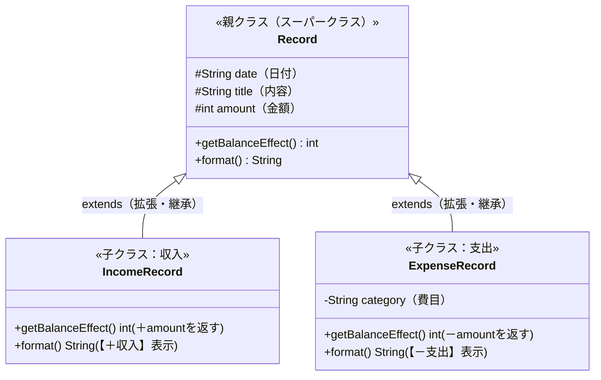

<div style="background: linear-gradient(135deg, #6a1b9a 0%, #ab47bc 100%); color: white; padding: 24px; border-radius: 12px; margin-bottom: 20px;">
  <div style="font-size: 0.9em; color: #f3e5f5; font-weight: bold;">Java実践カリキュラム ― 第4回 / 全10回</div>
  <h1 style="margin: 6px 0 10px 0; color: #ffffff; border: none;">🏛️ 第4回：クラスライブラリと継承・インターフェース</h1>
  <span style="background: rgba(255,255,255,0.2); padding: 4px 10px; border-radius: 20px; font-size: 0.85em; margin-right: 8px;">⏱ 目安時間：3〜4時間</span>
  <span style="background: rgba(255,255,255,0.2); padding: 4px 10px; border-radius: 20px; font-size: 0.85em;">📖 『やさしいJava』対応：Lesson 10 〜 Lesson 12</span>
</div>

---

## 🎯 0. 今日のゴールと時間配分

第3回で「自分でクラスを作る方法」を学びました。第4回では、Javaが最初から用意してくれている便利なクラス群（**クラスライブラリ**）の使いこなしと、オブジェクト指向の醍醐味である**「継承（`extends`）」**・**「インターフェース（`implements`）」**を学びます。
家計簿には**「収入データ」**と**「支出データ」**の2種類がありますが、共通する部分を「親クラス」にまとめることで、無駄のない美しい設計ができるようになります！

| 時間目安 | パート | 内容 |
| :--- | :--- | :--- |
| **0:00〜0:45** | <span style="color: #1565c0; font-weight: bold;">Part 1：標準クラスライブラリ（Lesson 10）</span> | 文字列操作（`String`）、文字列→数値変換（`Integer.parseInt`）、日付（`LocalDate`） |
| **0:45〜1:35** | <span style="color: #6a1b9a; font-weight: bold;">Part 2：クラスの継承とオーバーライド（Lesson 11）</span> | 親クラスの特徴を引き継ぐ `extends`、`super`、メソッドの上書き |
| **1:35〜2:15** | <span style="color: #2e7d32; font-weight: bold;">Part 3：抽象クラスとインターフェース（Lesson 12）</span> | 規格（ルール）を決める `interface` と `implements` |
| **2:15〜3:15** | <span style="color: #e65100; font-weight: bold;">Part 4：実践演習（ミニ家計簿 Ver.4）</span> | 3つの演習課題で「収入クラス・支出クラスの階層設計」を完成させる |
| **3:15〜3:45** | <span style="color: #c62828; font-weight: bold;">Part 5：第4回 確認テスト（10問）</span> | 今日の知識が定着しているか10問のテストでチェック！ |

---

## 🧰 Part 1：Java標準の「クラスライブラリ」を使いこなそう（Lesson 10 対応）

ゼロからすべて自分で作らなくても、Javaには最初から何千もの便利なクラス（部品）が用意されています。これを**クラスライブラリ（標準API）**と呼びます。後半のWebアプリ制作で**100%毎日使う3つの重要クラス**を押さえましょう！

### 1-1. Webアプリでも超重要！3大便利メソッド

<div style="background: #e3f2fd; border-left: 5px solid #1976d2; padding: 14px; border-radius: 6px; margin: 16px 0; color: #0d47a1;">
  <ol style="margin: 0; padding-left: 20px; color: #1e293b;">
    <li><strong style="color: #d32f2f;">文字列を整数に変換する：<code>Integer.parseInt("1500")</code></strong><br>
      後半のWebアプリ（Servlet）では、ブラウザから送られてくる金額はすべて<strong>文字列（<code>"1500"</code>）</strong>として届きます。それを計算できる整数（<code>int</code>型の <code>1500</code>）に変換する超重要メソッドです！</li>
    <li style="margin-top: 8px;"><strong style="color: #1565c0;">文字列の便利メソッド（<code>String</code> クラス）</strong><br>
      ・<code>str.length()</code>：文字数を調べる<br>
      ・<code>str.contains("キーワード")</code>：特定の文字が含まれているか調べる（<strong>家計簿の検索機能で大活躍！</strong>）<br>
      ・<code>str.split(",")</code>：カンマなどで文字列を分割して配列にする（<strong>CSVファイルの読み込みで大活躍！</strong>）</li>
    <li style="margin-top: 8px;"><strong style="color: #2e7d32;">今日の日付を取得する：<code>LocalDate.now()</code></strong><br>
      <code>import java.time.LocalDate;</code> を書くことで、今日の日付（例：<code>2026-10-17</code>）を簡単に扱えます。</li>
  </ol>
</div>

### 1-2. クラスライブラリ体験サンプル（`Sample4_1.java`）

```java
import java.time.LocalDate;

public class Sample4_1 {
    public static void main(String[] args) {
        // 1. 今日の日付を取得する
        LocalDate today = LocalDate.now();
        System.out.println("今日の日付：" + today);

        // 2. 文字列の数字を int に変換して計算する
        String inputPriceStr = "2500";
        int price = Integer.parseInt(inputPriceStr); // "2500" → 2500(int) に変換！
        System.out.println("1000円足すと：" + (price + 1000) + "円");

        // 3. 文字列の中に特定の言葉が含まれているかチェック（検索機能の基本）
        String memo = "コンビニでカフェラテとおにぎりを購入";
        if (memo.contains("カフェ")) {
            System.out.println("🔍 メモの中に「カフェ」という単語が見つかりました！");
        }
    }
}
```

---

## 🧬 Part 2：クラスの継承（`extends`）とオーバーライド（Lesson 11 対応）

家計簿には**「収入（お給料・お小遣い）」**と**「支出（食費・交通費）」**があります。
どちらも「日付」「品名（内容）」「金額」を持つ点はまったく同じですが、残高への影響（プラスかマイナスか）や表示の仕方が少しだけ違います。
そんなとき、共通部分を**「親クラス（スーパークラス）」**として作り、それを受け継いで**「子クラス（サブクラス）」**を作る仕組みを**継承（けいしょう / Inheritance）**と呼びます。



### 2-1. 継承のキーワード：`extends` と `super` と `protected`

1. **`class 子クラス名 extends 親クラス名`**：親クラスのフィールドやメソッドをそのまま引き継ぎます。
2. **`protected`（プロテクテッド）**：`private` だと子クラスからも触れなくなってしまいますが、`protected` にすると**「外部からは隠し、子クラスからは使える」**状態にできます。
3. **`super(...)`**：子クラスのコンストラクタの先頭で、**親クラスのコンストラクタを呼び出す**ときに使います。
4. **オーバーライド（Override：上書き）**：親クラスにあるメソッドと同じ名前のメソッドを子クラスで定義し直し、**子クラス専用の動きに書き換える**ことです。

### 2-2. 継承とオーバーライドのサンプル（`Sample4_2.java`）

```java
// ① 親クラス（すべての家計簿記録の共通ベース）
class Record {
    protected String date;
    protected String title;
    protected int amount;

    public Record(String date, String title, int amount) {
        this.date = date;
        this.title = title;
        this.amount = amount;
    }

    // 残高への影響額を返すメソッド（子クラスで上書きする）
    public int getBalanceEffect() {
        return 0;
    }

    public String getInfo() {
        return date + " | " + title + " : " + amount + "円";
    }
}

// ② 子クラス1：収入クラス（Record を継承）
class IncomeRecord extends Record {
    public IncomeRecord(String date, String title, int amount) {
        super(date, title, amount); // 親クラスのコンストラクタを呼び出す！
    }

    @Override // 親のメソッドを上書き（オーバーライド）している目印
    public int getBalanceEffect() {
        return +this.amount; // 収入なのでプラス！
    }

    @Override
    public String getInfo() {
        return "🟢【＋収入】" + super.getInfo();
    }
}

// ③ 子クラス2：支出クラス（Record を継承し、さらに「費目」を追加！）
class ExpenseRecord extends Record {
    private String category; // 支出クラス独自のフィールド

    public ExpenseRecord(String date, String category, String title, int amount) {
        super(date, title, amount); // 共通の3つは親に任せる
        this.category = category;   // 費目だけ自分でセットする
    }

    @Override
    public int getBalanceEffect() {
        return -this.amount; // 支出なのでマイナス！
    }

    @Override
    public String getInfo() {
        return "🔴【－支出(" + this.category + ")】" + super.getInfo();
    }
}

public class Sample4_2 {
    public static void main(String[] args) {
        // 親クラスの型（Record[]）の配列に、収入も支出も一緒に入れられる！（多態性・ポリモーフィズム）
        Record[] history = {
            new IncomeRecord("10/01", "今月のお小遣い", 30000),
            new ExpenseRecord("10/05", "食費", "スーパー買い物", 2800),
            new ExpenseRecord("10/10", "書籍費", "やさしいJava", 2860)
        };

        int balance = 0;
        System.out.println("=== 収支履歴一覧 ===");
        for (int i = 0; i < history.length; i++) {
            System.out.println(history[i].getInfo());
            balance += history[i].getBalanceEffect(); // 収入なら足され、支出なら引かれる！
        }
        System.out.println("------------------------------------");
        System.out.println("現在の残高：" + balance + "円");
    }
}
```

---

## 🔌 Part 3：インターフェース（`interface`）とは？（Lesson 12 対応）

『やさしいJava』Lesson 12 で登場する **インターフェース（`interface`）** は、一言で言うと**「このクラスは必ずこのメソッドを持っていますよ！という規格（約束事・ルールブック）」**です。

<div style="background: #e8f5e9; border-left: 5px solid #2e7d32; padding: 14px; border-radius: 6px; margin: 16px 0; color: #1b5e20;">
  <strong>🎮 家電のコンセントやUSB規格でイメージしよう！</strong><br>
  インターフェースには「メソッドの名前と引数・戻り値の宣言」だけが書かれており、中身の処理は書かれていません。<br>
  クラス側で <strong><code>class クラス名 implements インターフェース名</code></strong> と書く（実装する）と、「そのインターフェースで決められたメソッドを必ず中身まで作らなければならない」というルールが働きます。
</div>

### インターフェースの例（CSV出力ルールを決める `CsvExportable`）
```java
// 「CSV形式の文字列に変換できる」という規格（インターフェース）
interface CsvExportable {
    String toCsvString(); // 中身のない抽象メソッド（ルールだけ宣言）
}

// 規格を実装（implements）するクラス
class MemoItem implements CsvExportable {
    private String text;
    private int cost;

    public MemoItem(String text, int cost) {
        this.text = text;
        this.cost = cost;
    }

    // インターフェースで約束したメソッドを必ず実装する！
    @Override
    public String toCsvString() {
        return this.text + "," + this.cost;
    }
}
```

---

## 🛠️ Part 4：実践演習（自分の手で書いてみよう！）

### 🟢 【演習1】カンマ区切りの文字から家計簿データを読み取ろう（難易度：★☆☆）
**作成ファイル名：`Ex4_1.java`**

文字列 `"2026-10-17,食費,牛丼ランチ,680"` を `split(",")` メソッドで分割して配列 `String[] parts` に入れ、金額部分（`parts[3]`）を `Integer.parseInt(...)` で整数に変換して、税込金額（10%加算）と一緒に表示するプログラムを作成してください。

```text
日付：2026-10-17
費目：食費
品名：牛丼ランチ
税抜金額：680円（税込：748円）
```

<details>
<summary>👉 演習1の解答例を見る</summary>

```java
public class Ex4_1 {
    public static void main(String[] args) {
        String csvLine = "2026-10-17,食費,牛丼ランチ,680";

        // カンマ「,」で分割すると、4つの要素を持つ配列になる
        String[] parts = csvLine.split(",");

        String date = parts[0];
        String category = parts[1];
        String name = parts[2];
        int price = Integer.parseInt(parts[3]); // 文字列 "680" を int の 680 に変換！
        int taxIncluded = (int)(price * 1.1);

        System.out.println("日付：" + date);
        System.out.println("費目：" + category);
        System.out.println("品名：" + name);
        System.out.println("税抜金額：" + price + "円（税込：" + taxIncluded + "円）");
    }
}
```
</details>

---

### 🟡 【演習2】通常支出と「ポイント還元付き支出」を継承で作ろう（難易度：★★☆）
**作成ファイル名：`Ex4_2.java`**

1. 親クラス `Payment`（フィールド `String item`, `int price`、実質負担額を返す `int getActualCost()` メソッドはそのまま `price` を返す）を作成する。
2. `Payment` を継承（`extends`）した子クラス `PointPayment` を作成する。
   - 追加フィールド：`int pointBack`（獲得ポイント）
   - `getActualCost()` をオーバーライドし、`price - pointBack`（金額から獲得ポイントを引いた実質負担額）を返すようにする。
3. 両方のインスタンスを作って実質負担額を表示する。

```text
【通常払い】現金でパン購入：実質負担 450円
【ポイント払い】カードで家電購入（500pt還元）：実質負担 9500円
```

<details>
<summary>👉 演習2の解答例を見る</summary>

```java
class Payment {
    protected String item;
    protected int price;

    public Payment(String item, int price) {
        this.item = item;
        this.price = price;
    }

    public int getActualCost() {
        return this.price;
    }

    public String getDescription() {
        return "【通常払い】" + this.item + "：実質負担 " + getActualCost() + "円";
    }
}

class PointPayment extends Payment {
    private int pointBack;

    public PointPayment(String item, int price, int pointBack) {
        super(item, price);
        this.pointBack = pointBack;
    }

    @Override
    public int getActualCost() {
        return this.price - this.pointBack;
    }

    @Override
    public String getDescription() {
        return "【ポイント払い】" + this.item + "（" + this.pointBack + "pt還元）：実質負担 " + getActualCost() + "円";
    }
}

public class Ex4_2 {
    public static void main(String[] args) {
        Payment p1 = new Payment("現金でパン購入", 450);
        PointPayment p2 = new PointPayment("カードで家電購入", 10000, 500);

        System.out.println(p1.getDescription());
        System.out.println(p2.getDescription());
    }
}
```
</details>

---

### 🔴 【演習3】ミニ家計簿 Ver.4（検索インターフェース実装＆収支統合管理）（難易度：★★★）
**作成ファイル名：`KakeiboAppV4.java`**

1. インターフェース `Searchable` を定義し、キーワードが含まれるか判定する `boolean matches(String keyword);` メソッドを宣言する。
2. 家計簿データクラス `KakeiboEntry` に `Searchable` を実装（`implements`）し、`category` または `name` に `keyword` が含まれていれば（`.contains(keyword)`）`true` を返すようにする。
3. 4件の家計簿データを配列に登録し、キーボードから入力した検索ワードにヒットした明細だけを表示＆合計計算するプログラムを作成する。

```text
=== マイ家計簿 Ver.4（キーワード検索機能） ===
検索したいキーワードを入力してください（例：食費、カフェ、電車）：カフェ

--- 「カフェ」の検索結果 ---
・2026-10-15 | [食費] 駅前カフェラテ : 480円
・2026-10-17 | [交際費] カフェで打ち合わせ : 1200円
----------------------------
該当件数：2件 ／ 合計金額：1680円
```

<details>
<summary>👉 演習3の解答例を見る</summary>

```java
import java.util.Scanner;

interface Searchable {
    boolean matches(String keyword);
}

class KakeiboEntry implements Searchable {
    private String date;
    private String category;
    private String name;
    private int price;

    public KakeiboEntry(String date, String category, String name, int price) {
        this.date = date;
        this.category = category;
        this.name = name;
        this.price = price;
    }

    public int getPrice() { return this.price; }

    @Override
    public boolean matches(String keyword) {
        // 費目(category) または 品名(name) にキーワードが含まれていれば true
        return this.category.contains(keyword) || this.name.contains(keyword);
    }

    public String format() {
        return "・" + this.date + " | [" + this.category + "] " + this.name + " : " + this.price + "円";
    }
}

public class KakeiboAppV4 {
    public static void main(String[] args) {
        KakeiboEntry[] entries = {
            new KakeiboEntry("2026-10-14", "食費", "スーパー食材", 2300),
            new KakeiboEntry("2026-10-15", "食費", "駅前カフェラテ", 480),
            new KakeiboEntry("2026-10-16", "交通費", "電車代", 640),
            new KakeiboEntry("2026-10-17", "交際費", "カフェで打ち合わせ", 1200)
        };

        Scanner scanner = new Scanner(System.in);
        System.out.println("=== マイ家計簿 Ver.4（キーワード検索機能） ===");
        System.out.print("検索したいキーワードを入力してください（例：食費、カフェ、電車）：");
        String keyword = scanner.next();

        System.out.println("\n--- 「" + keyword + "」の検索結果 ---");
        int hitCount = 0;
        int hitTotal = 0;

        for (int i = 0; i < entries.length; i++) {
            if (entries[i].matches(keyword)) {
                System.out.println(entries[i].format());
                hitCount++;
                hitTotal += entries[i].getPrice();
            }
        }

        System.out.println("----------------------------");
        System.out.println("該当件数：" + hitCount + "件 ／ 合計金額：" + hitTotal + "円");
        scanner.close();
    }
}
```
</details>

---

## 📝 Part 5：第4回 確認テスト（全10問）

目標は **8問以上正解** です！

**第1問（文字列から整数への変換）**
文字列 `"3500"` を計算可能な `int` 型の整数 `3500` に変換するメソッドはどれですか？
- **A.** `String.toInt("3500")`
- **B.** `Integer.parseInt("3500")`
- **C.** `(int)"3500"`
- **D.** `Int.valueOf("3500")`

**第2問（文字列の部分一致検索）**
文字列 `String title = "コンビニ弁当";` の中に `"弁当"` という文字が含まれているか判定するメソッドはどれですか？
- **A.** `title.contains("弁当")` ／ **B.** `title.has("弁当")` ／ **C.** `title.find("弁当")` ／ **D.** `title.search("弁当")`

**第3問（クラスの継承キーワード）**
親クラス `Parent` を継承して子クラス `Child` を作るときの正しい宣言はどれですか？
- **A.** `class Child implements Parent`
- **B.** `class Child super Parent`
- **C.** `class Child extends Parent`
- **D.** `class Child inherits Parent`

**第4問（継承できる親クラスの数）**
Javaにおいて、1つの子クラスが同時に `extends` で直接継承できる親クラスの数はいくつまでですか？（単一継承の原則）
- **A.** 1つだけ ／ **B.** 2つまで ／ **C.** 何個でも無制限 ／ **D.** 継承はできない

**第5問（親クラスのコンストラクタ呼び出し）**
子クラスのコンストラクタの中で、親クラスのコンストラクタを呼び出すために使うキーワードはどれですか？
- **A.** `this(...)` ／ **B.** `parent(...)` ／ **C.** `base(...)` ／ **D.** `super(...)`

**第6問（アクセス修飾子 `protected`）**
フィールドに `protected` を付けた場合、アクセスできる範囲として正しいものはどれですか？
- **A.** どのクラスからも一切アクセスできない。
- **B.** 同じクラス内、同じパッケージ内、および**継承した子クラス（サブクラス）**からアクセスできる。
- **C.** 自分自身のクラス内からしかアクセスできない。
- **D.** インターフェースからしかアクセスできない。

**第7問（オーバーライド）**
親クラスで定義されているメソッドを、子クラス側で同じ名前・同じ引数で定義し直して処理内容を上書きすることを何と呼びますか？
- **A.** オーバーロード ／ **B.** オーバーライド ／ **C.** キャスト ／ **D.** カプセル化

**第8問（インターフェースの実装キーワード）**
`Printable` というインターフェースを `Receipt` クラスに実装するときの正しい宣言はどれですか？
- **A.** `class Receipt extends Printable`
- **B.** `class Receipt interface Printable`
- **C.** `class Receipt implements Printable`
- **D.** `class Receipt uses Printable`

**第9問（インターフェースのルール）**
インターフェースを `implements` したクラスが必ず守らなければならないルールは何ですか？
- **A.** フィールドを1つも持ってはいけない。
- **B.** インターフェースで宣言されている抽象メソッドをすべて実装（中身を記述）しなければならない。
- **C.** コンストラクタを作ってはいけない。
- **D.** 1つのクラスにつき1つのインターフェースしか `implements` できない。

**第10問（クラス変数・クラスメソッド `static`：Lesson 9・10 対応）**
`Integer.parseInt(...)` や `LocalDate.now()` のように、`new` でインスタンスを作らなくても `クラス名.メソッド名()` で直接呼び出せるメソッドには、定義時にどのキーワードが付いていますか？
- **A.** `final` ／ **B.** `abstract` ／ **C.** `static` ／ **D.** `private`

<details>
<summary>✅ 確認テスト（全10問）の解答と解説を見る</summary>

| 問題 | 正解 | 解説 |
| :---: | :---: | :--- |
| **第1問** | <span style="color: #d32f2f; font-weight: bold;">B</span> | `Integer.parseInt(文字列)` はWebアプリ開発で最もよく使う変換メソッドの1つです。 |
| **第2問** | <span style="color: #d32f2f; font-weight: bold;">A</span> | `文字列.contains("検索語")` で特定の文字列が含まれるか（`true`/`false`）を調べられます。 |
| **第3問** | <span style="color: #d32f2f; font-weight: bold;">C</span> | クラスの継承には `extends`（拡張する）を使います。 |
| **第4問** | <span style="color: #d32f2f; font-weight: bold;">A</span> | Javaのクラス継承（`extends`）は**1つの親クラスだけ**（単一継承）というルールがあります（インターフェースは何個でも実装可能です）。 |
| **第5問** | <span style="color: #d32f2f; font-weight: bold;">D</span> | 親クラス（スーパークラス）のコンストラクタは `super(...)` で呼び出します。 |
| **第6問** | <span style="color: #d32f2f; font-weight: bold;">B</span> | `protected` は子クラスからのアクセスを許可したいときに使います。 |
| **第7問** | <span style="color: #d32f2f; font-weight: bold;">B</span> | 親のメソッドを子クラスで上書き再定義することを**オーバーライド**と呼びます。 |
| **第8問** | <span style="color: #d32f2f; font-weight: bold;">C</span> | インターフェースの実装には `implements` を使います。 |
| **第9問** | <span style="color: #d32f2f; font-weight: bold;">B</span> | インターフェースで約束されたメソッドをすべて実装しないとコンパイルエラーになります（ちなみにインターフェースはカンマ区切りで複数同時に実装できます）。 |
| **第10問** | <span style="color: #d32f2f; font-weight: bold;">C</span> | `static` が付いたメソッド（クラスメソッド）は、インスタンスを生成せずに `クラス名.メソッド名()` で直接呼び出せます。 |

</details>

---
<div style="display: flex; justify-content: space-between; margin-top: 20px;">
  <a href="./lesson03.md">👈 第3回へ戻る</a>
  <a href="./README.md">🏠 カリキュラム目次</a>
  <a href="./lesson05.md" style="font-weight: bold; color: #6a1b9a;">👉 第5回：例外処理とコレクション・前半総まとめへ進む</a>
</div>
