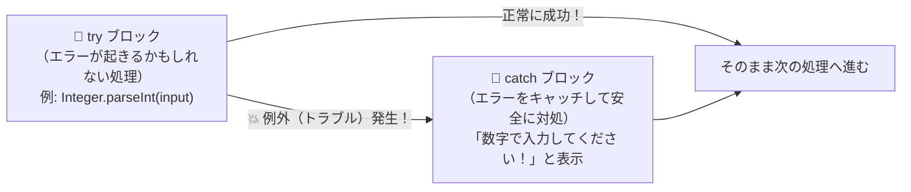

<div style="background: linear-gradient(135deg, #e65100 0%, #fb8c00 100%); color: white; padding: 24px; border-radius: 12px; margin-bottom: 20px;">
  <div style="font-size: 0.9em; color: #fff3e0; font-weight: bold;">Java実践カリキュラム ― 第5回 / 全10回 【前半総まとめ】</div>
  <h1 style="margin: 6px 0 10px 0; color: #ffffff; border: none;">🎒 第5回：例外処理とコレクション（ArrayList）・前半総まとめ</h1>
  <span style="background: rgba(255,255,255,0.2); padding: 4px 10px; border-radius: 20px; font-size: 0.85em; margin-right: 8px;">⏱ 目安時間：3.5〜4時間</span>
  <span style="background: rgba(255,255,255,0.2); padding: 4px 10px; border-radius: 20px; font-size: 0.85em;">📖 『やさしいJava』対応：Lesson 13 〜 Lesson 14（＋Lesson 16 コレクション）</span>
</div>

---

## 🎯 0. 今日のゴールと時間配分

今日でいよいよカリキュラム前半（Java基礎＆オブジェクト指向編）の総仕上げです！
これまでの家計簿アプリには、まだ**2つの弱点**がありました。
1. 金額欄に間違えて `"あいう"` と文字を入力すると、プログラムが強制終了（クラッシュ）してしまう。
2. 配列（`KakeiboItem[]`）は最初に決めた件数（例：3件）しか入らず、あとから自由に何件でも追加・削除することができない。

第5回では、エラーで止まらないための**「例外処理（`try-catch`）」**と、大きさが自由自在に伸び縮みする魔法のリスト**「`ArrayList`（コレクション）」**、そして**「ファイル保存」**を学び、コンソール版の完成形となる家計簿アプリを作り上げます！

| 時間目安 | パート | 内容 |
| :--- | :--- | :--- |
| **0:00〜0:45** | <span style="color: #d32f2f; font-weight: bold;">Part 1：例外処理（`try-catch`）（Lesson 13）</span> | 入力ミスが起きてもプログラムを止めずに優しく案内する仕組み |
| **0:45〜1:35** | <span style="color: #1565c0; font-weight: bold;">Part 2：`ArrayList` と拡張for文（Lesson 16）</span> | 何件でもデータを追加・削除できる可変長リストの使い方 |
| **1:35〜2:15** | <span style="color: #2e7d32; font-weight: bold;">Part 3：ファイル入出力の基本（Lesson 14）</span> | データをテキスト（CSV）ファイルに書き出して保存する |
| **2:15〜3:15** | <span style="color: #6a1b9a; font-weight: bold;">Part 4：実践演習（コンソール版・家計簿の完成！）</span> | メニュー選択式で「追加・一覧・削除・集計」ができるアプリを完成させる |
| **3:15〜3:45** | <span style="color: #e65100; font-weight: bold;">Part 5：第5回 確認テスト（10問）</span> | 前半5回分の総仕上げチェック！ |

---

## 🛟 Part 1：エラーで強制終了させない「例外処理」（Lesson 13 対応）

プログラムを実行している最中に起きる予期せぬトラブル（例：数字変換できない文字が入力された、0で割り算した、存在しないファイルを開こうとした）のことを、Javaでは**「例外（Exception）」**と呼びます。



### 1-1. `try - catch - finally` の書き方（`Sample5_1.java`）

```java
public class Sample5_1 {
    public static void main(String[] args) {
        String input = "千五百円"; // 数字ではなく漢字が入ってしまった！

        try {
            // ① try の中に「例外が起きるかもしれない処理」を書く
            int price = Integer.parseInt(input);
            System.out.println("登録金額：" + price + "円");
        } catch (NumberFormatException e) {
            // ② catch の中に「例外が起きたときのフォロー処理」を書く
            System.out.println("⚠️ エラー：「" + input + "」は数値に変換できません！半角数字で入力してください。");
        } finally {
            // ③ finally はエラーが起きても起きなくても「最後に必ず実行される処理」（省略可能）
            System.out.println("（入力チェック処理を終了しました）");
        }
    }
}
```

---

## 🎒 Part 2：何件でも追加・削除できる `ArrayList`（コレクション）

第2回・第3回で使った「配列（`int[]` や `KakeiboItem[]`）」は、最初に `new KakeiboItem[3]` と作ったら**あとから4件目を追加することができません**でした。
実務のJava開発やWebアプリ開発では、配列の代わりに**データが何件増えても自動的に枠が広がる `ArrayList`（アレイリスト）**をほぼ100%使います！

<div style="background: #e3f2fd; border-left: 5px solid #1976d2; padding: 14px; border-radius: 6px; margin: 16px 0; color: #0d47a1;">
  <h4 style="margin-top: 0; color: #1565c0;">📊 配列 と <code>ArrayList</code> の違い比較表</h4>
  <table style="width: 100%; background: white; border-collapse: collapse; color: #1e293b;">
    <tr style="background: #bbdefb;">
      <th style="padding: 8px; border: 1px solid #90caf9;">操作</th>
      <th style="padding: 8px; border: 1px solid #90caf9;">配列（Array）</th>
      <th style="padding: 8px; border: 1px solid #90caf9;">ArrayList（コレクション）</th>
    </tr>
    <tr>
      <td style="padding: 8px; border: 1px solid #90caf9;"><strong>サイズ（件数）</strong></td>
      <td style="padding: 8px; border: 1px solid #90caf9;">最初に固定（あとから変更不可）</td>
      <td style="padding: 8px; border: 1px solid #90caf9;"><strong style="color: #d32f2f;">自由自在に増減できる！</strong></td>
    </tr>
    <tr>
      <td style="padding: 8px; border: 1px solid #90caf9;"><strong>データの追加</strong></td>
      <td style="padding: 8px; border: 1px solid #90caf9;"><code>list[0] = item;</code></td>
      <td style="padding: 8px; border: 1px solid #90caf9;"><strong><code>list.add(item);</code></strong>（末尾にどんどん追加！）</td>
    </tr>
    <tr>
      <td style="padding: 8px; border: 1px solid #90caf9;"><strong>i番目の取得</strong></td>
      <td style="padding: 8px; border: 1px solid #90caf9;"><code>list[i]</code></td>
      <td style="padding: 8px; border: 1px solid #90caf9;"><strong><code>list.get(i)</code></strong></td>
    </tr>
    <tr>
      <td style="padding: 8px; border: 1px solid #90caf9;"><strong>件数の取得</strong></td>
      <td style="padding: 8px; border: 1px solid #90caf9;"><code>list.length</code></td>
      <td style="padding: 8px; border: 1px solid #90caf9;"><strong><code>list.size()</code></strong></td>
    </tr>
    <tr>
      <td style="padding: 8px; border: 1px solid #90caf9;"><strong>データの削除</strong></td>
      <td style="padding: 8px; border: 1px solid #90caf9;">できない（詰め直しが必要）</td>
      <td style="padding: 8px; border: 1px solid #90caf9;"><strong><code>list.remove(i);</code></strong>（自動で間を詰めてくれる！）</td>
    </tr>
  </table>
</div>

### 2-1. `ArrayList` と「拡張for文」のサンプル（`Sample5_2.java`）

`ArrayList` の中身を先頭から順番に取り出すときは、**拡張for文（`for (型 変数名 : リスト名)`）**を使うと驚くほどスッキリ書けます！

```java
import java.util.ArrayList; // ArrayListを使うためのインポート

public class Sample5_2 {
    public static void main(String[] args) {
        // String（文字列）を入れる ArrayList を作成する
        ArrayList<String> memoList = new ArrayList<>();

        // 1. データをどんどん追加する（.add）
        memoList.add("食費：850円");
        memoList.add("交通費：420円");
        memoList.add("書籍代：2860円");

        System.out.println("現在の登録件数：" + memoList.size() + "件");

        // 2. 拡張for文で、中身を1つずつ取り出して表示する
        System.out.println("--- 削除前の一覧 ---");
        for (String memo : memoList) {
            System.out.println("・" + memo);
        }

        // 3. 1番目（0から数えるので2つ目の「交通費：420円」）を削除する（.remove）
        memoList.remove(1);

        System.out.println("--- 1番目を削除した後の一覧（残り " + memoList.size() + "件） ---");
        for (String memo : memoList) {
            System.out.println("・" + memo);
        }
    }
}
```
> 💡 **補足**：`ArrayList< >` の `< >` の中には、`String` や `KakeiboItem` などのクラス名を書きます。`int`（整数）を入れたいときだけは、クラス版の **`ArrayList<Integer>`** と書きます。

---

## 💾 Part 3：ファイルへの書き出しと読み込み（Lesson 14 対応）

プログラムを終了してもデータが消えないように、家計簿のデータをファイル（`kakeibo.txt`）に保存する方法を学びましょう。第9回のWebアプリの保存機能でもこの知識がそのまま活きます！

### ファイル入出力サンプル（`Sample5_3.java`）

```java
import java.io.BufferedReader;
import java.io.FileReader;
import java.io.FileWriter;
import java.io.IOException;
import java.io.PrintWriter;

public class Sample5_3 {
    public static void main(String[] args) {
        String fileName = "kakeibo_sample.csv";

        // ① ファイルへの書き込み（PrintWriter と FileWriter）
        try (PrintWriter pw = new PrintWriter(new FileWriter(fileName))) {
            pw.println("2026-10-15,食費,ランチ弁当,650");
            pw.println("2026-10-16,交通費,バス代,220");
            System.out.println("✅ ファイル「" + fileName + "」に保存しました！");
        } catch (IOException e) {
            System.out.println("⚠️ ファイル書き込みエラー：" + e.getMessage());
        }

        // ② ファイルからの読み込み（BufferedReader と FileReader）
        System.out.println("--- ファイルから読み込んだ内容 ---");
        try (BufferedReader br = new BufferedReader(new FileReader(fileName))) {
            String line;
            // 1行ずつ読み込み、終端（null）になるまで繰り返す
            while ((line = br.readLine()) != null) {
                System.out.println(line);
            }
        } catch (IOException e) {
            System.out.println("⚠️ ファイル読み込みエラー：" + e.getMessage());
        }
    }
}
```

---

## 🛠️ Part 4：実践演習（自分の手で書いてみよう！）

### 🟢 【演習1】安全な金額入力チェックを作ろう（難易度：★☆☆）
**作成ファイル名：`Ex5_1.java`**

キーボードから文字列（`scanner.next()`）として金額を受け取り、`Integer.parseInt(...)` で整数に変換して表示してください。もし数字以外の文字（例：`"abc"`）が入力されて `NumberFormatException` が発生した場合は、クラッシュさせずに `「⚠️ エラー：数字のみで入力してください！」` と表示するように `try-catch` で囲んでください。

```text
金額を入力してください：abc
⚠️ エラー：数字のみで入力してください！
```

<details>
<summary>👉 演習1の解答例を見る</summary>

```java
import java.util.Scanner;

public class Ex5_1 {
    public static void main(String[] args) {
        Scanner scanner = new Scanner(System.in);
        System.out.print("金額を入力してください：");
        String input = scanner.next();

        try {
            int price = Integer.parseInt(input);
            System.out.println("正しく受け付けました：" + price + "円");
        } catch (NumberFormatException e) {
            System.out.println("⚠️ エラー：数字のみで入力してください！");
        }

        scanner.close();
    }
}
```
</details>

---

### 🟡 【演習2】`ArrayList<Integer>` で支出リストを管理しよう（難易度：★★☆）
**作成ファイル名：`Ex5_2.java`**

1. `ArrayList<Integer> expenses = new ArrayList<>();` を作成する。
2. `expenses.add(...)` を使って、`1200`, `500`, `3400`, `800` の4つの金額を追加する。
3. 拡張for文（`for (int price : expenses)`）を使って全件を表示しつつ、合計金額を計算して出力する。

```text
・支出：1200円
・支出：500円
・支出：3400円
・支出：800円
------------------
件数：4件 ／ 合計：5900円
```

<details>
<summary>👉 演習2の解答例を見る</summary>

```java
import java.util.ArrayList;

public class Ex5_2 {
    public static void main(String[] args) {
        ArrayList<Integer> expenses = new ArrayList<>();
        expenses.add(1200);
        expenses.add(500);
        expenses.add(3400);
        expenses.add(800);

        int total = 0;
        for (int price : expenses) {
            System.out.println("・支出：" + price + "円");
            total += price;
        }

        System.out.println("------------------");
        System.out.println("件数：" + expenses.size() + "件 ／ 合計：" + total + "円");
    }
}
```
</details>

---

### 🔴 【演習3】前半の集大成！コンソール版「マイ家計簿アプリ」完成版（難易度：★★★）
**作成ファイル名：`KakeiboConsoleApp.java`**

第1回〜第5回で学んだ**「クラス・メソッド」「条件分岐・ループ」「`ArrayList`」「例外処理」**をすべて合体させて、メニュー選択式でいつでも明細の追加・一覧＆合計表示・削除ができるコンソール版家計簿アプリを完成させましょう！

```text
================ マイ家計簿（コンソール完成版） ================
操作を選んでください [1:支出の追加 / 2:明細一覧と合計 / 3:明細の削除 / 0:終了]：1
費目（食費/交通費など）：食費
品名：焼肉ランチ
金額（円）：1500
✅「焼肉ランチ (1500円)」を登録しました！

操作を選んでください [1:支出の追加 / 2:明細一覧と合計 / 3:明細の削除 / 0:終了]：2
--- 現在の明細一覧（1件） ---
[0] 【食費】焼肉ランチ : 1500円
-----------------------------
💰 支出合計：1500円
```

<details>
<summary>👉 演習3の解答例を見る</summary>

```java
import java.util.ArrayList;
import java.util.Scanner;

// 家計簿の1件分のデータを表すクラス
class KakeiboRecord {
    private String category;
    private String name;
    private int price;

    public KakeiboRecord(String category, String name, int price) {
        this.category = category;
        this.name = name;
        this.price = price;
    }

    public String getName() { return this.name; }
    public int getPrice()   { return this.price; }

    public String format() {
        return "【" + this.category + "】" + this.name + " : " + this.price + "円";
    }
}

public class KakeiboConsoleApp {
    public static void main(String[] args) {
        Scanner scanner = new Scanner(System.in);
        ArrayList<KakeiboRecord> list = new ArrayList<>();

        System.out.println("================ マイ家計簿（コンソール完成版） ================");

        while (true) {
            System.out.println();
            System.out.print("操作を選んでください [1:支出の追加 / 2:明細一覧と合計 / 3:明細の削除 / 0:終了]：");
            String menu = scanner.next();

            if (menu.equals("0")) {
                System.out.println("家計簿アプリを終了します。お疲れ様でした！");
                break;
            } else if (menu.equals("1")) {
                // 1. 支出の追加
                System.out.print("費目（食費/交通費など）：");
                String category = scanner.next();
                System.out.print("品名：");
                String name = scanner.next();
                System.out.print("金額（円）：");
                String priceStr = scanner.next();

                try {
                    int price = Integer.parseInt(priceStr);
                    list.add(new KakeiboRecord(category, name, price));
                    System.out.println("✅「" + name + " (" + price + "円)」を登録しました！");
                } catch (NumberFormatException e) {
                    System.out.println("⚠️ 金額は半角数字で入力してください！登録をキャンセルしました。");
                }

            } else if (menu.equals("2")) {
                // 2. 明細一覧と合計
                System.out.println("--- 現在の明細一覧（" + list.size() + "件） ---");
                int total = 0;
                for (int i = 0; i < list.size(); i++) {
                    KakeiboRecord r = list.get(i);
                    System.out.println("[" + i + "] " + r.format());
                    total += r.getPrice();
                }
                System.out.println("-----------------------------");
                System.out.println("💰 支出合計：" + total + "円");

            } else if (menu.equals("3")) {
                // 3. 明細の削除
                System.out.print("削除したい明細の番号 [0〜" + (list.size() - 1) + "] を入力してください：");
                try {
                    int index = Integer.parseInt(scanner.next());
                    KakeiboRecord removed = list.remove(index);
                    System.out.println("🗑️「" + removed.getName() + "」を削除しました。");
                } catch (Exception e) {
                    System.out.println("⚠️ 正しい番号を指定してください！");
                }
            } else {
                System.out.println("⚠️ 0〜3 の番号を入力してください。");
            }
        }

        scanner.close();
    }
}
```
</details>

---

## 📝 Part 5：第5回 確認テスト（全10問）

目標は **8問以上正解** です！

**第1問（例外処理の構文）**
エラー（例外）が発生するかもしれない処理を囲むブロックと、例外が発生したときに受け止めて対処するブロックの組み合わせとして正しいものはどれですか？
- **A.** `if` と `else` ／ **B.** `try` と `catch` ／ **C.** `check` と `error` ／ **D.** `do` と `while`

**第2問（finallyブロックの役割）**
`try - catch - finally` 構文において、`finally` ブロックの中に書かれた処理はいつ実行されますか？
- **A.** 例外が発生したときだけ実行される。
- **B.** 例外が発生しなかったときだけ実行される。
- **C.** 例外の発生有無にかかわらず、最後に必ず実行される。
- **D.** コンパイル時だけ実行される。

**第3問（数値変換時の例外クラス）**
`Integer.parseInt("あいう")` を実行したときに発生する例外（エラー）の名前はどれですか？
- **A.** `NumberFormatException`
- **B.** `ArrayIndexOutOfBoundsException`
- **C.** `NullPointerException`
- **D.** `IOException`

**第4問（ArrayListの特徴）**
通常の配列（`String[]` など）と比べたときの `ArrayList` の最大の特徴はどれですか？
- **A.** 最初に決めた個数から絶対に変更できない。
- **B.** データの追加や削除に合わせて、要素数（サイズ）を後から自由に変更できる。
- **C.** 数値しか入れることができない。
- **D.** ループ処理で使えない。

**第5問（ArrayListへのデータ追加メソッド）**
`ArrayList<String> list = new ArrayList<>();` の末尾に `"食費"` というデータを追加するメソッドはどれですか？
- **A.** `list.put("食費");` ／ **B.** `list.push("食費");` ／ **C.** `list.add("食費");` ／ **D.** `list.insert("食費");`

**第6問（ArrayListからのデータ取得メソッド）**
`ArrayList` である `list` から、先頭（0番目）の要素を取り出す正しい書き方はどれですか？
- **A.** `list[0]` ／ **B.** `list.get(0)` ／ **C.** `list.take(0)` ／ **D.** `list.first()`

**第7問（ArrayListの要素数の取得）**
`ArrayList` である `list` に現在何件のデータが入っているかを取得するメソッドはどれですか？
- **A.** `list.length` ／ **B.** `list.size()` ／ **C.** `list.count()` ／ **D.** `list.max()`

**第8問（ArrayListからの要素削除）**
`list` の `2` 番目の要素を削除して間を詰めるメソッドはどれですか？
- **A.** `list.delete(2);` ／ **B.** `list.clear(2);` ／ **C.** `list.remove(2);` ／ **D.** `list.drop(2);`

**第9問（拡張for文の書き方）**
`ArrayList<KakeiboRecord> records` の要素を先頭から1つずつ変数 `r` に取り出してループする「拡張for文」の正しい書き方はどれですか？
- **A.** `for (KakeiboRecord r : records) { ... }`
- **B.** `for (records : KakeiboRecord r) { ... }`
- **C.** `for (int r in records) { ... }`
- **D.** `for (KakeiboRecord r = records) { ... }`

**第10問（NullPointerException の原因）**
実務やWebアプリ開発で最もよく遭遇する例外の1つである **`NullPointerException`（ヌルポ）** は、どんなときに発生しますか？
- **A.** 0で割り算をしたとき
- **B.** 中身が空っぽ（`null`：何もインスタンスが入っていない状態）の変数に対して、`.equals()` や `.length()` などのメソッドを呼び出そうとしたとき
- **C.** セミコロン `;` を忘れたとき
- **D.** ファイル名を間違えたとき

<details>
<summary>✅ 確認テスト（全10問）の解答と解説を見る</summary>

| 問題 | 正解 | 解説 |
| :---: | :---: | :--- |
| **第1問** | <span style="color: #d32f2f; font-weight: bold;">B</span> | `try` で囲み、例外が起きたら `catch` で捕まえて処理します。 |
| **第2問** | <span style="color: #d32f2f; font-weight: bold;">C</span> | `finally` は例外が起きても起きなくても最後に必ず実行されます。 |
| **第3問** | <span style="color: #d32f2f; font-weight: bold;">A</span> | 数字の形式（NumberFormat）が正しくないときに発生する例外です。 |
| **第4問** | <span style="color: #d32f2f; font-weight: bold;">B</span> | `ArrayList` は後から何件でもデータを追加・削除できる可変長のリストです。 |
| **第5問** | <span style="color: #d32f2f; font-weight: bold;">C</span> | `add(要素)` メソッドで末尾に追加します。 |
| **第6問** | <span style="color: #d32f2f; font-weight: bold;">B</span> | `ArrayList` では `[0]` ではなく `get(0)` メソッドで要素を取得します。 |
| **第7問** | <span style="color: #d32f2f; font-weight: bold;">B</span> | 配列は `.length` ですが、`ArrayList` は `.size()` メソッドを使います。 |
| **第8問** | <span style="color: #d32f2f; font-weight: bold;">C</span> | `remove(インデックス番号)` で指定位置の要素を削除できます。 |
| **第9問** | <span style="color: #d32f2f; font-weight: bold;">A</span> | `for (要素の型 変数名 : リスト名)` の順番で書きます。 |
| **第10問** | <span style="color: #d32f2f; font-weight: bold;">B</span> | 変数の中身が `null`（空っぽ）なのにメソッドを呼ぼうとすると `NullPointerException` が発生します。後半のServlet開発でもよく出会うので覚えておきましょう！ |

</details>

---
<div style="display: flex; justify-content: space-between; margin-top: 20px;">
  <a href="./lesson04.md">👈 第4回へ戻る</a>
  <a href="./README.md">🏠 カリキュラム目次</a>
  <a href="./lesson06.md" style="font-weight: bold; color: #e65100;">👉 第6回：【Web編スタート】Servletはじめの一歩へ進む</a>
</div>
