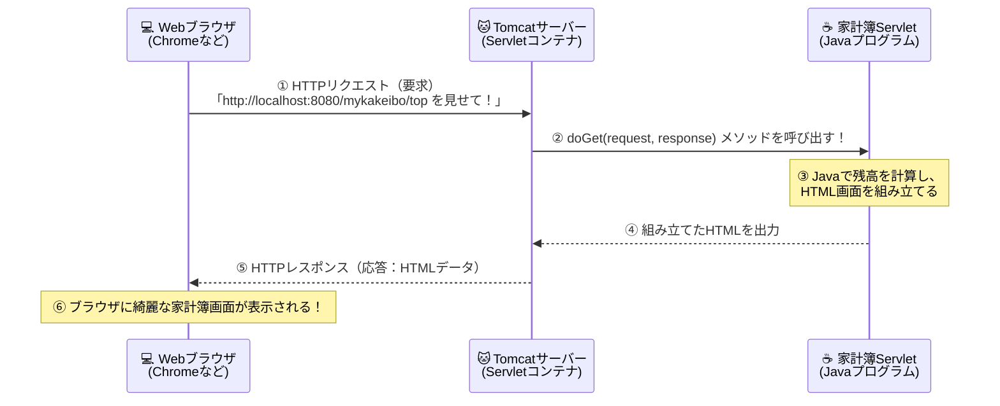

<div style="background: linear-gradient(135deg, #00838f 0%, #26c6da 100%); color: white; padding: 24px; border-radius: 12px; margin-bottom: 20px;">
  <div style="font-size: 0.9em; color: #e0f7fa; font-weight: bold;">Java実践カリキュラム ― 第6回 / 全10回 【後半：Webアプリ開発編スタート！】</div>
  <h1 style="margin: 6px 0 10px 0; color: #ffffff; border: none;">🌐 第6回：Webアプリケーションの仕組みとServletはじめの一歩</h1>
  <span style="background: rgba(255,255,255,0.2); padding: 4px 10px; border-radius: 20px; font-size: 0.85em; margin-right: 8px;">⏱ 目安時間：3.5〜4時間</span>
  <span style="background: rgba(255,255,255,0.2); padding: 4px 10px; border-radius: 20px; font-size: 0.85em;">📖 『やさしいJava』対応：Lesson 11（継承）・Lesson 14（入出力）のWeb実践発展</span>
</div>

---

## 🎯 0. 今日のゴールと時間配分

今日からいよいよ後半戦、**ブラウザで動く「家計簿Webアプリケーション（MyKakeibo）」**の開発がスタートします！
第1回〜第5回では「黒い画面（ターミナル）」に文字を出していましたが、第6回からは **Google Chrome や Edge などのWebブラウザ**に、色鮮やかな家計簿の画面を表示させます。
その主役となるのが、JavaでWebサーバー側の処理を書くための技術 **「Servlet（サーブレット）」** と、それを動かすサーバーソフト **「Apache Tomcat（トムキャット）」** です！

| 時間目安 | パート | 内容 |
| :--- | :--- | :--- |
| **0:00〜0:45** | <span style="color: #00838f; font-weight: bold;">Part 1：Webアプリが動く仕組み（HTTP）</span> | リクエストとレスポンス、なぜHTMLだけでは家計簿が作れないのか？ |
| **0:45〜1:35** | <span style="color: #1565c0; font-weight: bold;">Part 2：Tomcatの導入とディレクトリ構造</span> | Webサーバー（Tomcat）の役割と、アプリを配置するフォルダ構成 |
| **1:35〜2:20** | <span style="color: #2e7d32; font-weight: bold;">Part 3：初めてのServlet作成とコンパイル</span> | `HttpServlet` の継承（第4回の知識が活きる！）、`@WebServlet`、`doGet` |
| **2:20〜3:20** | <span style="color: #6a1b9a; font-weight: bold;">Part 4：実践演習（ブラウザで動く家計簿トップ画面）</span> | 3つの演習課題で「ブラウザに今日の収支速報を表示するServlet」を作る |
| **3:20〜3:50** | <span style="color: #c62828; font-weight: bold;">Part 5：第6回 確認テスト（10問）</span> | WebとServletの基本知識を10問のテストでチェック！ |

---

## 📡 Part 1：Webアプリケーションが動く仕組み

私たちが普段スマホやパソコンのブラウザでWebサイトを見るとき、裏側では**「ブラウザ（クライアント）」**と**「Webサーバー」**がキャッチボールをしています。



<div style="background: #e0f7fa; border-left: 5px solid #00838f; padding: 14px; border-radius: 6px; margin: 16px 0; color: #004d40;">
  <strong>💡 絶対に覚えたいWebの3大用語！</strong>
  <ul style="margin-bottom: 0; color: #1e293b;">
    <li><strong style="color: #00838f;">① HTTPリクエスト（Request：要求）</strong>：ブラウザからサーバーへ「このページを見せて！」「この金額を登録して！」とお願いすること。</li>
    <li><strong style="color: #1565c0;">② HTTPレスポンス（Response：応答）</strong>：サーバーからブラウザへ「はい、計算結果のHTML画面ですよ！」と返事を返すこと。</li>
    <li><strong style="color: #c62828;">③ Servlet（サーブレット）</strong>：Webサーバーの上で動き、リクエストを受け取ってJavaで計算を行い、レスポンス（HTML）を作って返す<strong>Javaのクラス</strong>のこと。</li>
  </ul>
</div>

---

## 🐱 Part 2：🐧 UbuntuでのTomcat 10セットアップとフォルダ構成

Servlet（JavaのWebプログラム）を動かすには、**「Apache Tomcat（トムキャット）」**という無料のWebアプリケーションサーバー（Servletコンテナ）を使います。
お使いの **Ubuntu 26.04 LTS** では、`apt` コマンドで公式の `tomcat10` パッケージを一発で導入できます！

### 2-1. UbuntuへのTomcat 10インストール手順
ターミナルで以下のコマンドを実行します。

```bash
sudo apt update
sudo apt install -y tomcat10
```

### 2-2. 🐧 Ubuntu特有の「権限（パーミッション）問題」をゼロにする賢い構成！
Ubuntuで `apt install tomcat10` すると、システム全体のTomcat（`/var/lib/tomcat10`）が自動で動き始めますが、ここにはUbuntu特有の落とし穴が2つあります。
1. システムのTomcatは `tomcat` という専用ユーザーで動くため、あなたのホームフォルダ（`/home/miyakawaharuki/...`）にあるファイルを読み書きしようとすると **「Permission denied（権限がありません）」** で弾かれてしまう。
2. 第9回でCSVファイルを保存するときにも、書き込み権限エラーが起きてしまう。

そこで、プロのUbuntu開発者がよく使う **「プログラム本体は `/usr/share/tomcat10` を使いつつ、設定とWebアプリは自分の学習フォルダ（`/home/miyakawaharuki/java学習`）の中で自分自身の権限で動かす（`CATALINA_BASE` 方式）」** を使いましょう！これなら `sudo` も権限エラーも一切不要で、エラーログもすぐ手元で見られます！

#### 以下のコマンドをターミナルに貼り付けて実行しましょう（初回1回だけでOK！）

```bash
# 1. システム側で勝手に動いているtomcat10サービスを止めておく（8080番ポートを空けるため）
sudo systemctl stop tomcat10
sudo systemctl disable tomcat10

# 2. 自分の学習フォルダの中に、自分専用のTomcat環境（tomcat_base）とアプリフォルダ（mykakeibo）を作る
mkdir -p /home/miyakawaharuki/java学習/tomcat_base/{conf,logs,temp,work,webapps}
cp -r /etc/tomcat10/* /home/miyakawaharuki/java学習/tomcat_base/conf/ 2>/dev/null || cp -r /usr/share/tomcat10/conf/* /home/miyakawaharuki/java学習/tomcat_base/conf/

# 3. Webアプリ「mykakeibo」の標準フォルダ構成を作る
mkdir -p /home/miyakawaharuki/java学習/tomcat_base/webapps/mykakeibo/WEB-INF/{classes,src}

# 4. 使いやすいように /home/miyakawaharuki/java学習/mykakeibo からショートカット（リンク）を張る
ln -sfn /home/miyakawaharuki/java学習/tomcat_base/webapps/mykakeibo /home/miyakawaharuki/java学習/mykakeibo
```

これで、あなたの作業フォルダ直下に **`mykakeibo/`** フォルダができました！

```text
/home/miyakawaharuki/java学習/mykakeibo/  ← 普段ここで作業します！
 ├── index.html                          ← 静的HTMLやJSPファイルを置く場所
 └── WEB-INF/                            ← 外から直接覗かれない安全な設定・プログラム置き場
      ├── classes/                       ← コンパイルした .class ファイルが入る場所！
      └── src/                           ← 私たちが書く .java ソースコード置き場
```

---

## ☕ Part 3：初めてのServletを作ってみよう！

ここで、**第4回で学んだ「クラスの継承（`extends`）」と「オーバーライド（`@Override`）」**が大活躍します！
Servletを作るときは、ゼロから通信プログラムを書くのではなく、あらかじめ用意されている **`HttpServlet` という親クラスを `extends`（継承）して、`doGet` メソッドをオーバーライドするだけ**で作れます！

### 3-1. 最初のServletコード（`HelloKakeiboServlet.java`）

`mykakeibo/WEB-INF/src/HelloKakeiboServlet.java` として以下のファイルを作成します。
（※Ubuntu 26.04 の Tomcat 10 ではパッケージ名が `jakarta.servlet.*` になります）。

```java
import java.io.IOException;
import java.io.PrintWriter;
import jakarta.servlet.ServletException;
import jakarta.servlet.annotation.WebServlet;
import jakarta.servlet.http.HttpServlet;
import jakarta.servlet.http.HttpServletRequest;
import jakarta.servlet.http.HttpServletResponse;

// ① URLの指定：ブラウザから「/hello」でアクセスされたらこのクラスを動かす！
@WebServlet("/hello")
public class HelloKakeiboServlet extends HttpServlet { // ② HttpServlet を継承する！

    // ③ ブラウザからアクセス（GETリクエスト）されたときに自動で呼ばれるメソッド
    @Override
    protected void doGet(HttpServletRequest request, HttpServletResponse response)
            throws ServletException, IOException {

        // ④ ブラウザに返す文字コードを UTF-8（日本語対応）の HTML に設定する
        response.setContentType("text/html; charset=UTF-8");

        // ⑤ ブラウザへHTML文字を送り出すためのペン（PrintWriter）を取り出す
        PrintWriter out = response.getWriter();

        // ⑥ Javaの中で計算してみる
        int income = 50000;
        int expense = 18500;
        int balance = income - expense;

        // ⑦ ブラウザに向かって HTML を出力する！
        out.println("<!DOCTYPE html>");
        out.println("<html><head><meta charset='UTF-8'><title>マイ家計簿</title></head>");
        out.println("<body style='font-family: sans-serif; padding: 20px;'>");
        out.println("<h1 style='color: #00838f;'>📒 マイ家計簿 Webアプリへようこそ！（on Ubuntu）</h1>");
        out.println("<p>現在の残高は <strong style='font-size: 1.5em; color: #d32f2f;'>" + balance + "円</strong> です。</p>");
        out.println("</body></html>");
    }
}
```

<div style="background: #fff8e1; border-left: 5px solid #ffb300; padding: 14px; border-radius: 6px; margin: 16px 0; color: #3e2723;">
  <strong>🔍 第1回〜第5回の知識と比べてみよう！</strong>
  <ul style="margin-bottom: 0;">
    <li>コンソールアプリでは <strong><code>main</code> メソッド</strong>が開始地点でしたが、Servletでは <strong><code>doGet</code>（または <code>doPost</code>）メソッド</strong>が開始地点になります！</li>
    <li>コンソールアプリでは <code>System.out.println(...)</code> で黒い画面に出力していましたが、Servletでは <code>response.getWriter()</code> で取得した <strong><code>out.println(...)</code></strong> を使って<strong>ブラウザへHTMLを出力</strong>します！</li>
  </ul>
</div>

### 3-2. 🐧 Ubuntu用：1コマンドで「全Servletコンパイル＆Tomcat再起動」する魔法のコマンド

毎回長い `javac -cp ...` コマンドを打つのは大変なので、以下のコマンドを実行して **`run_web.sh`** というUbuntu用の自動ビルド＆起動スクリプトを作っておきましょう！

```bash
cat << 'EOF' > /home/miyakawaharuki/java学習/run_web.sh
#!/bin/bash
set -e
BASE_DIR="/home/miyakawaharuki/java学習"
APP_DIR="$BASE_DIR/tomcat_base/webapps/mykakeibo"

echo "🔨 [1/2] Servlet・Javaクラスをコンパイルしています..."
find "$APP_DIR/WEB-INF/src" -name "*.java" > /tmp/java_sources.txt
if [ -s /tmp/java_sources.txt ]; then
    javac -cp "/usr/share/tomcat10/lib/*" \
          -d "$APP_DIR/WEB-INF/classes" \
          @/tmp/java_sources.txt
    echo "✅ コンパイル成功！"
fi

echo "🚀 [2/2] Tomcatサーバーを起動（再起動）しています..."
export CATALINA_HOME="/usr/share/tomcat10"
export CATALINA_BASE="$BASE_DIR/tomcat_base"
$CATALINA_HOME/bin/shutdown.sh 2>/dev/null || true
sleep 1
$CATALINA_HOME/bin/startup.sh

echo "=========================================================="
echo "🌐 起動完了！Ubuntuのブラウザで以下のURLを開いてください："
echo "   👉 http://localhost:8080/mykakeibo/hello"
echo "=========================================================="
EOF
chmod +x /home/miyakawaharuki/java学習/run_web.sh
```

これを作っておけば、第6回〜第10回で新しい `.java`（ServletやModelやDAO）を作るたびに、ターミナルで

```bash
./run_web.sh
```

と打つだけで、**すべてのJavaファイルのコンパイルとTomcatの再起動が自動で完了**します！
また、Ubuntuのターミナルから直接ブラウザを開きたいときは、以下のコマンドでも開けます：
```bash
xdg-open http://localhost:8080/mykakeibo/hello
```

---

## 🛠️ Part 4：実践演習（自分の手で書いてみよう！）

### 🟢 【演習1】家計簿アプリのトップページHTMLを作ろう（難易度：★☆☆）
**作成ファイル名：`mykakeibo/index.html`**

まずはWebアプリの玄関となる `index.html` を作成し、先ほど作った `/hello` サーブレットや、次の演習で作る `/summary` サーブレットへ移動できるリンク（`<a href="...">`）を設置してください。

<details>
<summary>👉 演習1の解答例を見る</summary>

```html
<!DOCTYPE html>
<html lang="ja">
<head>
    <meta charset="UTF-8">
    <title>MyKakeibo トップページ</title>
</head>
<body style="font-family: sans-serif; background-color: #f5f7fa; padding: 30px;">
    <div style="background: white; padding: 24px; border-radius: 12px; max-width: 600px; margin: auto; box-shadow: 0 2px 8px rgba(0,0,0,0.1);">
        <h1 style="color: #1976d2;">📒 MyKakeibo（マイ家計簿）Webアプリ</h1>
        <p>Java Servlet &amp; JSP で作る家計簿システムへようこそ！</p>
        <ul>
            <li><a href="hello">挨拶サーブレット（/hello）を開く</a></li>
            <li><a href="summary">今月の収支サマリー（/summary）を開く</a></li>
            <li><a href="omikuji">今日の金運おみくじ（/omikuji）を引く</a></li>
        </ul>
    </div>
</body>
</html>
```
</details>

---

### 🟡 【演習2】アクセスするたびに結果が変わる「金運おみくじServlet」（難易度：★★☆）
**作成ファイル名：`mykakeibo/WEB-INF/src/MoneyFortuneServlet.java`**

HTMLファイルとServletの最大の違いは、**「アクセスするたびにJavaが計算して、違う画面を動的に作れること」**です！
1. `@WebServlet("/omikuji")` を付けた `MoneyFortuneServlet` クラスを作成する。
2. `String[] fortunes = {"大吉：臨時収入の予感！", "中吉：ポイント還元でお得！", "小吉：無駄遣いに注意すれば黒字！"};` の配列を用意する。
3. 乱数 `(int)(Math.random() * 3)` で `0〜2` の番号をランダムに選び、選ばれた金運メッセージをHTMLの `<h2>` タグで表示する。

<details>
<summary>👉 演習2の解答例を見る</summary>

```java
import java.io.IOException;
import java.io.PrintWriter;
import jakarta.servlet.ServletException;
import jakarta.servlet.annotation.WebServlet;
import jakarta.servlet.http.HttpServlet;
import jakarta.servlet.http.HttpServletRequest;
import jakarta.servlet.http.HttpServletResponse;

@WebServlet("/omikuji")
public class MoneyFortuneServlet extends HttpServlet {
    @Override
    protected void doGet(HttpServletRequest request, HttpServletResponse response)
            throws ServletException, IOException {

        response.setContentType("text/html; charset=UTF-8");
        PrintWriter out = response.getWriter();

        String[] fortunes = {
            "🎉 大吉：思わぬ臨時収入やセールに出会える最高の日！",
            "✨ 中吉：コツコツ節約が実を結ぶ日！ポイント2倍デーをチェック！",
            "🍀 小吉：衝動買いに一呼吸おけば、今月もバッチリ黒字キープ！"
        };

        int index = (int)(Math.random() * fortunes.length); // 0, 1, 2 のどれかになる

        out.println("<!DOCTYPE html><html><head><meta charset='UTF-8'><title>金運おみくじ</title></head>");
        out.println("<body style='font-family: sans-serif; padding: 24px;'>");
        out.println("<h1>🔮 今日の家計＆金運おみくじ</h1>");
        out.println("<h2 style='color: #e65100; background: #fff3e0; padding: 16px; border-radius: 8px;'>" + fortunes[index] + "</h2>");
        out.println("<p><a href='omikuji'>🔄 もう一度引く</a> ｜ <a href='index.html'>🏠 トップへ戻る</a></p>");
        out.println("</body></html>");
    }
}
```
</details>

---

### 🔴 【演習3】ミニ家計簿 Web版 Ver.1（今日の日付と収支テーブルを表示するServlet）（難易度：★★★）
**作成ファイル名：`mykakeibo/WEB-INF/src/SummaryServlet.java`**

1. `@WebServlet("/summary")` を付けた `SummaryServlet` クラスを作成する。
2. `LocalDate.now()` で今日の日付を取得する。
3. 配列を使って3件の支出データ（品名と金額）を用意し、HTMLの `<table border="1">` タグを使ってブラウザに綺麗な表形式で出力する。
4. 表の下に合計金額を表示し、合計が `5000` 円以上なら赤文字で `「⚠️ 使いすぎ注意！」`、未満なら緑文字で `「✅ 順調です！」` と表示する。

<details>
<summary>👉 演習3の解答例を見る</summary>

```java
import java.io.IOException;
import java.io.PrintWriter;
import java.time.LocalDate;
import jakarta.servlet.ServletException;
import jakarta.servlet.annotation.WebServlet;
import jakarta.servlet.http.HttpServlet;
import jakarta.servlet.http.HttpServletRequest;
import jakarta.servlet.http.HttpServletResponse;

@WebServlet("/summary")
public class SummaryServlet extends HttpServlet {
    @Override
    protected void doGet(HttpServletRequest request, HttpServletResponse response)
            throws ServletException, IOException {

        response.setContentType("text/html; charset=UTF-8");
        PrintWriter out = response.getWriter();

        LocalDate today = LocalDate.now();
        String[] items = {"スーパー食材", "書籍（やさしいJava）", "カフェ代"};
        int[] prices = {1800, 2860, 520};

        int total = 0;

        out.println("<!DOCTYPE html><html><head><meta charset='UTF-8'><title>収支サマリー</title></head>");
        out.println("<body style='font-family: sans-serif; padding: 24px;'>");
        out.println("<h1>📊 今月の支出サマリー（基準日：" + today + "）</h1>");

        out.println("<table border='1' style='border-collapse: collapse; width: 400px;'>");
        out.println("<tr style='background: #e3f2fd;'><th>No.</th><th>品名</th><th>金額</th></tr>");

        for (int i = 0; i < items.length; i++) {
            out.println("<tr>");
            out.println("<td style='padding: 8px; text-align: center;'>" + (i + 1) + "</td>");
            out.println("<td style='padding: 8px;'>" + items[i] + "</td>");
            out.println("<td style='padding: 8px; text-align: right;'>" + prices[i] + "円</td>");
            out.println("</tr>");
            total += prices[i];
        }
        out.println("</table>");

        out.println("<h3>💰 支出合計：" + total + "円</h3>");
        if (total >= 5000) {
            out.println("<p style='color: #d32f2f; font-weight: bold;'>⚠️ 5,000円を超えています！使いすぎ注意！</p>");
        } else {
            out.println("<p style='color: #2e7d32; font-weight: bold;'>✅ 予算内で順調です！</p>");
        }
        out.println("<p><a href='index.html'>🏠 トップへ戻る</a></p>");
        out.println("</body></html>");
    }
}
```
</details>

---

## 📝 Part 5：第6回 確認テスト（全10問）

目標は **8問以上正解** です！

**第1問（リクエストとレスポンス）**
WebブラウザからWebサーバーに対して「このページを見せてください」と要求を送ることを何と呼びますか？
- **A.** HTTPレスポンス ／ **B.** HTTPリクエスト ／ **C.** コンパイル ／ **D.** デプロイ

**第2問（Servletを動かすサーバーソフト）**
Javaで作られたServletやJSPを動かすために使われる、代表的なWebアプリケーションサーバー（Servletコンテナ）の名前はどれですか？
- **A.** Apache Tomcat ／ **B.** Microsoft Excel ／ **C.** Scanner ／ **D.** ArrayList

**第3問（Servletの親クラス）**
Web用のServletクラスを作成するとき、`extends` キーワードを使って継承する親クラスはどれですか？
- **A.** `WebClass` ／ **B.** `HttpServlet` ／ **C.** `JavaServer` ／ **D.** `HtmlWriter`

**第4問（URLマッピングのアノテーション）**
ブラウザから `http://localhost:8080/アプリ名/kakeibo` というURLでアクセスされたときにそのServletが動くよう、クラス宣言の直前に書くアノテーション（目印）はどれですか？
- **A.** `@Override("/kakeibo")`
- **B.** `@Url("/kakeibo")`
- **C.** `@WebServlet("/kakeibo")`
- **D.** `@HttpGet("/kakeibo")`

**第5問（ブラウザでURLを開いたときに呼ばれるメソッド）**
ブラウザのアドレスバーにURLを入力したり、リンク（`<a href="...">`）をクリックしてアクセスしたとき、Servletの中で自動的に呼び出されるメソッドはどれですか？
- **A.** `main` メソッド ／ **B.** `doGet` メソッド ／ **C.** `start` メソッド ／ **D.** `run` メソッド

**第6問（doGetメソッドの2つの引数）**
`protected void doGet(HttpServletRequest request, HttpServletResponse response)` の2つの引数の役割として、正しい組み合わせはどれですか？
- **A.** `request`：ブラウザからの要求情報 ／ `response`：ブラウザへの応答送信用
- **B.** `request`：ブラウザへの応答送信用 ／ `response`：ブラウザからの要求情報
- **C.** 両方ともエラー処理用
- **D.** 両方ともファイル保存用

**第7問（文字化け防止とコンテンツタイプの設定）**
Servletから日本語を含むHTMLをブラウザに返すとき、文字化けを防ぐために `response.getWriter()` の**前**に実行するコードはどれですか？
- **A.** `response.setContentType("text/html; charset=UTF-8");`
- **B.** `System.out.println("UTF-8");`
- **C.** `request.close();`
- **D.** `response.setLanguage("Japanese");`

**第8問（ブラウザへHTMLを出力するストリーム）**
Servletの中で `PrintWriter out = response.getWriter();` を取得したあと、ブラウザへHTMLの文字列を出力するにはどう書きますか？
- **A.** `System.out.println("<h1>家計簿</h1>");`
- **B.** `out.println("<h1>家計簿</h1>");`
- **C.** `request.println("<h1>家計簿</h1>");`
- **D.** `scanner.println("<h1>家計簿</h1>");`

**第9問（Webアプリのディレクトリ構造）**
JavaのWebアプリケーションにおいて、コンパイル済みの `.class` ファイルを配置する決まりになっているフォルダはどこですか？
- **A.** `WEB-INF/classes` フォルダ
- **B.** `WEB-INF/html` フォルダ
- **C.** デスクトップ直下
- **D.** `public_html` フォルダ

**第10問（静的ページと動的ページの違い）**
普通の `.html` ファイル（静的ページ）と比べたときの、Servlet（動的ページ）の最大の特徴はどれですか？
- **A.** 文字の色を変えられない。
- **B.** アクセスされるたびにJavaプログラムが計算や判定を行い、状況や日時・データに応じた異なるHTML画面を生成して返せる。
- **C.** ブラウザで見ることができない。
- **D.** インターネットに繋がっていないと動かない。

<details>
<summary>✅ 確認テスト（全10問）の解答と解説を見る</summary>

| 問題 | 正解 | 解説 |
| :---: | :---: | :--- |
| **第1問** | <span style="color: #d32f2f; font-weight: bold;">B</span> | ブラウザからの要求が「HTTPリクエスト」、サーバーからの返事が「HTTPレスポンス」です。 |
| **第2問** | <span style="color: #d32f2f; font-weight: bold;">A</span> | Tomcatは世界中で最も広く使われているJava Webサーバー（Servletコンテナ）です。 |
| **第3問** | <span style="color: #d32f2f; font-weight: bold;">B</span> | `public class XxxServlet extends HttpServlet` のように `HttpServlet` を継承します。 |
| **第4問** | <span style="color: #d32f2f; font-weight: bold;">C</span> | `@WebServlet("/URLパターン")` で、どのURLとどのServletを結びつけるかを指定します。 |
| **第5問** | <span style="color: #d32f2f; font-weight: bold;">B</span> | 通常のページ閲覧（GETリクエスト）では `doGet` メソッドが呼び出されます。 |
| **第6問** | <span style="color: #d32f2f; font-weight: bold;">A</span> | `request` から送られてきたデータを取り出し、`response` を使ってブラウザへ画面を返します。 |
| **第7問** | <span style="color: #d32f2f; font-weight: bold;">A</span> | 「今から返すデータはHTML形式で、文字コードはUTF-8ですよ」とブラウザに伝える設定です。 |
| **第8問** | <span style="color: #d32f2f; font-weight: bold;">B</span> | `response.getWriter()` で取得した `out` に対して `out.println(...)` を呼ぶと、ブラウザにHTMLが送られます（`System.out.println` はサーバーの裏側のログに出るだけです）。 |
| **第9問** | <span style="color: #d32f2f; font-weight: bold;">A</span> | `WEB-INF/classes` の中にコンパイルした `.class` ファイルを置くと、Tomcatが自動的に読み込んでくれます。 |
| **第10問** | <span style="color: #d32f2f; font-weight: bold;">B</span> | Javaの計算結果やデータベース・ファイルの中身に応じて動的に画面を作れるのがServletの強みです。 |

</details>

---
<div style="display: flex; justify-content: space-between; margin-top: 20px;">
  <a href="./lesson05.md">👈 第5回へ戻る</a>
  <a href="./README.md">🏠 カリキュラム目次</a>
  <a href="./lesson07.md" style="font-weight: bold; color: #00838f;">👉 第7回：JSPとフォーム送信！ブラウザから家計簿データを送るへ進む</a>
</div>
