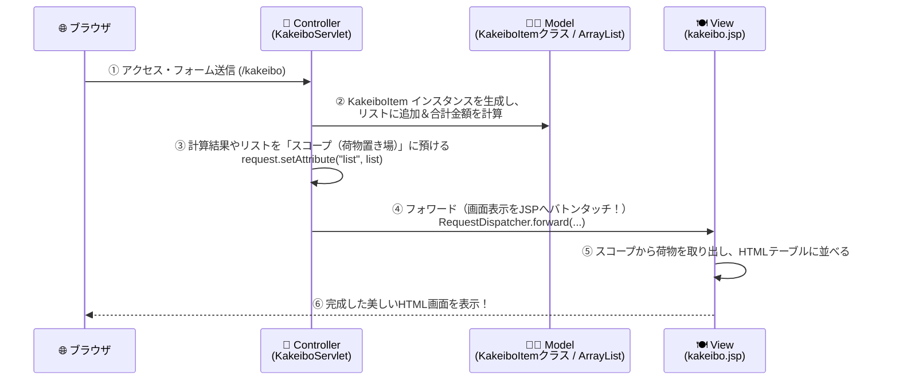

<div style="background: linear-gradient(135deg, #ad1457 0%, #ec407a 100%); color: white; padding: 24px; border-radius: 12px; margin-bottom: 20px;">
  <div style="font-size: 0.9em; color: #fce4ec; font-weight: bold;">Java実践カリキュラム ― 第8回 / 全10回 【Web設計の核心】</div>
  <h1 style="margin: 6px 0 10px 0; color: #ffffff; border: none;">🏗️ 第8回：MVCモデルとスコープ！一覧表示と合計金額の自動計算</h1>
  <span style="background: rgba(255,255,255,0.2); padding: 4px 10px; border-radius: 20px; font-size: 0.85em; margin-right: 8px;">⏱ 目安時間：3.5〜4時間</span>
  <span style="background: rgba(255,255,255,0.2); padding: 4px 10px; border-radius: 20px; font-size: 0.85em;">📖 『やさしいJava』対応：Lesson 8〜9（クラス設計）・Lesson 16（ArrayList）のWeb統合</span>
</div>

---

## 🎯 0. 今日のゴールと時間配分

第6回で「Servlet」、第7回で「JSP」を別々に使いましたが、実際のプロのWebアプリケーション開発では、**「第3回で作った家計簿データクラス（Model）」「画面を表示するJSP（View）」「全体の流れを指揮するServlet（Controller）」の3つを組み合わせて（役割分担して）**作ります。これを **MVCモデル** と呼びます！
今日で、ブラウザから何件でも収支データを追加でき、画面上のテーブルに一覧表示され、収入合計・支出合計・残高がリアルタイムに自動計算される「Web家計簿」が動き出します！

| 時間目安 | パート | 内容 |
| :--- | :--- | :--- |
| **0:00〜0:45** | <span style="color: #ad1457; font-weight: bold;">Part 1：MVCモデルとフォワードの仕組み</span> | Model・View・Controller の役割分担、ServletからJSPへバトンタッチする |
| **0:45〜1:35** | <span style="color: #1565c0; font-weight: bold;">Part 2：データを共有する「スコープ」</span> | リクエストスコープとセッションスコープ（`setAttribute` / `getAttribute`） |
| **1:35〜2:20** | <span style="color: #2e7d32; font-weight: bold;">Part 3：第3回のクラス × 第5回のArrayListをWebへ！</span> | `KakeiboItem` のリストをServletで作ってJSPの表（`<table>`）に出す |
| **2:20〜3:20** | <span style="color: #6a1b9a; font-weight: bold;">Part 4：実践演習（Web家計簿 MVC版の実装）</span> | ブラウザから連続追加・一覧表示・自動集計ができるWebアプリを構築する |
| **3:20〜3:50** | <span style="color: #c62828; font-weight: bold;">Part 5：第8回 確認テスト（10問）</span> | MVC・フォワード・スコープの知識を10問のテストでチェック！ |

---

## 🎭 Part 1：Webアプリの王道設計「MVCモデル」とは？

レストランのお仕事でイメージしてみましょう。
- 注文を聞いて全体を回す**「ホール係（Controller：Servlet）」**
- 厨房で料理データを作る**「シェフ・食材クラス（Model：通常のJavaクラス）」**
- お客さんに綺麗なお皿で盛り付けて見せる**「盛り付け皿（View：JSP）」**
この3つが自分の得意な仕事だけを担当する設計を **MVCモデル** と呼びます。



### 1-1. フォワード（Forward）とリダイレクト（Redirect）

Servletが処理を終えたあと、画面表示をJSPにバトンタッチする方法には2種類あります。

<div style="display: flex; gap: 16px; flex-wrap: wrap; margin: 16px 0;">
  <div style="flex: 1; min-width: 260px; background: #fce4ec; border-left: 5px solid #ad1457; padding: 14px; border-radius: 8px; color: #880e4f;">
    <h4 style="margin-top: 0; color: #ad1457;">🤝 ① フォワード（Forward：内部転送）</h4>
    <p style="margin-bottom: 0; color: #1e293b;">
      サーバーの内部で、ServletからJSPへ直接バトンを渡します。<br>
      <strong>書き方：</strong><br>
      <code>request.getRequestDispatcher("/WEB-INF/kakeibo.jsp").forward(request, response);</code><br>
      👉 <strong>一覧画面の表示（doGet）</strong>で使います！
    </p>
  </div>
  <div style="flex: 1; min-width: 260px; background: #e3f2fd; border-left: 5px solid #1976d2; padding: 14px; border-radius: 8px; color: #0d47a1;">
    <h4 style="margin-top: 0; color: #1565c0;">🔄 ② リダイレクト（Redirect：再アクセス指示）</h4>
    <p style="margin-bottom: 0; color: #1e293b;">
      データを登録したあと、ブラウザに「一覧表示のURLにもう一度アクセスし直してね！」と指示します（F5更新での二重登録を防ぐため）。<br>
      <strong>書き方：</strong><br>
      <code>response.sendRedirect("kakeibo");</code><br>
      👉 <strong>データ登録後（doPostの最後）</strong>で使います！
    </p>
  </div>
</div>

---

## 🧳 Part 2：ServletからJSPへデータを渡す「スコープ」

Servletで作った `ArrayList<KakeiboItem>` や合計金額 `total` を、バトンタッチ先のJSPへ渡すにはどうすればいいでしょうか？
そのために用意されている**「一時的な荷物置き場（共有メモリ領域）」**を **スコープ（Scope）** と呼びます。

### 2-1. 2つの代表的なスコープと使い方

| スコープの種類 | 荷物が残る期間（寿命） | 取得・利用方法 | 使いどころ |
| :--- | :--- | :--- | :--- |
| <span style="color: #ad1457; font-weight: bold;">① リクエストスコープ</span><br>(`HttpServletRequest`) | **1回のリクエスト〜JSP表示が終わるまで**（画面が出たら消える） | そのまま `request` を使う | 今回表示する画面だけに計算結果や一覧を渡したいとき |
| <span style="color: #1565c0; font-weight: bold;">② セッションスコープ</span><br>(`HttpSession`) | **ブラウザを閉じるまで、ページを移動してもずっと残る！** | `HttpSession session = request.getSession();` | 複数回の画面遷移にまたがって家計簿リストを保持したいとき |

#### 荷物を預けるときと、取り出すときの2つのメソッド
1. **預ける（Servlet側）**：`request.setAttribute("ラベル名", 預けるデータ);`
2. **取り出す（JSP側）**：`型 変数名 = (型) request.getAttribute("ラベル名");`
   - ※取り出すときは、中身の型（例：`(Integer)` や `(ArrayList<KakeiboItem>)`）に**キャスト**して取り出します！

---

## 🧩 Part 3：第3回のクラス × 第5回のArrayListをWebへ持ち込もう！

ここで感動の瞬間です！**第3回で作った `KakeiboItem` クラス**が、Webアプリの **Model（JavaBeans）** としてそのまま登場します。
パッケージ名を `model` にして、収支区分（`"収入"` / `"支出"`）も持たせた決定版の `KakeiboItem.java` を作りましょう！

### 3-1. Modelクラス：`mykakeibo/WEB-INF/src/model/KakeiboItem.java`

```java
package model; // modelパッケージに入れる

import java.io.Serializable;

public class KakeiboItem implements Serializable {
    private int id;          // 明細番号（ID）
    private String date;     // 日付（例: "2026-10-17"）
    private String type;     // 収支区分（"収入" または "支出"）
    private String category; // 費目（"食費", "交通費", "給料" など）
    private String name;     // 品名・メモ
    private int amount;      // 金額（円）

    // コンストラクタ
    public KakeiboItem(int id, String date, String type, String category, String name, int amount) {
        this.id = id;
        this.date = date;
        this.type = type;
        this.category = category;
        this.name = name;
        this.amount = amount;
    }

    // Getterメソッド群（JSPやServletから値を取り出すために使う）
    public int getId()          { return this.id; }
    public String getDate()     { return this.date; }
    public String getType()     { return this.type; }
    public String getCategory() { return this.category; }
    public String getName()     { return this.name; }
    public int getAmount()      { return this.amount; }

    // 収入かどうかを判定する便利メソッド
    public boolean isIncome() {
        return "収入".equals(this.type);
    }
}
```

---

## 🛠️ Part 4：実践演習（自分の手で書いてみよう！）

### 🟢 【演習1】Servletで計算した残高をリクエストスコープでJSPに渡そう（難易度：★☆☆）
**作成ファイル名：`mykakeibo/WEB-INF/src/ScopeTestServlet.java` と `mykakeibo/WEB-INF/scope_test.jsp`**

1. `ScopeTestServlet`（URL：`/scopeTest`）の `doGet` で、`int balance = 34500;` と `String message = "今月は順調です！";` を用意する。
2. `request.setAttribute("balance", balance);` と `request.setAttribute("msg", message);` でリクエストスコープに預け、`/WEB-INF/scope_test.jsp` へフォワードする。
3. `scope_test.jsp` で `request.getAttribute(...)` を使って2つの値を取り出し、画面に表示する。

<details>
<summary>👉 演習1の解答例を見る</summary>

**① `mykakeibo/WEB-INF/src/ScopeTestServlet.java`**
```java
import java.io.IOException;
import jakarta.servlet.ServletException;
import jakarta.servlet.annotation.WebServlet;
import jakarta.servlet.http.HttpServlet;
import jakarta.servlet.http.HttpServletRequest;
import jakarta.servlet.http.HttpServletResponse;

@WebServlet("/scopeTest")
public class ScopeTestServlet extends HttpServlet {
    @Override
    protected void doGet(HttpServletRequest request, HttpServletResponse response)
            throws ServletException, IOException {

        int balance = 34500;
        String message = "今月は順調に黒字キープ中です！";

        // リクエストスコープにデータを預ける
        request.setAttribute("balance", balance);
        request.setAttribute("msg", message);

        // JSPへフォワード（バトンタッチ）する
        request.getRequestDispatcher("/WEB-INF/scope_test.jsp").forward(request, response);
    }
}
```

**② `mykakeibo/WEB-INF/scope_test.jsp`**
```jsp
<%@ page contentType="text/html; charset=UTF-8" %>
<%
    // リクエストスコープからデータを取り出す
    Integer balance = (Integer) request.getAttribute("balance");
    String msg = (String) request.getAttribute("msg");
%>
<!DOCTYPE html>
<html>
<head><meta charset="UTF-8"><title>スコープ受け渡しテスト</title></head>
<body style="font-family: sans-serif; padding: 24px;">
    <h2>🤝 ServletからJSPへデータが届きました！</h2>
    <p>現在の残高：<strong style="font-size: 1.5em; color: #ad1457;"><%= balance %>円</strong></p>
    <p>メッセージ：<%= msg %></p>
</body>
</html>
```
</details>

---

### 🔴 【演習2＆3（統合実践）】ミニ家計簿 Web版 Ver.3（MVCモデル＆セッションスコープで連続登録・一覧集計）（難易度：★★★）
**作成ファイル名：**
1. `mykakeibo/WEB-INF/src/model/KakeiboItem.java`（Part 3で作成したもの）
2. `mykakeibo/WEB-INF/src/KakeiboMvcServlet.java`（Controller：URL `/mvcKakeibo`）
3. `mykakeibo/WEB-INF/kakeibo_mvc.jsp`（View：入力フォーム＆集計パネル＆明細一覧テーブル）

#### 仕様
- **セッションスコープ**に `ArrayList<KakeiboItem>` を保存し、ブラウザから何度でも新しい収支を追加できるようにする。
- **`doGet` メソッド**：リストの中の「収入合計(`totalIncome`)」「支出合計(`totalExpense`)」「現在の残高(`balance`)」を計算してリクエストスコープに入れ、`kakeibo_mvc.jsp` へフォワードする。
- **`doPost` メソッド**：フォームから送信された「日付・区分・費目・品名・金額」を受け取り、`new KakeiboItem(...)` を作ってリストに追加し、`response.sendRedirect("mvcKakeibo");` で一覧画面へリダイレクトする。

<details>
<summary>👉 演習2＆3の完全解答コードを見る</summary>

**① Controller：`mykakeibo/WEB-INF/src/KakeiboMvcServlet.java`**
```java
import java.io.IOException;
import java.util.ArrayList;
import jakarta.servlet.ServletException;
import jakarta.servlet.annotation.WebServlet;
import jakarta.servlet.http.HttpServlet;
import jakarta.servlet.http.HttpServletRequest;
import jakarta.servlet.http.HttpServletResponse;
import jakarta.servlet.http.HttpSession;
import model.KakeiboItem;

@WebServlet("/mvcKakeibo")
public class KakeiboMvcServlet extends HttpServlet {

    // 画面表示（GETリクエスト）
    @Override
    protected void doGet(HttpServletRequest request, HttpServletResponse response)
            throws ServletException, IOException {

        HttpSession session = request.getSession();
        @SuppressWarnings("unchecked")
        ArrayList<KakeiboItem> list = (ArrayList<KakeiboItem>) session.getAttribute("kakeiboList");

        // 初回アクセス時はリストがまだ無い（null）ので、新しく作ってサンプルデータを2件入れておく
        if (list == null) {
            list = new ArrayList<>();
            list.add(new KakeiboItem(1, "2026-10-01", "収入", "給料・お小遣い", "10月分お小遣い", 30000));
            list.add(new KakeiboItem(2, "2026-10-05", "支出", "食費", "スーパー買い出し", 2450));
            session.setAttribute("kakeiboList", list);
        }

        // 収入合計と支出合計を計算する
        int totalIncome = 0;
        int totalExpense = 0;
        for (KakeiboItem item : list) {
            if (item.isIncome()) {
                totalIncome += item.getAmount();
            } else {
                totalExpense += item.getAmount();
            }
        }
        int balance = totalIncome - totalExpense;

        // 計算結果をリクエストスコープに預ける
        request.setAttribute("totalIncome", totalIncome);
        request.setAttribute("totalExpense", totalExpense);
        request.setAttribute("balance", balance);

        // View（JSP）へフォワード！
        request.getRequestDispatcher("/WEB-INF/kakeibo_mvc.jsp").forward(request, response);
    }

    // 新規登録（POSTリクエスト）
    @Override
    protected void doPost(HttpServletRequest request, HttpServletResponse response)
            throws ServletException, IOException {

        request.setCharacterEncoding("UTF-8");

        HttpSession session = request.getSession();
        @SuppressWarnings("unchecked")
        ArrayList<KakeiboItem> list = (ArrayList<KakeiboItem>) session.getAttribute("kakeiboList");
        if (list == null) {
            list = new ArrayList<>();
            session.setAttribute("kakeiboList", list);
        }

        String date = request.getParameter("date");
        String type = request.getParameter("type");
        String category = request.getParameter("category");
        String name = request.getParameter("name");
        String amountStr = request.getParameter("amount");

        try {
            int amount = Integer.parseInt(amountStr);
            int nextId = list.size() + 1;
            // 新しい KakeiboItem インスタンスを作ってリストに追加！
            list.add(new KakeiboItem(nextId, date, type, category, name, amount));
        } catch (NumberFormatException e) {
            // 数値変換エラー時は無視して一覧へ戻る
        }

        // 登録後はリダイレクトで doGet を呼び出し直す（二重登録防止）
        response.sendRedirect("mvcKakeibo");
    }
}
```

**② View：`mykakeibo/WEB-INF/kakeibo_mvc.jsp`**
```jsp
<%@ page contentType="text/html; charset=UTF-8" %>
<%@ page import="java.util.ArrayList, java.time.LocalDate, model.KakeiboItem" %>
<%
    @SuppressWarnings("unchecked")
    ArrayList<KakeiboItem> list = (ArrayList<KakeiboItem>) session.getAttribute("kakeiboList");
    int totalIncome  = (Integer) request.getAttribute("totalIncome");
    int totalExpense = (Integer) request.getAttribute("totalExpense");
    int balance      = (Integer) request.getAttribute("balance");
%>
<!DOCTYPE html>
<html lang="ja">
<head>
    <meta charset="UTF-8">
    <title>MyKakeibo（MVC版）</title>
</head>
<body style="font-family: sans-serif; background: #f4f6f9; padding: 24px;">
    <div style="max-width: 800px; margin: auto; background: white; padding: 24px; border-radius: 12px; box-shadow: 0 2px 10px rgba(0,0,0,0.08);">
        <h1 style="color: #ad1457; margin-top: 0;">📒 MyKakeibo（MVCモデル版）</h1>

        <!-- ① 収支サマリーパネル -->
        <div style="display: flex; gap: 12px; margin-bottom: 24px;">
            <div style="flex: 1; background: #e8f5e9; padding: 14px; border-radius: 8px; text-align: center;">
                <div>🟢 収入合計</div>
                <strong style="font-size: 1.4em; color: #2e7d32;">＋<%= totalIncome %>円</strong>
            </div>
            <div style="flex: 1; background: #ffebee; padding: 14px; border-radius: 8px; text-align: center;">
                <div>🔴 支出合計</div>
                <strong style="font-size: 1.4em; color: #c62828;">－<%= totalExpense %>円</strong>
            </div>
            <div style="flex: 1; background: #e3f2fd; padding: 14px; border-radius: 8px; text-align: center;">
                <div>💰 現在の残高</div>
                <strong style="font-size: 1.5em; color: <%= balance >= 0 ? "#1565c0" : "#d32f2f" %>;"><%= balance %>円</strong>
            </div>
        </div>

        <!-- ② 新規登録フォーム -->
        <form action="mvcKakeibo" method="post" style="background: #fafafa; padding: 16px; border: 1px solid #ddd; border-radius: 8px; margin-bottom: 24px;">
            <h3 style="margin-top: 0;">✏️ 収支の追加</h3>
            日付：<input type="date" name="date" value="<%= LocalDate.now() %>" required>
            区分：<select name="type"><option value="支出">支出</option><option value="収入">収入</option></select>
            費目：<select name="category">
                <option value="食費">食費</option>
                <option value="交通費">交通費</option>
                <option value="日用品">日用品</option>
                <option value="交際費">交際費</option>
                <option value="給料・お小遣い">給料・お小遣い</option>
                <option value="その他">その他</option>
            </select><br><br>
            品名：<input type="text" name="name" placeholder="品名・内容" required>
            金額：<input type="number" name="amount" min="1" placeholder="金額" required> 円
            <button type="submit" style="background: #ad1457; color: white; border: none; padding: 6px 18px; border-radius: 4px; cursor: pointer;">追加する</button>
        </form>

        <!-- ③ 明細一覧テーブル -->
        <h3>📋 登録明細一覧（全 <%= list.size() %> 件）</h3>
        <table border="1" style="width: 100%; border-collapse: collapse; border-color: #ddd;">
            <tr style="background: #fce4ec;">
                <th style="padding: 8px;">ID</th>
                <th style="padding: 8px;">日付</th>
                <th style="padding: 8px;">区分</th>
                <th style="padding: 8px;">費目</th>
                <th style="padding: 8px;">品名</th>
                <th style="padding: 8px;">金額</th>
            </tr>
            <% for (KakeiboItem item : list) { %>
                <tr>
                    <td style="padding: 8px; text-align: center;"><%= item.getId() %></td>
                    <td style="padding: 8px; text-align: center;"><%= item.getDate() %></td>
                    <td style="padding: 8px; text-align: center; color: <%= item.isIncome() ? "#2e7d32" : "#c62828" %>; font-weight: bold;">
                        <%= item.getType() %>
                    </td>
                    <td style="padding: 8px;"><%= item.getCategory() %></td>
                    <td style="padding: 8px;"><%= item.getName() %></td>
                    <td style="padding: 8px; text-align: right; font-weight: bold;">
                        <%= item.isIncome() ? "+" : "-" %><%= item.getAmount() %>円
                    </td>
                </tr>
            <% } %>
        </table>
    </div>
</body>
</html>
```
</details>

---

## 📝 Part 5：第8回 確認テスト（全10問）

目標は **8問以上正解** です！

**第1問（MVCモデルの役割分担）**
MVCモデルにおいて、**M（Model）・V（View）・C（Controller）**にそれぞれ対応するJavaの要素の組み合わせとして、最も適切なものはどれですか？
- **A.** M：データや計算ロジックを持つJavaクラス ／ V：画面表示を行うJSP ／ C：要求を受け取り全体を制御するServlet
- **B.** M：JSP ／ V：Servlet ／ C：HTML
- **C.** M：ブラウザ ／ V：Tomcat ／ C：キーボード
- **D.** すべてJSPだけで行う

**第2問（フォワードの役割）**
Servletで処理を行ったあと、サーバー内部でJSPに処理を転送（バトンタッチ）して画面を表示させる仕組みを何と呼びますか？
- **A.** コンパイル ／ **B.** フォワード（Forward） ／ **C.** ループ ／ **D.** キャスト

**第3問（フォワードのコード）**
Servletから `/WEB-INF/list.jsp` へフォワードする正しいコードはどれですか？
- **A.** `request.getRequestDispatcher("/WEB-INF/list.jsp").forward(request, response);`
- **B.** `System.out.println("/WEB-INF/list.jsp");`
- **C.** `request.getParameter("/WEB-INF/list.jsp");`
- **D.** `new ListJsp();`

**第4問（リダイレクトの役割）**
`POST` でデータを登録したあとに `response.sendRedirect("mvcKakeibo");` でリダイレクトを行う主な理由は何ですか？
- **A.** 文字の色を赤くするため
- **B.** ブラウザの更新（再読み込み）ボタンを押したときに、同じデータが二重に登録されてしまうのを防ぐため
- **C.** プログラムを終了させるため
- **D.** コンパイルをやり直すため

**第5問（スコープへのデータの保存）**
リクエストスコープやセッションスコープに `"balance"` という名前で変数 `balance` のデータを保存（格納）するメソッドはどれですか？
- **A.** `setAttribute("balance", balance)`
- **B.** `getAttribute("balance")`
- **C.** `getParameter("balance")`
- **D.** `add("balance", balance)`

**第6問（スコープからのデータの取得）**
JSP側で、リクエストスコープに保存された `"balance"` という名前のデータを取り出すメソッドはどれですか？
- **A.** `request.setAttribute("balance")`
- **B.** `request.getAttribute("balance")`
- **C.** `request.remove("balance")`
- **D.** `request.close("balance")`

**第7問（リクエストスコープとセッションスコープの寿命の違い）**
「1回のリクエスト〜レスポンスが終わると消えるスコープ」と、「ページを移動してもブラウザを閉じるまでデータが残るスコープ」の正しい組み合わせはどれですか？
- **A.** 1回で消える：リクエストスコープ ／ ページ移動しても残る：セッションスコープ
- **B.** 1回で消える：セッションスコープ ／ ページ移動しても残る：リクエストスコープ
- **C.** どちらも永久に消えない
- **D.** どちらも1回で消える

**第8問（セッションオブジェクトの取得）**
Servletの中で `HttpSession`（セッションスコープ）を取得する正しいコードはどれですか？
- **A.** `HttpSession session = new HttpSession();`
- **B.** `HttpSession session = request.getSession();`
- **C.** `HttpSession session = response.getWriter();`
- **D.** `HttpSession session = System.getSession();`

**第9問（JSPを `WEB-INF` フォルダの中に置く理由）**
MVCモデルでは、JSPファイルを `/WEB-INF/kakeibo_mvc.jsp` のように `WEB-INF` フォルダの中に置くことがよくあります。その理由は何ですか？
- **A.** ブラウザからJSPのURLを直接開かれるのを防ぎ、必ずController（Servlet）を経由してアクセスさせるため
- **B.** ファイルサイズを小さくするため
- **C.** 日本語を使えるようにするため
- **D.** 画像を表示させないため

**第10問（JSPで自作クラスを使うための宣言）**
JSPファイルの中で、`model` パッケージにある `KakeiboItem` クラスや `java.util.ArrayList` を使うために、JSPの先頭に書くインポート宣言はどれですか？
- **A.** `<%@ page import="java.util.ArrayList, model.KakeiboItem" %>`
- **B.** `<script src="KakeiboItem.java"></script>`
- **C.** `<link rel="import" href="KakeiboItem">`
- **D.** `include KakeiboItem;`

<details>
<summary>✅ 確認テスト（全10問）の解答と解説を見る</summary>

| 問題 | 正解 | 解説 |
| :---: | :---: | :--- |
| **第1問** | <span style="color: #d32f2f; font-weight: bold;">A</span> | Model（Javaクラス）、View（JSP）、Controller（Servlet）の3つに分けることで、整理された保守しやすいWebアプリになります。 |
| **第2問** | <span style="color: #d32f2f; font-weight: bold;">B</span> | ServletからJSPへ内部で処理を引き継ぐことを**フォワード**と呼びます。 |
| **第3問** | <span style="color: #d32f2f; font-weight: bold;">A</span> | `RequestDispatcher` を取得して `.forward(request, response)` を呼び出します。 |
| **第4問** | <span style="color: #d32f2f; font-weight: bold;">B</span> | POSTのあとにリダイレクト（GETへ誘導）するパターンは **PRG（Post-Redirect-Get）パターン** と呼ばれ、二重送信防止の定番テクニックです。 |
| **第5問** | <span style="color: #d32f2f; font-weight: bold;">A</span> | `setAttribute("名前", 値)` でスコープにデータを預けます。 |
| **第6問** | <span style="color: #d32f2f; font-weight: bold;">B</span> | `getAttribute("名前")` で取り出します（取り出す際は元の型へキャストします）。 |
| **第7問** | <span style="color: #d32f2f; font-weight: bold;">A</span> | 1画面限りのデータはリクエストスコープ、複数リクエストにまたがるデータはセッションスコープを使います。 |
| **第8問** | <span style="color: #d32f2f; font-weight: bold;">B</span> | `request.getSession()` で現在のユーザーのセッションを取得できます。 |
| **第9問** | <span style="color: #d32f2f; font-weight: bold;">A</span> | `WEB-INF` 内のファイルはブラウザから直接URL指定で開けないため、Servletで計算準備をしてからフォワードする安全な設計になります。 |
| **第10問** | <span style="color: #d32f2f; font-weight: bold;">A</span> | JSPでは `<%@ page import="..." %>` を使ってJavaクラスをインポートします。 |

</details>

---
<div style="display: flex; justify-content: space-between; margin-top: 20px;">
  <a href="./lesson07.md">👈 第7回へ戻る</a>
  <a href="./README.md">🏠 カリキュラム目次</a>
  <a href="./lesson09.md" style="font-weight: bold; color: #ad1457;">👉 第9回：データの永続化！アプリを再起動しても消えない家計簿へ進む</a>
</div>
