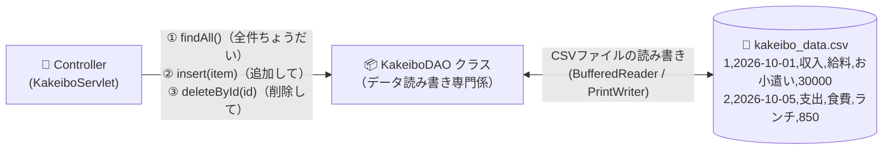

<div style="background: linear-gradient(135deg, #4e342e 0%, #8d6e63 100%); color: white; padding: 24px; border-radius: 12px; margin-bottom: 20px;">
  <div style="font-size: 0.9em; color: #efebe9; font-weight: bold;">Java実践カリキュラム ― 第9回 / 全10回</div>
  <h1 style="margin: 6px 0 10px 0; color: #ffffff; border: none;">💾 第9回：データの永続化！アプリを再起動しても消えない家計簿へ</h1>
  <span style="background: rgba(255,255,255,0.2); padding: 4px 10px; border-radius: 20px; font-size: 0.85em; margin-right: 8px;">⏱ 目安時間：3.5〜4時間</span>
  <span style="background: rgba(255,255,255,0.2); padding: 4px 10px; border-radius: 20px; font-size: 0.85em;">📖 『やさしいJava』対応：Lesson 13（例外）・Lesson 14（入出力）のWeb実践</span>
</div>

---

## 🎯 0. 今日のゴールと時間配分

第8回で作ったMVC版の家計簿は、ブラウザから何件でも収支を登録できましたが、**「ブラウザを閉じたり、Tomcatサーバーを再起動したりすると、登録したデータが消えてしまう」**という弱点がありました（セッションスコープはメモリ上の一時保管庫だからです）。
第9回では、データをサーバー内のファイル（またはデータベース）に書き込んで永久に保存する**「データの永続化（えいぞくか）」**と、データの読み書き専門クラスである **「DAO（Data Access Object）パターン」**、さらに**「指定した明細の削除機能」**を実装します！

| 時間目安 | パート | 内容 |
| :--- | :--- | :--- |
| **0:00〜0:45** | <span style="color: #4e342e; font-weight: bold;">Part 1：データの永続化とDAOパターンとは？</span> | メモリ（揮発性）とストレージ（永続化）の違い、なぜDAOクラスを分けるのか |
| **0:45〜1:35** | <span style="color: #1565c0; font-weight: bold;">Part 2：`KakeiboDAO` クラスの実装</span> | 第5回のファイル入出力（`BufferedReader`/`PrintWriter`）でCSV読み書きを作る |
| **1:35〜2:20** | <span style="color: #c62828; font-weight: bold;">Part 3：間違えた明細を消す「削除機能」の実装</span> | 隠しパラメータ（`<input type="hidden">`）でIDを送り、指定データを削除する |
| **2:20〜3:20** | <span style="color: #2e7d32; font-weight: bold;">Part 4：実践演習（自動保存＆削除つき家計簿）</span> | DAOを組み込み、再起動してもデータが消えないWeb家計簿を作る |
| **3:20〜3:50** | <span style="color: #6a1b9a; font-weight: bold;">Part 5：第9回 確認テスト（10問）</span> | 永続化・DAO・削除処理の知識を10問のテストでチェック！ |

---

## 🏛️ Part 1：データの永続化と「DAOパターン」

プログラムが動いている間だけメモリ（RAM）にあるデータを、ハードディスクやSSD上のファイル・データベースに保存して、**電源を切っても消えないようにすること**を **永続化（Persistence）** と呼びます。

そして、Servletの中に直接ファイルの読み書きコードをごちゃ混ぜに書くのではなく、**「データの保存・読み込み・削除だけを専門に担当するクラス」**を独立させて作ります。これを **DAO（Data Access Object：ダオ）** と呼びます！



<div style="background: #efebe9; border-left: 5px solid #4e342e; padding: 14px; border-radius: 6px; margin: 16px 0; color: #3e2723;">
  <strong>💡 なぜ DAO クラスに分けるの？（メリット）</strong><br>
  Servletは「<code>dao.findAll()</code>（全部取ってきて）」「<code>dao.insert(item)</code>（これを保存して）」と頼むだけで済みます。将来、保存先をCSVファイルから本格的なデータベース（MySQLやPostgreSQL）に変えたくなったときも、<strong><code>KakeiboDAO</code> の中身を書き換えるだけで、ServletやJSPは1行も直さずに済む</strong>のです！
</div>

---

## 🛠️ Part 2：`KakeiboDAO` クラスを作ろう！

ここで、**第4回で学んだ `split(",")` / `Integer.parseInt`** と、**第5回で学んだ `ArrayList` / ファイル入出力（`BufferedReader` / `PrintWriter`）** がすべて合体します！

### 2-1. `mykakeibo/WEB-INF/src/dao/KakeiboDAO.java`

```java
package dao;

import java.io.BufferedReader;
import java.io.File;
import java.io.FileInputStream;
import java.io.FileOutputStream;
import java.io.IOException;
import java.io.InputStreamReader;
import java.io.OutputStreamWriter;
import java.io.PrintWriter;
import java.nio.charset.StandardCharsets;
import java.util.ArrayList;
import model.KakeiboItem;

public class KakeiboDAO {
    private final String filePath;

    // コンストラクタで保存先ファイルのパスを受け取る
    public KakeiboDAO(String filePath) {
        this.filePath = filePath;
        initFileIfNeeded();
    }

    // ファイルがまだ存在しない場合は、初期サンプルデータを作って保存する
    private void initFileIfNeeded() {
        File file = new File(this.filePath);
        if (!file.exists()) {
            ArrayList<KakeiboItem> initialList = new ArrayList<>();
            initialList.add(new KakeiboItem(1, "2026-10-01", "収入", "給料・お小遣い", "今月のお小遣い", 40000));
            initialList.add(new KakeiboItem(2, "2026-10-03", "支出", "食費", "スーパー買い出し", 3200));
            initialList.add(new KakeiboItem(3, "2026-10-07", "支出", "書籍・勉強", "やさしいJava", 2860));
            saveAll(initialList);
        }
    }

    // ① 全件取得メソッド：CSVファイルを1行ずつ読んで ArrayList<KakeiboItem> を返す
    public ArrayList<KakeiboItem> findAll() {
        ArrayList<KakeiboItem> list = new ArrayList<>();
        File file = new File(this.filePath);
        if (!file.exists()) {
            return list;
        }

        try (BufferedReader br = new BufferedReader(
                new InputStreamReader(new FileInputStream(file), StandardCharsets.UTF_8))) {
            String line;
            while ((line = br.readLine()) != null) {
                if (line.trim().isEmpty()) continue;
                String[] parts = line.split(","); // カンマで6項目に分割！
                if (parts.length >= 6) {
                    int id          = Integer.parseInt(parts[0]);
                    String date     = parts[1];
                    String type     = parts[2];
                    String category = parts[3];
                    String name     = parts[4];
                    int amount      = Integer.parseInt(parts[5]);
                    list.add(new KakeiboItem(id, date, type, category, name, amount));
                }
            }
        } catch (IOException | NumberFormatException e) {
            e.printStackTrace();
        }
        return list;
    }

    // ② リスト全体をCSVファイルに上書き保存するメソッド
    public void saveAll(ArrayList<KakeiboItem> list) {
        try (PrintWriter pw = new PrintWriter(
                new OutputStreamWriter(new FileOutputStream(this.filePath), StandardCharsets.UTF_8))) {
            for (KakeiboItem item : list) {
                pw.println(item.getId() + "," +
                           item.getDate() + "," +
                           item.getType() + "," +
                           item.getCategory() + "," +
                           item.getName() + "," +
                           item.getAmount());
            }
        } catch (IOException e) {
            e.printStackTrace();
        }
    }

    // ③ 新しい明細を1件追加して保存するメソッド
    public void insert(String date, String type, String category, String name, int amount) {
        ArrayList<KakeiboItem> list = findAll();
        // 新しいIDを決める（既存の最大ID + 1）
        int maxId = 0;
        for (KakeiboItem item : list) {
            if (item.getId() > maxId) {
                maxId = item.getId();
            }
        }
        // 品名にカンマ「,」が含まれているとCSVがずれるため「、」に置き換えておく安全対策
        String safeName = name.replace(",", "、");
        list.add(new KakeiboItem(maxId + 1, date, type, category, safeName, amount));
        saveAll(list); // ファイルへ保存！
    }

    // ④ 指定されたIDの明細を削除して保存するメソッド
    public void deleteById(int targetId) {
        ArrayList<KakeiboItem> list = findAll();
        for (int i = 0; i < list.size(); i++) {
            if (list.get(i).getId() == targetId) {
                list.remove(i); // 見つけたらリストから削除！
                break;
            }
        }
        saveAll(list); // ファイルへ保存！
    }
}
```

---

## 🗑️ Part 3：特定の明細を消す「削除ボタン」の仕組み

一覧表の各行の右端に**「🗑️ 削除」ボタン**を置き、押された行のデータだけを削除するにはどうすればよいでしょうか？
その秘密兵器が、HTMLフォームの **`<input type="hidden" name="..." value="...">`（隠しフィールド）** です！

```html
<!-- 各行の「削除」ボタンの中に、目に見えない hidden タグで「アクション種別」と「その行のID」を仕込んでおく！ -->
<form action="kakeibo" method="post" style="margin: 0;">
    <input type="hidden" name="action" value="delete">
    <input type="hidden" name="id" value="<%= item.getId() %>">
    <button type="submit">🗑️ 削除</button>
</form>
```

画面上には「🗑️ 削除」ボタンしか見えませんが、ボタンを押すと裏側で `action=delete` と `id=3` がServletの `doPost` へ送られます！
Servlet側では `String action = request.getParameter("action");` を調べ、
- `"add"` なら `dao.insert(...)`（新規追加）
- `"delete"` なら `dao.deleteById(id)`（指定IDの削除）
と振り分けることができます！

---

## 🛠️ Part 4：実践演習（自分の手で書いてみよう！）

### 🟢 【演習1】`KakeiboItem` に `toCsvString()` メソッドを追加しよう（難易度：★☆☆）
**対象ファイル：`mykakeibo/WEB-INF/src/model/KakeiboItem.java`**

`KakeiboItem` クラスの中に、自分のフィールドをカンマ区切りにした文字列（例：`"1,2026-10-01,収入,給料,お小遣い,40000"`）を返すメソッド `public String toCsvString()` を追加してください。

<details>
<summary>👉 演習1の解答例を見る</summary>

```java
    // KakeiboItem クラス内に以下を追加します
    public String toCsvString() {
        return this.id + "," + this.date + "," + this.type + "," +
               this.category + "," + this.name + "," + this.amount;
    }
```
これを作っておくと、`KakeiboDAO` の `saveAll` メソッドの中が `pw.println(item.toCsvString());` のたった1行で書けるようになります！
</details>

---

### 🟡 【演習2】全件一括クリア（初期化）メソッド `clearAll()` をDAOに追加しよう（難易度：★★☆）
**対象ファイル：`mykakeibo/WEB-INF/src/dao/KakeiboDAO.java`**

`KakeiboDAO` クラスの中に、空っぽの `new ArrayList<KakeiboItem>()` を `saveAll(...)` に渡すことで、保存されているデータを全件消去できる `public void clearAll()` メソッドを作成してください。

<details>
<summary>👉 演習2の解答例を見る</summary>

```java
    // KakeiboDAO クラス内に以下を追加します
    public void clearAll() {
        ArrayList<KakeiboItem> emptyList = new ArrayList<>();
        saveAll(emptyList);
    }
```
</details>

---

### 🔴 【演習3】ミニ家計簿 Web版 Ver.4（DAOによる自動ファイル保存＆行別削除ボタンの実装）（難易度：★★★）
**作成ファイル名：**
1. `mykakeibo/WEB-INF/src/KakeiboPersistServlet.java`（URL：`/persistKakeibo`）
2. `mykakeibo/WEB-INF/kakeibo_persist.jsp`

`KakeiboDAO` を使って、`WEB-INF/kakeibo_data.csv` にデータを自動保存・読み込みし、各行の「🗑️ 削除」ボタンを押すとその明細がファイルからも削除されるWebアプリを作成してください！

<details>
<summary>👉 演習3の解答例を見る</summary>

**① `mykakeibo/WEB-INF/src/KakeiboPersistServlet.java`**
```java
import java.io.IOException;
import java.util.ArrayList;
import jakarta.servlet.ServletException;
import jakarta.servlet.annotation.WebServlet;
import jakarta.servlet.http.HttpServlet;
import jakarta.servlet.http.HttpServletRequest;
import jakarta.servlet.http.HttpServletResponse;
import dao.KakeiboDAO;
import model.KakeiboItem;

@WebServlet("/persistKakeibo")
public class KakeiboPersistServlet extends HttpServlet {

    // DAOを取得するヘルパーメソッド（保存先は WEB-INF/kakeibo_data.csv）
    private KakeiboDAO getDao() {
        String realPath = getServletContext().getRealPath("/WEB-INF/kakeibo_data.csv");
        return new KakeiboDAO(realPath);
    }

    @Override
    protected void doGet(HttpServletRequest request, HttpServletResponse response)
            throws ServletException, IOException {

        KakeiboDAO dao = getDao();
        ArrayList<KakeiboItem> list = dao.findAll();

        int totalIncome = 0;
        int totalExpense = 0;
        for (KakeiboItem item : list) {
            if (item.isIncome()) {
                totalIncome += item.getAmount();
            } else {
                totalExpense += item.getAmount();
            }
        }

        request.setAttribute("list", list);
        request.setAttribute("totalIncome", totalIncome);
        request.setAttribute("totalExpense", totalExpense);
        request.setAttribute("balance", totalIncome - totalExpense);

        request.getRequestDispatcher("/WEB-INF/kakeibo_persist.jsp").forward(request, response);
    }

    @Override
    protected void doPost(HttpServletRequest request, HttpServletResponse response)
            throws ServletException, IOException {

        request.setCharacterEncoding("UTF-8");
        KakeiboDAO dao = getDao();
        String action = request.getParameter("action");

        if ("delete".equals(action)) {
            // 削除ボタンが押された場合
            int id = Integer.parseInt(request.getParameter("id"));
            dao.deleteById(id);
        } else {
            // 新規追加フォームが送信された場合
            String date = request.getParameter("date");
            String type = request.getParameter("type");
            String category = request.getParameter("category");
            String name = request.getParameter("name");
            int amount = Integer.parseInt(request.getParameter("amount"));
            dao.insert(date, type, category, name, amount);
        }

        response.sendRedirect("persistKakeibo");
    }
}
```

**② `mykakeibo/WEB-INF/kakeibo_persist.jsp`（テーブル部分の抜粋）**
```jsp
<%@ page contentType="text/html; charset=UTF-8" %>
<%@ page import="java.util.ArrayList, java.time.LocalDate, model.KakeiboItem" %>
<%
    @SuppressWarnings("unchecked")
    ArrayList<KakeiboItem> list = (ArrayList<KakeiboItem>) request.getAttribute("list");
    int totalIncome  = (Integer) request.getAttribute("totalIncome");
    int totalExpense = (Integer) request.getAttribute("totalExpense");
    int balance      = (Integer) request.getAttribute("balance");
%>
<!DOCTYPE html>
<html lang="ja">
<head><meta charset="UTF-8"><title>MyKakeibo（永続化版）</title></head>
<body style="font-family: sans-serif; background: #f4f6f9; padding: 24px;">
    <div style="max-width: 850px; margin: auto; background: white; padding: 24px; border-radius: 12px;">
        <h1 style="color: #4e342e; margin-top: 0;">💾 MyKakeibo（自動ファイル保存＆削除対応版）</h1>
        <p><strong>収入：＋<%= totalIncome %>円 ／ 支出：－<%= totalExpense %>円 ／ 残高：<%= balance %>円</strong></p>

        <form action="persistKakeibo" method="post" style="background: #efebe9; padding: 14px; border-radius: 8px; margin-bottom: 20px;">
            <input type="hidden" name="action" value="add">
            日付：<input type="date" name="date" value="<%= LocalDate.now() %>" required>
            区分：<select name="type"><option value="支出">支出</option><option value="収入">収入</option></select>
            費目：<input type="text" name="category" value="食費" style="width: 80px;" required>
            品名：<input type="text" name="name" placeholder="品名" required>
            金額：<input type="number" name="amount" min="1" required> 円
            <button type="submit">💾 保存する</button>
        </form>

        <table border="1" style="width: 100%; border-collapse: collapse;">
            <tr style="background: #d7ccc8;">
                <th>ID</th><th>日付</th><th>区分</th><th>費目</th><th>品名</th><th>金額</th><th>操作</th>
            </tr>
            <% for (KakeiboItem item : list) { %>
                <tr>
                    <td style="text-align: center; padding: 6px;"><%= item.getId() %></td>
                    <td style="text-align: center; padding: 6px;"><%= item.getDate() %></td>
                    <td style="text-align: center; padding: 6px;"><%= item.getType() %></td>
                    <td style="padding: 6px;"><%= item.getCategory() %></td>
                    <td style="padding: 6px;"><%= item.getName() %></td>
                    <td style="text-align: right; padding: 6px;"><%= item.getAmount() %>円</td>
                    <td style="text-align: center; padding: 6px;">
                        <form action="persistKakeibo" method="post" style="margin: 0;">
                            <input type="hidden" name="action" value="delete">
                            <input type="hidden" name="id" value="<%= item.getId() %>">
                            <button type="submit" style="color: #c62828; cursor: pointer;">🗑️ 削除</button>
                        </form>
                    </td>
                </tr>
            <% } %>
        </table>
    </div>
</body>
</html>
```
</details>

---

## 📝 Part 5：第9回 確認テスト（全10問）

目標は **8問以上正解** です！

**第1問（データの永続化の意味）**
「データの永続化（Persistence）」とはどういうことですか？
- **A.** プログラムやサーバーを再起動してもデータが消えないように、ファイルやデータベースなどの記憶装置に保存すること
- **B.** 無限ループでプログラムを止めないこと
- **C.** 変数の名前を長くすること
- **D.** 画面の色を固定すること

**第2問（DAOパターンの役割）**
Webアプリケーション設計における **DAO（Data Access Object）** の役割として、最も適切なものはどれですか？
- **A.** HTMLのデザイン（CSS）を整える専門クラス
- **B.** ファイルやデータベースに対するデータの取得・保存・削除などの読み書き処理を専門に担当するクラス
- **C.** ブラウザそのものを動かすクラス
- **D.** エラー画面だけを表示するクラス

**第3問（CSVファイルの形式）**
CSV（Comma-Separated Values）ファイルでは、1行の中の複数のデータ項目（日付、費目、品名、金額など）を何の記号で区切って保存しますか？
- **A.** カンマ `,` ／ **B.** ピリオド `.` ／ **C.** クエスチョン `?` ／ **D.** アットマーク `@`

**第4問（CSVの1行を配列に分解するメソッド）**
ファイルから読み込んだ1行の文字列 `String line = "1,食費,弁当,600";` をカンマで区切って配列 `String[] parts` に分割するメソッドはどれですか？
- **A.** `line.cut(",")` ／ **B.** `line.split(",")` ／ **C.** `line.divide(",")` ／ **D.** `line.parse(",")`

**第5問（ファイルの1行読み込みメソッド）**
`BufferedReader br` を使って、テキストファイルから1行分の文字列を読み込むメソッドはどれですか？
- **A.** `br.readLine()` ／ **B.** `br.nextInt()` ／ **C.** `br.getParameter()` ／ **D.** `br.println()`

**第6問（ファイルの終端判定）**
`BufferedReader` の `readLine()` メソッドでファイルを最後まで読み切ったとき（もう次の行がないとき）、戻り値として何が返ってきますか？
- **A.** `"END"` という文字列 ／ **B.** `null` ／ **C.** `0` ／ **D.** `"false"`

**第7問（画面に見せずに値を送信するHTMLタグ）**
削除ボタンを押したときに、画面上には表示させずに「どのIDの行を削除するか（`id=5`）」というデータをフォームから一緒に送信したい場合、使うべき `<input>` の `type` はどれですか？
- **A.** `type="text"` ／ **B.** `type="password"` ／ **C.** `type="hidden"` ／ **D.** `type="submit"`

**第8問（1つのServletで追加と削除を振り分ける工夫）**
1つのServletの `doPost` メソッドで「新規追加」と「削除」の両方を受け付けたい場合、どのような方法で処理を分岐させるのが一般的ですか？
- **A.** フォームに `<input type="hidden" name="action" value="delete">` のような識別用パラメータを入れて送り、Servlet側で `request.getParameter("action")` の値を調べて分岐する
- **B.** 乱数でランダムに分岐する
- **C.** 分岐することは絶対にできない
- **D.** `main` メソッドを2つ作る

**第9問（CSV保存時のカンマ対策）**
ユーザーが品名に `"パン,牛乳"` のようにカンマ `,` を入力してしまうと、CSV読み込み時の `split(",")` で項目数がずれてしまいます。これを防ぐ簡単な対策はどれですか？
- **A.** `name.replace(",", "、")` のように、保存前に半角カンマを読点や別の文字に置き換える
- **B.** 品名を入力させないようにする
- **C.** 金額を0円にする
- **D.** 対策する方法はない

**第10問（try-with-resources構文）**
`try (BufferedReader br = new BufferedReader(...)) { ... }` のように、`try` の直後の丸カッコ `()` の中でファイルストリームを開くと、どんなメリットがありますか？
- **A.** ファイルの読み込み速度が100倍になる
- **B.** `try` ブロックを抜けたときに、自動的に `br.close()`（ファイルを閉じる処理）が呼ばれて閉じ忘れを防げる
- **C.** コンパイルが不要になる
- **D.** 例外が絶対に発生しなくなる

<details>
<summary>✅ 確認テスト（全10問）の解答と解説を見る</summary>

| 問題 | 正解 | 解説 |
| :---: | :---: | :--- |
| **第1問** | <span style="color: #d32f2f; font-weight: bold;">A</span> | データをファイルやDBに保存して、プログラム終了後も失われないようにすることを永続化と呼びます。 |
| **第2問** | <span style="color: #d32f2f; font-weight: bold;">B</span> | データアクセス処理をDAOにまとめることで、Servletのコードがシンプルで読みやすくなります。 |
| **第3問** | <span style="color: #d32f2f; font-weight: bold;">A</span> | Comma-Separated Values の名前の通り、カンマ `,` で値を区切ります。 |
| **第4問** | <span style="color: #d32f2f; font-weight: bold;">B</span> | `split(",")` でカンマの位置ごとに分割された配列を取得できます。 |
| **第5問** | <span style="color: #d32f2f; font-weight: bold;">A</span> | `readLine()` で1行ずつ文字列として読み込みます（『やさしいJava』Lesson 14参照）。 |
| **第6問** | <span style="color: #d32f2f; font-weight: bold;">B</span> | ファイルの終端に達すると `null` が返るため、`while ((line = br.readLine()) != null)` が定番のイディオムです。 |
| **第7問** | <span style="color: #d32f2f; font-weight: bold;">C</span> | `type="hidden"` はブラウザ画面には表示されず、送信時に `name` と `value` のペアをサーバーへ送ることができます。 |
| **第8問** | <span style="color: #d32f2f; font-weight: bold;">A</span> | `action` パラメータ（`"add"` や `"delete"`）を使って処理を切り替えるのはWeb開発の定番手法です。 |
| **第9問** | <span style="color: #d32f2f; font-weight: bold;">A</span> | `String.replace("置換前", "置換後")` を使うことで、区切り文字の衝突を簡単に防げます。 |
| **第10問** | <span style="color: #d32f2f; font-weight: bold;">B</span> | Java 7以降で導入された `try-with-resources` 文で、ファイルの閉じ忘れ（リソースリーク）を確実に防げます。 |

</details>

---
<div style="display: flex; justify-content: space-between; margin-top: 20px;">
  <a href="./lesson08.md">👈 第8回へ戻る</a>
  <a href="./README.md">🏠 カリキュラム目次</a>
  <a href="./lesson10.md" style="font-weight: bold; color: #4e342e;">👉 第10回：【最終回】家計簿Webアプリの完成！検索・デザイン・総仕上げへ進む</a>
</div>
