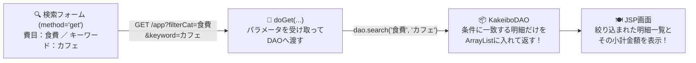

<div style="background: linear-gradient(135deg, #0d47a1 0%, #1976d2 50%, #ffb300 100%); color: white; padding: 26px; border-radius: 12px; margin-bottom: 20px; box-shadow: 0 4px 14px rgba(0,0,0,0.2);">
  <div style="font-size: 0.9em; color: #fff8e1; font-weight: bold;">Java実践カリキュラム ― 第10回 / 全10回 【🎉 最終回・Webアプリ完成！】</div>
  <h1 style="margin: 6px 0 10px 0; color: #ffffff; border: none;">👑 第10回：家計簿Webアプリの完成！検索機能・デザイン調整・総仕上げ</h1>
  <span style="background: rgba(255,255,255,0.25); padding: 4px 10px; border-radius: 20px; font-size: 0.85em; margin-right: 8px;">⏱ 目安時間：3.5〜4時間</span>
  <span style="background: rgba(255,255,255,0.25); padding: 4px 10px; border-radius: 20px; font-size: 0.85em;">📖 『やさしいJava』全章 ＆ Webアプリケーション総合完成</span>
</div>

---

## 🎯 0. 今日のゴールと時間配分

ついに最終回（第10回）に到達しました！ここまでコツコツ積み上げてきたあなたは、すでにJavaの変数・制御文・クラスとメソッド・継承・コレクション・ファイル入出力、そしてServlet / JSP / MVCモデル・DAOパターンまでを一通り経験しています。
最終回では、家計簿アプリを本物の製品レベルに仕上げるために、以下の3つの機能を追加して **「MyKakeibo（マイ家計簿）完成版」** をリリースします！

1. <span style="color: #1565c0; font-weight: bold;">費目別・キーワードによる絞り込み検索機能（フィルタリング）</span>
2. <span style="color: #d32f2f; font-weight: bold;">入力チェック（バリデーション）とエラーメッセージ表示・XSSセキュリティ対策</span>
3. <span style="color: #2e7d32; font-weight: bold;">モダンなCSSデザインと「支出率メーター（プログレスバー）」の搭載</span>

| 時間目安 | パート | 内容 |
| :--- | :--- | :--- |
| **0:00〜0:45** | <span style="color: #1565c0; font-weight: bold;">Part 1：費目別・キーワード検索（GETパラメータ）</span> | `doGet` で検索条件を受け取り、条件に合う明細だけを抽出するメソッド |
| **0:45〜1:30** | <span style="color: #d32f2f; font-weight: bold;">Part 2：入力チェック（バリデーション）とセキュリティ</span> | 空文字・マイナス金額の防止、HTMLエスケープ（XSS対策） |
| **1:30〜2:30** | <span style="color: #2e7d32; font-weight: bold;">Part 3：完成版「MyKakeibo」の全コード実装</span> | Model・DAO・Servlet・JSPの4ファイルを組み上げて完成させる！ |
| **2:30〜3:20** | <span style="color: #6a1b9a; font-weight: bold;">Part 4：総合実践演習（オリジナル機能の追加）</span> | 完成した家計簿アプリに自分だけの機能を追加する3つの演習課題 |
| **3:20〜3:55** | <span style="color: #e65100; font-weight: bold;">Part 5：最終回 総合確認テスト（全10問）</span> | 全10回の学習の集大成となる卒業テスト！ |

---

## 🔍 Part 1：費目別・キーワード検索機能の仕組み

家計簿のデータが増えてくると、「今月『食費』にいくら使ったかな？」「『カフェ』という文字が入る出費だけ見たいな」と思いますよね。
検索機能は、データを変更しない「閲覧」なので **`GET` リクエスト（`<form method="get">`）** で作り、`KakeiboDAO` に **`search(String category, String keyword)`** メソッドを追加して実現します！



### DAOに追加する `search` メソッドのロジック（第2回の `if` 文＋第4回の `.contains()` が大活躍！）
```java
    // 費目(filterCategory) と キーワード(keyword) で絞り込んだリストを返すメソッド
    public ArrayList<KakeiboItem> search(String filterCategory, String keyword) {
        ArrayList<KakeiboItem> allList = findAll();
        ArrayList<KakeiboItem> result = new ArrayList<>();

        for (KakeiboItem item : allList) {
            // ① 費目フィルターのチェック（空欄または「すべて」なら全員合格、指定があれば一致するか確認）
            boolean categoryMatch = (filterCategory == null || filterCategory.isEmpty() || "すべて".equals(filterCategory))
                                    || item.getCategory().equals(filterCategory);

            // ② キーワードのチェック（空欄なら全員合格、指定があれば品名か費目に含まれるか確認）
            boolean keywordMatch = (keyword == null || keyword.trim().isEmpty())
                                   || item.getName().contains(keyword.trim())
                                   || item.getCategory().contains(keyword.trim());

            // 両方の条件を満たした明細だけを result リストに追加！
            if (categoryMatch && keywordMatch) {
                result.add(item);
            }
        }
        return result;
    }
```

---

## 🛡️ Part 2：入力チェック（バリデーション）とWebセキュリティ

Webアプリを公開するときに欠かせないのが **バリデーション（入力値の妥当性チェック）** と **XSS（クロスサイト・スクリプティング）対策** です。

<div style="background: #ffebee; border-left: 5px solid #d32f2f; padding: 14px; border-radius: 6px; margin: 16px 0; color: #b71c1c;">
  <strong>🔒 プロのWeb開発で必須の2つの防御壁！</strong>
  <ol style="margin-bottom: 0; color: #1e293b;">
    <li><strong>入力値チェック（Validation）</strong>：品名が空っぽ（<code>name.trim().isEmpty()</code>）だったり、金額が <code>0</code> 円以下だったりした場合は登録せず、<code>"品名と1円以上の金額を正しく入力してください"</code> と案内を出します。</li>
    <li><strong>HTMLエスケープ（XSS対策）</strong>：もし品名に <code>&lt;script&gt;...&lt;/script&gt;</code> のような悪意のあるHTMLタグが入力された場合、そのまま画面に出すとブラウザがプログラムとして実行してしまいます。<code>&lt;</code> を <code>&amp;lt;</code>、<code>&gt;</code> を <code>&amp;gt;</code> に変換して無害化するメソッド（<code>escapeHtml</code>）を用意しましょう！</li>
  </ol>
</div>

---

## 👑 Part 3：完成版「MyKakeibo」の全ソースコード

それでは、全10回の集大成となる完成版コードを組み立てましょう！以下の3つのファイルを作成・更新すると、すべての機能（収支登録・自動保存・削除・費目＆キーワード検索・支出率メーター）を備えたWebアプリが完成します。

### ① Modelクラス：`mykakeibo/WEB-INF/src/model/KakeiboItem.java`
（※第8回・第9回で作ったものに、HTMLエスケープ用の安全表示メソッドを追加した完成版です）

```java
package model;

import java.io.Serializable;

public class KakeiboItem implements Serializable {
    private int id;
    private String date;
    private String type;     // "収入" または "支出"
    private String category;
    private String name;
    private int amount;

    public KakeiboItem(int id, String date, String type, String category, String name, int amount) {
        this.id = id;
        this.date = date;
        this.type = type;
        this.category = category;
        this.name = name;
        this.amount = amount;
    }

    public int getId()          { return this.id; }
    public String getDate()     { return this.date; }
    public String getType()     { return this.type; }
    public String getCategory() { return this.category; }
    public String getName()     { return this.name; }
    public int getAmount()      { return this.amount; }

    public boolean isIncome() {
        return "収入".equals(this.type);
    }

    // XSS対策：特殊文字を安全なHTML文字に変換して返すメソッド
    public String getSafeName() {
        if (this.name == null) return "";
        return this.name.replace("&", "&amp;")
                        .replace("<", "&lt;")
                        .replace(">", "&gt;")
                        .replace("\"", "&quot;");
    }

    public String toCsvString() {
        return this.id + "," + this.date + "," + this.type + "," +
               this.category + "," + this.name + "," + this.amount;
    }
}
```

### ② Controller（Servlet）：`mykakeibo/WEB-INF/src/MyKakeiboAppServlet.java`
（※`dao/KakeiboDAO.java` に Part 1 の `search` メソッドを追加した状態で使います）

```java
import java.io.IOException;
import java.util.ArrayList;
import jakarta.servlet.ServletException;
import jakarta.servlet.annotation.WebServlet;
import jakarta.servlet.http.HttpServlet;
import jakarta.servlet.http.HttpServletRequest;
import jakarta.servlet.http.HttpServletResponse;
import dao.KakeiboDAO;
import model.KakeiboItem;

@WebServlet("/app")
public class MyKakeiboAppServlet extends HttpServlet {

    private KakeiboDAO getDao() {
        String realPath = getServletContext().getRealPath("/WEB-INF/kakeibo_final.csv");
        return new KakeiboDAO(realPath);
    }

    @Override
    protected void doGet(HttpServletRequest request, HttpServletResponse response)
            throws ServletException, IOException {

        request.setCharacterEncoding("UTF-8");
        KakeiboDAO dao = getDao();

        // 1. 全体の収支・残高・支出率を計算する
        ArrayList<KakeiboItem> allList = dao.findAll();
        int totalIncome = 0;
        int totalExpense = 0;
        for (KakeiboItem item : allList) {
            if (item.isIncome()) {
                totalIncome += item.getAmount();
            } else {
                totalExpense += item.getAmount();
            }
        }
        int balance = totalIncome - totalExpense;
        int expenseRate = (totalIncome > 0) ? (int)((double) totalExpense * 100 / totalIncome) : 0;

        // 2. 検索条件（費目・キーワード）を受け取って絞り込みリストを取得する
        String filterCat = request.getParameter("filterCat");
        String keyword   = request.getParameter("keyword");
        if (filterCat == null) filterCat = "すべて";
        if (keyword == null)   keyword = "";

        ArrayList<KakeiboItem> filteredList = dao.search(filterCat, keyword);

        // 絞り込み結果の小計も計算する
        int filteredTotal = 0;
        for (KakeiboItem item : filteredList) {
            filteredTotal += item.isIncome() ? item.getAmount() : -item.getAmount();
        }

        // 3. リクエストスコープに預けてJSPへフォワード！
        request.setAttribute("list", filteredList);
        request.setAttribute("totalIncome", totalIncome);
        request.setAttribute("totalExpense", totalExpense);
        request.setAttribute("balance", balance);
        request.setAttribute("expenseRate", expenseRate);
        request.setAttribute("filterCat", filterCat);
        request.setAttribute("keyword", keyword);
        request.setAttribute("filteredTotal", filteredTotal);

        request.getRequestDispatcher("/WEB-INF/app.jsp").forward(request, response);
    }

    @Override
    protected void doPost(HttpServletRequest request, HttpServletResponse response)
            throws ServletException, IOException {

        request.setCharacterEncoding("UTF-8");
        KakeiboDAO dao = getDao();
        String action = request.getParameter("action");

        if ("delete".equals(action)) {
            try {
                int id = Integer.parseInt(request.getParameter("id"));
                dao.deleteById(id);
            } catch (NumberFormatException ignored) {}
        } else if ("add".equals(action)) {
            String date     = request.getParameter("date");
            String type     = request.getParameter("type");
            String category = request.getParameter("category");
            String name     = request.getParameter("name");
            String amountStr = request.getParameter("amount");

            // バリデーション（入力チェック）
            try {
                int amount = Integer.parseInt(amountStr);
                if (name != null && !name.trim().isEmpty() && amount > 0) {
                    dao.insert(date, type, category, name.trim(), amount);
                }
            } catch (NumberFormatException ignored) {}
        }

        response.sendRedirect("app");
    }
}
```

### ③ View（完成版画面）：`mykakeibo/WEB-INF/app.jsp`

```jsp
<%@ page contentType="text/html; charset=UTF-8" %>
<%@ page import="java.util.ArrayList, java.time.LocalDate, model.KakeiboItem" %>
<%
    @SuppressWarnings("unchecked")
    ArrayList<KakeiboItem> list = (ArrayList<KakeiboItem>) request.getAttribute("list");
    int totalIncome   = (Integer) request.getAttribute("totalIncome");
    int totalExpense  = (Integer) request.getAttribute("totalExpense");
    int balance       = (Integer) request.getAttribute("balance");
    int expenseRate   = (Integer) request.getAttribute("expenseRate");
    String filterCat  = (String) request.getAttribute("filterCat");
    String keyword    = (String) request.getAttribute("keyword");
    int filteredTotal = (Integer) request.getAttribute("filteredTotal");
    int barWidth      = Math.min(100, Math.max(0, expenseRate));
%>
<!DOCTYPE html>
<html lang="ja">
<head>
    <meta charset="UTF-8">
    <title>MyKakeibo - 完成版家計簿アプリ</title>
    <style>
        body { font-family: 'Segoe UI', sans-serif; background: #f0f4f8; margin: 0; padding: 24px; color: #1e293b; }
        .container { max-width: 900px; margin: auto; background: white; padding: 28px; border-radius: 16px; box-shadow: 0 4px 20px rgba(0,0,0,0.08); }
        .header { background: linear-gradient(135deg, #0d47a1, #1976d2); color: white; padding: 20px 24px; border-radius: 12px; margin-bottom: 24px; }
        .cards { display: flex; gap: 16px; margin-bottom: 20px; }
        .card { flex: 1; padding: 16px; border-radius: 10px; text-align: center; }
        .bar-bg { background: #e2e8f0; height: 22px; border-radius: 11px; overflow: hidden; margin-bottom: 24px; }
        .bar-fill { height: 100%; background: <%= expenseRate > 80 ? "#ef4444" : "#3b82f6" %>; width: <%= barWidth %>%; transition: width 0.3s; }
        table { width: 100%; border-collapse: collapse; margin-top: 12px; }
        th, td { padding: 10px 12px; border-bottom: 1px solid #e2e8f0; }
        th { background: #f8fafc; text-align: left; color: #475569; }
        .badge-in { background: #dcfce7; color: #166534; padding: 3px 10px; border-radius: 12px; font-weight: bold; font-size: 0.85em; }
        .badge-out { background: #fee2e2; color: #991b1b; padding: 3px 10px; border-radius: 12px; font-weight: bold; font-size: 0.85em; }
    </style>
</head>
<body>
<div class="container">
    <div class="header">
        <h1 style="margin: 0; font-size: 1.6em;">👑 MyKakeibo ― マイ家計簿ダッシュボード</h1>
        <p style="margin: 4px 0 0 0; opacity: 0.9;">Java Servlet &amp; JSP 全10回カリキュラム完成版</p>
    </div>

    <!-- ① 収支サマリーカード -->
    <div class="cards">
        <div class="card" style="background: #f0fdf4; border: 1px solid #bbf7d0;">
            <div>🟢 今月の収入合計</div>
            <div style="font-size: 1.5em; font-weight: bold; color: #15803d;">＋<%= String.format("%,d", totalIncome) %>円</div>
        </div>
        <div class="card" style="background: #fef2f2; border: 1px solid #fecaca;">
            <div>🔴 今月の支出合計</div>
            <div style="font-size: 1.5em; font-weight: bold; color: #b91c1c;">－<%= String.format("%,d", totalExpense) %>円</div>
        </div>
        <div class="card" style="background: #eff6ff; border: 1px solid #bfdbfe;">
            <div>💰 現在の残高（支出率 <%= expenseRate %>%）</div>
            <div style="font-size: 1.6em; font-weight: bold; color: <%= balance >= 0 ? "#1d4ed8" : "#dc2626" %>;">
                <%= String.format("%,d", balance) %>円
            </div>
        </div>
    </div>

    <!-- 支出率メーター -->
    <div class="bar-bg" title="収入に対する支出の割合：<%= expenseRate %>%">
        <div class="bar-fill"></div>
    </div>

    <!-- ② 新規登録フォーム -->
    <form action="app" method="post" style="background: #f8fafc; padding: 18px; border-radius: 10px; border: 1px solid #e2e8f0; margin-bottom: 24px;">
        <h3 style="margin-top: 0; color: #0f172a;">✏️ 新しい収支を記録する</h3>
        <input type="hidden" name="action" value="add">
        日付：<input type="date" name="date" value="<%= LocalDate.now() %>" required>
        区分：<select name="type"><option value="支出">🔴 支出</option><option value="収入">🟢 収入</option></select>
        費目：<select name="category">
            <option value="食費">食費</option>
            <option value="交通費">交通費</option>
            <option value="日用品">日用品</option>
            <option value="交際費">交際費</option>
            <option value="書籍・勉強">書籍・勉強</option>
            <option value="給料・お小遣い">給料・お小遣い</option>
            <option value="その他">その他</option>
        </select>
        品名：<input type="text" name="name" placeholder="例：カフェランチ" required>
        金額：<input type="number" name="amount" min="1" placeholder="金額" style="width: 100px;" required> 円
        <button type="submit" style="background: #1976d2; color: white; border: none; padding: 8px 18px; border-radius: 6px; font-weight: bold; cursor: pointer;">＋ 追加登録</button>
    </form>

    <!-- ③ 絞り込み・キーワード検索フォーム（GET送信） -->
    <form action="app" method="get" style="display: flex; gap: 12px; align-items: center; background: #fffbeb; padding: 14px; border-radius: 10px; border: 1px solid #fde68a; margin-bottom: 16px;">
        <strong>🔍 明細の絞り込み：</strong>
        費目：
        <select name="filterCat">
            <% String[] cats = {"すべて", "食費", "交通費", "日用品", "交際費", "書籍・勉強", "給料・お小遣い", "その他"};
               for (String c : cats) { %>
                <option value="<%= c %>" <%= c.equals(filterCat) ? "selected" : "" %>><%= c %></option>
            <% } %>
        </select>
        キーワード：<input type="text" name="keyword" value="<%= keyword %>" placeholder="品名や費目で検索">
        <button type="submit" style="background: #d97706; color: white; border: none; padding: 6px 14px; border-radius: 6px; cursor: pointer;">検索</button>
        <a href="app" style="color: #64748b; text-decoration: none; font-size: 0.9em;">🔄 リセット</a>
    </form>

    <!-- ④ 明細一覧テーブル -->
    <div style="display: flex; justify-content: space-between; align-items: center;">
        <h3 style="margin: 0;">📋 収支明細一覧（該当：<%= list.size() %>件）</h3>
        <div>表示中の収支差額：<strong><%= String.format("%,d", filteredTotal) %>円</strong></div>
    </div>

    <table>
        <tr>
            <th>日付</th><th>区分</th><th>費目</th><th>品名・メモ</th><th style="text-align: right;">金額</th><th style="text-align: center;">削除</th>
        </tr>
        <% for (KakeiboItem item : list) { %>
            <tr>
                <td><%= item.getDate() %></td>
                <td><span class="<%= item.isIncome() ? "badge-in" : "badge-out" %>"><%= item.getType() %></span></td>
                <td><%= item.getCategory() %></td>
                <td><%= item.getSafeName() %></td>
                <td style="text-align: right; font-weight: bold; color: <%= item.isIncome() ? "#15803d" : "#b91c1c" %>;">
                    <%= item.isIncome() ? "+" : "-" %><%= String.format("%,d", item.getAmount()) %>円
                </td>
                <td style="text-align: center;">
                    <form action="app" method="post" style="margin: 0;">
                        <input type="hidden" name="action" value="delete">
                        <input type="hidden" name="id" value="<%= item.getId() %>">
                        <button type="submit" style="background: none; border: 1px solid #fca5a5; color: #dc2626; border-radius: 4px; padding: 3px 8px; cursor: pointer;">🗑️</button>
                    </form>
                </td>
            </tr>
        <% } %>
    </table>
</div>
</body>
</html>
```

---

## 🛠️ Part 4：総合実践演習（自分の手で機能を拡張してみよう！）

完成した「MyKakeibo」を自分の手で改造して、オリジナル機能を追加する3つのチャレンジ課題です！

### 🟢 【演習1】新しい費目「医療費」「美容・衣服」を追加しよう（難易度：★☆☆）
`app.jsp` の新規登録フォームの `<select name="category">` と、検索フォームの配列 `String[] cats` の両方に、**`"医療費"`** と **`"美容・衣服"`** を追加して選択・検索できるようにしてください。

### 🟡 【演習2】高額出費（5,000円以上）に「🔥高額」バッジを表示しよう（難易度：★★☆）
`KakeiboItem` クラスに `public boolean isHighExpense()` メソッド（支出 かつ 金額が5000円以上なら `true` を返す）を追加し、`app.jsp` の品名の横に `<% if (item.isHighExpense()) { %> <span style="color:red;">🔥高額</span> <% } %>` と表示されるように改造してください。

<details>
<summary>👉 演習2の解答コードを見る</summary>

```java
// KakeiboItem.java に追加するメソッド
public boolean isHighExpense() {
    return !isIncome() && this.amount >= 5000;
}
```
```jsp
<!-- app.jsp の品名表示欄（<td>）の中を変更 -->
<td>
    <%= item.getSafeName() %>
    <% if (item.isHighExpense()) { %>
        <span style="background: #fef08a; color: #b91c1c; font-size: 0.8em; padding: 2px 6px; border-radius: 4px; font-weight: bold;">🔥高額</span>
    <% } %>
</td>
```
</details>

---

### 🔴 【演習3】「今月の目標貯金額」に対する達成判定メッセージを表示しよう（難易度：★★★）
`MyKakeiboAppServlet` の `doGet` で目標貯金額 `int targetSaving = 20000;` を設定し、現在の残高 `balance` が `targetSaving` 以上なら `「🎉 目標貯金額（20,000円）を達成圏内です！」`、未満なら `「💪 目標貯金額まであと 〇〇円 です！」` というアドバイス文字列を作ってJSPの上部に表示してください。

<details>
<summary>👉 演習3の解答コードを見る</summary>

```java
// MyKakeiboAppServlet.java の doGet 内に追加
int targetSaving = 20000;
String savingAdvice;
if (balance >= targetSaving) {
    savingAdvice = "🎉 素晴らしい！今月の目標貯金額（" + targetSaving + "円）をクリアしています！";
} else {
    int shortage = targetSaving - balance;
    savingAdvice = "💪 目標貯金額（" + targetSaving + "円）まで、あと " + shortage + "円 です！";
}
request.setAttribute("savingAdvice", savingAdvice);
```
```jsp
<!-- app.jsp のサマリーカードの下あたりに追加 -->
<p style="background: #e0f2fe; color: #0369a1; padding: 12px; border-radius: 8px; font-weight: bold;">
    <%= request.getAttribute("savingAdvice") %>
</p>
```
</details>

---

## 📝 Part 5：最終回 総合確認テスト（全10問）

全10回のカリキュラムの卒業テストです！**8問以上正解**で卒業合格です！

**第1問（検索フォームのHTTPメソッド）**
家計簿の「費目での絞り込み」や「キーワード検索」のように、サーバーのデータを書き換えずに条件に合う一覧を表示するフォームには、`GET` と `POST` のどちらを使うのが適切ですか？
- **A.** `GET` ／ **B.** `POST` ／ **C.** どちらでも動かない ／ **D.** `DELETE`

**第2問（空文字のチェック）**
ユーザーが入力した文字列 `String name` の前後の空白を取り除いたうえで、中身が空っぽ（0文字）かどうかを判定するメソッドの組み合わせはどれですか？
- **A.** `name.trim().isEmpty()`
- **B.** `name.split().length()`
- **C.** `name.parseInt()`
- **D.** `name.close()`

**第3問（XSS対策・HTMLエスケープ）**
ユーザーが入力した文字列をHTML画面に出力するとき、`<` を `&lt;`、`>` を `&gt;` に変換して悪意のあるスクリプト実行を防ぐセキュリティ対策を何と呼びますか？
- **A.** コンパイル ／ **B.** HTMLエスケープ（サニタイジング：無害化） ／ **C.** キャスト ／ **D.** オーバーライド

**第4問（数値の3桁カンマ区切りフォーマット）**
金額 `30000` を `"30,000"` のように3桁ごとのカンマ区切り文字列に整形するJavaの標準メソッドはどれですか？
- **A.** `String.format("%,d", 30000)`
- **B.** `Integer.parseInt("30000")`
- **C.** `Math.random()`
- **D.** `30000.split(",")`

**第5問（三項演算子：条件演算子）**
JSPやJavaコードでよく使われる `item.isIncome() ? "+" : "-"` という式（条件演算子・三項演算子）は、どういう意味ですか？
- **A.** `item.isIncome()` が `true` なら `"+"` に、`false` なら `"-"` になる（`if-else` を1行で書いたもの）
- **B.** 常に `"+"` になる
- **C.** エラーが発生したときだけ `"-"` になる
- **D.** ループを終了する

**第6問（クラスとインスタンスの総復習）**
`KakeiboItem item = new KakeiboItem(1, "2026-10-17", "支出", "食費", "弁当", 650);` の1行で呼び出されている、`KakeiboItem` クラスの特別な初期化メソッドを何と呼びますか？
- **A.** メインメソッド ／ **B.** コンストラクタ ／ **C.** インターフェース ／ **D.** サーブレット

**第7問（カプセル化の総復習）**
`KakeiboItem` クラスのフィールド（`amount` や `name`）を `private` にし、`getAmount()` や `getName()` といった `public` メソッド経由で値を取得させる設計手法を何と呼びますか？
- **A.** カプセル化 ／ **B.** 無限ループ ／ **C.** リダイレクト ／ **D.** ポリモーフィズム

**第8問（コレクションとループの総復習）**
`ArrayList<KakeiboItem> allList` の中から、「費目が `"食費"` のデータだけ」を抜き出して新しいリスト `result` を作りたいとき、使う制御文の組み合わせはどれですか？
- **A.** `for` 文（または拡張for文）の中に `if (item.getCategory().equals("食費"))` を書いて `result.add(item)` する
- **B.** `switch` 文だけを使う
- **C.** `try-catch` だけを使う
- **D.** 配列の添字 `[0]` だけを見る

**第9問（MVCとDAOの総復習）**
完成した「MyKakeibo」アプリにおける4つの登場人物の役割として、**間違っているもの**はどれですか？
- **A.** `KakeiboItem`（Model）：家計簿1件分のデータと判定メソッドを持つクラス
- **B.** `KakeiboDAO`（DAO）：CSVファイルへの保存・読み込み・検索・削除を担当するクラス
- **C.** `MyKakeiboAppServlet`（Controller）：ブラウザからのリクエストを受け取り、DAOを呼んで計算し、JSPへフォワードするクラス
- **D.** `app.jsp`（View）：データベースやCSVファイルを直接書き換えるだけで、HTML画面は一切出力しないファイル

**第10問（今後のステップアップに向けて）**
この全10回で学んだ「Javaの基礎・オブジェクト指向（クラス／メソッド／継承／コレクション）」と「Webの基礎（HTTP／Servlet／JSP／MVC／DAO）」は、現在もっとも使われているフレームワーク **Spring Boot** やデータベース連携（**JDBC / SQL**）に進むときにどう役立ちますか？
- **A.** Spring Bootでも裏側ではまったく同じ「MVCモデル」「クラス・メソッド・リスト」「リクエストとレスポンス」の仕組みで動いているため、今回学んだ基礎がそのまま強力な土台になる！
- **B.** まったく関係がない
- **C.** 変数やクラスはもう使われない
- **D.** HTMLは今後使われない

<details>
<summary>✅ 確認テスト（全10問）の解答と解説を見る</summary>

| 問題 | 正解 | 解説 |
| :---: | :---: | :--- |
| **第1問** | <span style="color: #d32f2f; font-weight: bold;">A</span> | 検索や絞り込みはURLに条件が含まれ、ブックマークやリセットも簡単な `GET` リクエストで作るのが基本です。 |
| **第2問** | <span style="color: #d32f2f; font-weight: bold;">A</span> | `trim()` で前後のスペースを除去し、`isEmpty()` で空文字かどうかを判定します。 |
| **第3問** | <span style="color: #d32f2f; font-weight: bold;">B</span> | HTMLの特殊文字をエスケープすることで、XSS（クロスサイト・スクリプティング）攻撃を防ぎます。 |
| **第4問** | <span style="color: #d32f2f; font-weight: bold;">A</span> | `String.format("%,d", 整数)` を使うと、簡単に3桁カンマ区切りの文字列が作れます。 |
| **第5問** | <span style="color: #d32f2f; font-weight: bold;">A</span> | `条件式 ? 真のときの値 : 偽のときの値` は『やさしいJava』Lesson 5でも紹介されている条件演算子で、JSPの表示切り替えで大活躍します。 |
| **第6問** | <span style="color: #d32f2f; font-weight: bold;">B</span> | `new` と同時に呼ばれてフィールドを初期化するメソッドは**コンストラクタ**です。 |
| **第7問** | <span style="color: #d32f2f; font-weight: bold;">A</span> | データを `private` で守り、公開されたメソッド（Getter/Setter）経由で扱うことを**カプセル化**と呼びます。 |
| **第8問** | <span style="color: #d32f2f; font-weight: bold;">A</span> | リストの全件を `for` で走査し、`if` で条件を満たすものだけを新しいリストに `add` するのがフィルタリングの基本アルゴリズムです。 |
| **第9問** | <span style="color: #d32f2f; font-weight: bold;">D</span> | `app.jsp`（View）は、Servletから渡されたデータを綺麗なHTML画面としてブラウザに出力する役割を担います。 |
| **第10問** | <span style="color: #d32f2f; font-weight: bold;">A</span> | Servlet/JSPとMVC・DAOの基礎を自分の手で書いた経験があると、Spring Bootなどの最新フレームワークを学んだときに「なぜこう書くのか」が驚くほど深く理解できます！ |

</details>

---

<div style="background: #e8f5e9; border: 2px solid #2e7d32; padding: 20px; border-radius: 12px; margin-top: 28px; text-align: center; color: #1b5e20;">
  <h2 style="margin-top: 0; color: #2e7d32;">🎓 全10回カリキュラム完走、おめでとうございます！</h2>
  <p style="margin-bottom: 0; color: #1e293b;">
    『やさしいJava』の基礎からスタートし、自分の手でWebアプリケーション「MyKakeibo」を完成させました！<br>
    この教材のコードをベースに、グラフ表示を足したり、データベース（SQL）に接続したりして、あなただけのアプリへさらに進化させてみてください！
  </p>
</div>

<div style="display: flex; justify-content: space-between; margin-top: 20px;">
  <a href="./lesson09.md">👈 第9回へ戻る</a>
  <a href="./README.md" style="font-weight: bold; color: #0d47a1;">🏠 カリキュラム目次トップへ戻る</a>
</div>
